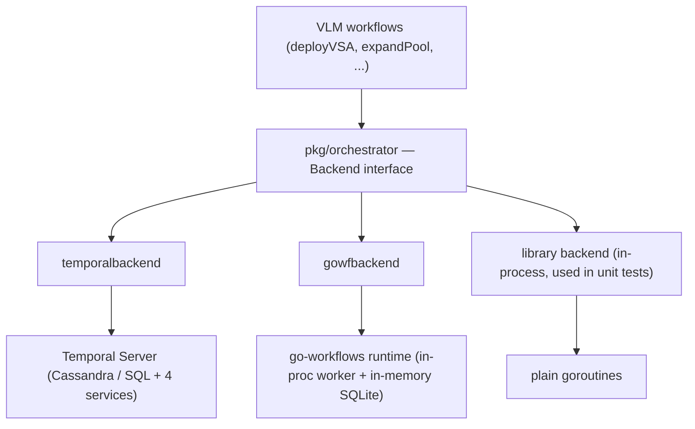
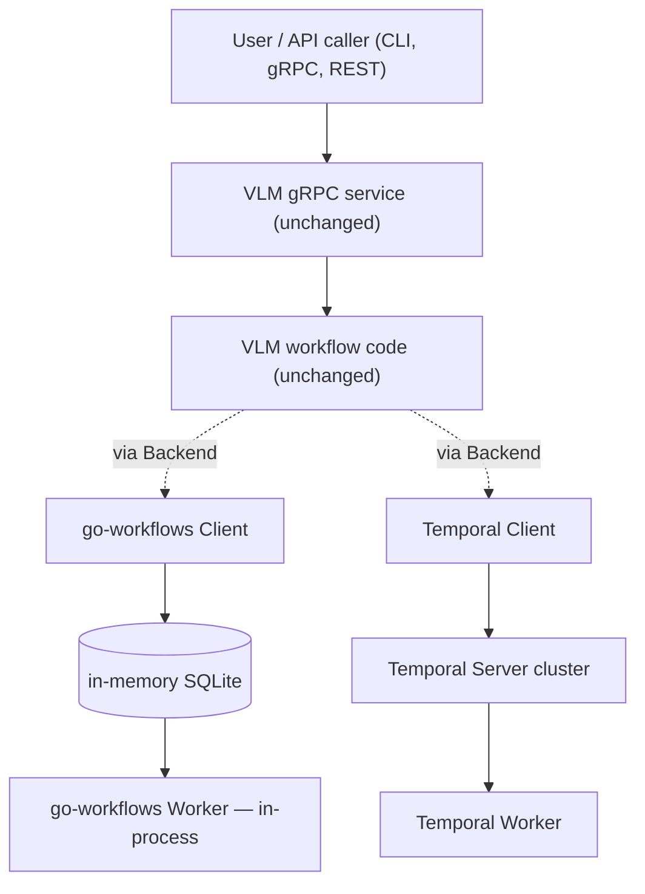
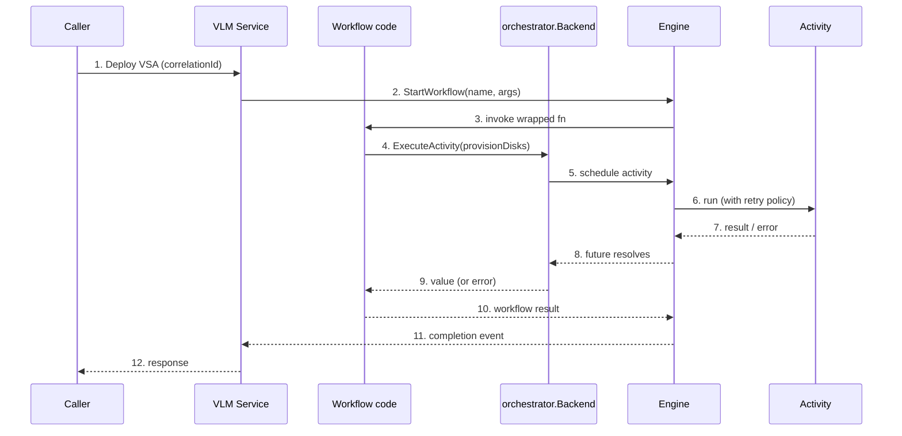
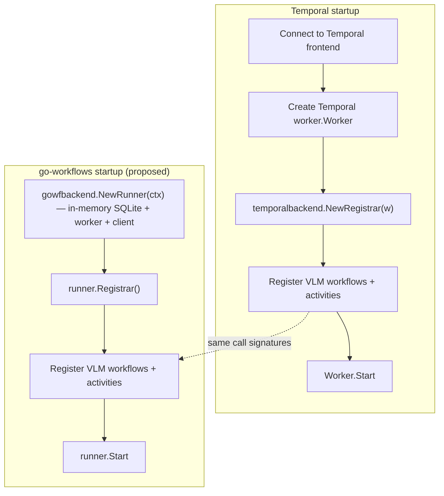
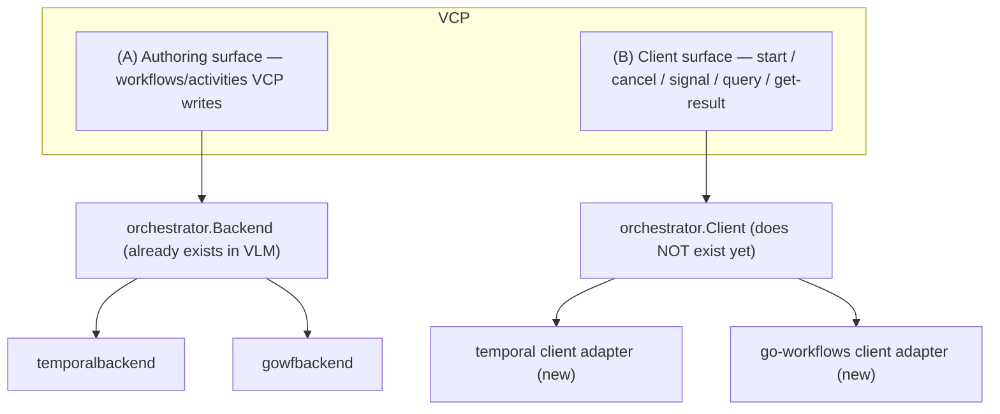

# VLM - Pluggable Workflow Engine (Temporal + go-workflows)

## 1. TL;DR

VLM workflows historically run on Temporal. We have now added a second, fully working
backend — **go-workflows** — behind the same internal interface. A single workflow function can
run on either engine without changes to the workflow code, the CLI, or the service layer.

- The abstraction (`orchestrator.Backend`) was already in place from the earlier library
  mode work; adding go-workflows is now an additive, opt-in package —
  `pkg/orchestrator/gowfbackend/`.
- Existing Temporal flows are untouched.
- A future binary (or operating mode) can choose Temporal or go-workflows at startup.
- Some Temporal-only features (heartbeats, parent-close-policy knobs) have no equivalent in
  go-workflows; those are clearly documented.

## 2. Why This Matters

Both backends are first-class. The decision is not "Temporal vs. go-workflows" or "production
vs. dev"; it is whether VLM should keep both implementations of the same interface available,
and let each deployment pick the engine that matches its constraints.

| Concern | Today (Temporal-only) | With go-workflows option |
|---|---|---|
| Operational dependency | Requires a Temporal cluster (Cassandra/SQL, frontend, history, matching, workers). | Can also run with an in-memory SQLite, in-process. |
| Deployment shapes supported | One — a service that talks to a Temporal cluster. | Two — the existing shape, plus a self-contained single-binary shape. |
| Evaluation of alternatives | One-vendor lock-in. | Concrete, working comparison data. |
| Risk of vendor change | High blast radius. | Abstraction proven against a second engine. |

## 3. The Abstraction in One Picture

Workflow code in VLM is written against `pkg/orchestrator` — a small, neutral interface. Concrete
backends implement it. That is the only thing workflow code knows about.



The interface (11 methods, all engine-neutral). If a workflow uses only these primitives — and
all VLM workflows do — it runs identically on Temporal or go-workflows.

```go
type Backend interface {
    ExecuteActivity(ctx *Context, fn interface{}, args ...interface{}) Future
    ExecuteChildWorkflow(ctx *Context, fn interface{}, args ...interface{}) Future
    WithValue(ctx *Context, key, val any) *Context
    Now(ctx *Context) time.Time
    GetInfo(ctx *Context) WorkflowInfo
    Sleep(ctx *Context, d time.Duration) error
    WithActivityOptions(ctx *Context, opts ActivityOptions) *Context
    WithChildWorkflowOptions(ctx *Context, opts ChildWorkflowOptions) *Context
    Value(ctx *Context, key any) any
    Done(ctx *Context) <-chan struct{}
    Err(ctx *Context) error
}
```

## 4. How a Request Flows on Each Backend

### 4.1 The same VLM API, two execution paths

The caller, the gRPC service, and every workflow function are completely unaware of which engine
is dispatching their activities. The same request bytes flow on either path; only the engine that
executes the dispatched activities differs.



### 4.2 Detail — request lifecycle

The same sequence applies regardless of which engine is plugged in. The only difference is
where "Engine" lives — a remote Temporal cluster, or an in-process go-workflows runtime
backed by in-memory SQLite.



### 4.3 What changes at the wiring layer

Registration code looks essentially identical — only the registrar provider differs. The VLM
workflow registration calls (`vlmclient.RegisterTemporalWorkflows(...)`) do not change.



## 5. Side-by-Side: One Workflow, Two Engines

| Aspect | Temporal-backed run | go-workflows-backed run |
|---|---|---|
| Workflow source code | unchanged | unchanged |
| Activity source code | unchanged | unchanged |
| Registration call site | unchanged | unchanged |
| Logger emits `correlationId` / `deploymentId` | yes | yes (via the new propagator) |
| Retry policy is honoured | yes | yes |
| Non-retryable error stops retries | yes (Temporal native) | yes (translated to go-workflows' permanent error) |
| `Sleep`, `Now`, child workflows | yes | yes |
| Heartbeat-based liveness for long activities | yes | no (see §8) |

## 6. Choosing a Backend at Startup

The backend choice is a single, isolated wiring decision made once when the binary starts. The
existing helper that registers every VLM workflow — `vlmclient.RegisterTemporalWorkflows` —
accepts an engine-agnostic `orchestrator.WorkflowRegistrar`, not anything Temporal-specific.
The name is a legacy from when Temporal was the only backend; the function itself works
unchanged for both engines.

```go
// VLM workflow — written once, runs on either engine.
func DeployVSA(ctx *orchestrator.Context, req DeployRequest) (DeployResponse, error) {
    ctx = ctx.WithActivityOptions(orchestrator.ActivityOptions{
        ScheduleToCloseTimeout: 30 * time.Minute,
        RetryPolicy:            &orchestrator.RetryPolicy{MaximumAttempts: 3},
    })

    var disks DiskSet
    if err := orchestrator.ExecuteActivity(ctx, ProvisionDisks, req).Get(ctx, &disks); err != nil {
        return DeployResponse{}, err
    }
    // ...
}
```

The only differences between the two paths are:

1. which package builds the `WorkflowRegistrar`,
2. how the worker lifecycle is owned.

Everything else — the registration call, the workflow source code, and the activity source code
— is identical. The `RegisterTemporalWorkflows` name is purely historical; renaming it (e.g. to
`RegisterAll`) is a small, optional cleanup but is not required for the go-workflows backend to
work.

## 7. Code-Level Changes Across VLM & VCP (Migration Map)

The interface only buys flexibility if every workflow uses it. To get there, a mechanical set of
substitutions was applied across the workflow source files. The leading change is the workflow
context type; once that is in place, the rest of the substitutions follow. No business logic was
touched.

```go
// --- Path A: Temporal backend ---------------------------------------------
import (
    "go.temporal.io/sdk/client"
    "go.temporal.io/sdk/worker"
    "netapp.com/vsa/lifecycle-manager/pkg/orchestrator/temporalbackend"
    "netapp.com/vsa/lifecycle-manager/pkg/vlmclient"
)

func runWithTemporal(ctx context.Context, provider string) error {
    c, err := client.Dial(client.Options{HostPort: "temporal-frontend:7233"})
    if err != nil {
        return err
    }
    defer c.Close()

    w := worker.New(c, "vlm-task-queue", worker.Options{})

    // Same call, engine-agnostic registrar.
    vlmclient.RegisterTemporalWorkflows(temporalbackend.NewRegistrar(w), provider)

    return w.Run(worker.InterruptCh()) // blocks until shutdown
}

// --- Path B: go-workflows backend (in-memory SQLite, single process) ------
import (
    "netapp.com/vsa/lifecycle-manager/pkg/orchestrator/gowfbackend"
    "netapp.com/vsa/lifecycle-manager/pkg/vlmclient"
)

func runWithGoWorkflows(ctx context.Context, provider string) error {
    runner, err := gowfbackend.NewRunner(ctx) // in-memory SQLite by default
    if err != nil {
        return err
    }

    // Same call, engine-agnostic registrar.
    vlmclient.RegisterTemporalWorkflows(runner.Registrar(), provider)

    if err := runner.Start(ctx); err != nil {
        return err
    }
    <-ctx.Done()
    return runner.Stop()
}
```

### 7.1 The context change that drives everything

Every workflow's first parameter switches to the engine-neutral context. Activity functions are
not affected — they continue to take `context.Context` (Go's stdlib type), which is already
engine-neutral.

```go
// Before (Temporal-only)
func DeployVSA(ctx workflow.Context, req DeployRequest) (...)

// After (engine-neutral)
func DeployVSA(ctx *orchestrator.Context, req DeployRequest) (...)
```

| Concern | Before (Temporal-specific) | After (engine-neutral) |
|---|---|---|
| Workflow context type | `workflow.Context` | `*orchestrator.Context` |
| Imports in workflow files | `go.temporal.io/sdk/workflow`, `go.temporal.io/sdk/temporal` | `pkg/orchestrator` only |
| Run an activity | `workflow.ExecuteActivity(ctx, fn, args...)` | `orchestrator.ExecuteActivity(ctx, fn, args...)` |
| Run a child workflow | `workflow.ExecuteChildWorkflow(ctx, fn, args...)` | `orchestrator.ExecuteChildWorkflow(ctx, fn, args...)` |
| Attach activity options | `workflow.WithActivityOptions(ctx, workflow.ActivityOptions{...})` | `ctx.WithActivityOptions(orchestrator.ActivityOptions{...})` |
| Attach child options | `workflow.WithChildOptions(ctx, workflow.ChildWorkflowOptions{...})` | `ctx.WithChildWorkflowOptions(orchestrator.ChildWorkflowOptions{...})` |
| Activity options type | `workflow.ActivityOptions` | `orchestrator.ActivityOptions` |
| Retry policy type | `temporal.RetryPolicy` | `orchestrator.RetryPolicy` |
| Workflow clock | `workflow.Now(ctx)` | `orchestrator.Now(ctx)` |
| Workflow sleep | `workflow.Sleep(ctx, d)` | `orchestrator.Sleep(ctx, d)` |
| Workflow info | `workflow.GetInfo(ctx)` | `orchestrator.GetInfo(ctx)` |
| Cancellation channel / err | `ctx.Done()` / `ctx.Err()` on `workflow.Context` | `ctx.Done()` / `ctx.Err()` on `*orchestrator.Context` |
| Non-retryable error | `temporal.NewNonRetryableApplicationError(...)` | `orchestrator.NewNonRetryableError(...)` |
| Workflow logger | `workflow.GetLogger(ctx)` | `log.GetLogger(ctx)` (engine-aware factory) |
| Workflow registration | `worker.RegisterWorkflow(fn)` | `r.RegisterWorkflowWithName(name, fn)` on `orchestrator.WorkflowRegistrar` |
| Activity registration | `worker.RegisterActivity(fn)` | `r.RegisterActivity(fn)` on `orchestrator.WorkflowRegistrar` |
| Context value propagation | `temporal.ContextPropagator` (for `correlationId` / `deploymentId`) | Engine-specific propagator wired at startup; workflows still read via `ctx.Value(...)` |

### 7.2 What did not change

- Activity bodies and signatures. Still `func(ctx context.Context, …) (T, error)`.
- No workflow SDK imports.
- Domain types (request/response structs, business types).
- Activity unit tests — activities are plain Go functions.

### 7.3 Why these substitutions are safe

Every "After" idiom is implemented by both backends:

- `temporalbackend` maps them to `workflow.ExecuteActivity`, `workflow.ActivityOptions`,
  `temporal.NewNonRetryableApplicationError`, etc.
- `gowfbackend` maps them to go-workflows' `workflow.ExecuteActivity`, `activity.Options`,
  `workflow.NewPermanentError`, etc.

A workflow author writes against one set of APIs; the chosen backend at startup decides where
each call lands. The migration is mechanical and one-directional — once a file is on the
orchestrator API, it runs on either engine.

## 8. Behavioral Divergences From Temporal (Brief)

These are the only places where the two engines do not behave identically. None of them affect
the VLM workflows that exist today, but the leadership team should be aware of them when
deciding policy.

| Capability | Temporal | go-workflows | Impact for VLM |
|---|---|---|---|
| Activity heartbeats | `RecordHeartbeat` and `HeartbeatTimeout` are first-class. | Not supported. | Long-running activities cannot use heartbeat-based liveness detection on go-workflows. Today no VLM activity depends on this. |
| `ActivityID` (per-call ID) | Supported. | Not supported. | Cosmetic; not used for correctness in VLM. |
| `WorkflowExecutionTimeout` on child workflows | Enforced by server. | Not enforced; surfaced as an upper bound on retries instead. | Same effective behaviour for retry-bounded child workflows. |
| `ParentClosePolicy` | Configurable (`TERMINATE` / `ABANDON` / etc.). | Always `TERMINATE`. | We already hard-code `TERMINATE` on Temporal, so behaviour is identical. |
| `WorkflowStartTime` in `GetInfo` | Server-provided. | Captured at first context wrap and cached. | Equivalent for our use cases. |
| Persistence model | Cassandra / SQL cluster, replicated. | In-memory SQLite (or single-file SQLite). | The two backends fit different deployment shapes — replicated multi-node vs. self-contained single-process. |
| Visibility / search | Rich Temporal UI, advanced visibility. | Minimal — must be built. | Different operational tooling. |
| Versioning / patches | Mature versioning APIs. | Simpler model. | Long-running migrations have richer support on Temporal. |

**Bottom line:** for the workflow author, the engines are interchangeable. For the operator, they
offer different trade-offs — Temporal is feature-richer; go-workflows is dependency-free. Neither
is "the production backend" or "the dev backend"; each fits a different deployment shape.

## 9. Decision Considerations

### 9.1 Pros of keeping both backends

1. **Deployment flexibility.** Each deployment can pick the backend that matches its constraints
   — a clustered, multi-node deployment can run on Temporal; a self-contained single-binary
   deployment can run on go-workflows. The same workflow code serves both.
2. **Architectural insurance.** The interface is now proven against two real engines. If we ever
   needed a third (or had to migrate off either one), the cost would be a single-package addition
   rather than a re-architecture.
3. **Feature reach.** Workflows that need Temporal-specific features (e.g. heartbeats, mature
   versioning) keep them; workflows that need zero external dependencies get a working
   implementation.

### 9.2 Cons of keeping both backends

1. **Surface area.** Two backends means two implementations to keep working when the
   abstraction evolves. The code overhead today is small (~1.1k LOC, isolated package), but it is
   non-zero.
2. **Feature ceiling on the go-workflows side.** Workflows that rely on Temporal-only features
   (heartbeats, advanced visibility) cannot run on go-workflows. Teams must either skip those
   features or target only the Temporal backend.
3. **Two operational surfaces.** Each engine has its own dashboards, on-call playbook, and
   failure modes. Wherever both run, both must be operated.

## 10. What This Means for VCP (the Consumer of VLM)

VCP today drives VLM workflows by importing the Temporal SDK directly — `client.Dial(...)`,
`ExecuteWorkflow(...)`, `SignalWorkflow(...)`, `handle.Get(...)`, `CancelWorkflow(...)`. That
call path is Temporal-SDK-specific by definition, so for VCP to also support a go-workflows-backed
VLM (and, more broadly, to gain the same Temporal-or-go-workflows flexibility for its own
workflows), VCP needs the same shape of abstraction we introduced in VLM — but on a much
smaller scope, because most of the design and infrastructure is already paid for.

There are two surfaces to think about; one already exists, one does not.



### 10.1 Authoring surface — already solved

VCP workflows and activities just need to be written against `orchestrator.Context`. Once that
is true, VCP can depend directly on VLM's `pkg/orchestrator`, `temporalbackend`, and
`gowfbackend` — no new abstraction work, no rewrites of retry policies, registrar, or error
mapping. This is the part VLM has already done end-to-end.

### 10.2 Client surface — currently missing

`orchestrator.Backend` only abstracts the inside of a workflow. The outside surface VCP uses
today — starting workflows, signaling, cancelling, fetching handles, getting results — is not yet
abstracted. To make VCP backend-agnostic, a small new interface is needed and implemented
twice. Sketch:

```go
type Client interface {
    ExecuteWorkflow(ctx context.Context, opts StartOptions, workflowFn any, args ...any) (Run, error)
    SignalWorkflow(ctx context.Context, workflowID, runID, signalName string, payload any) error
    CancelWorkflow(ctx context.Context, workflowID, runID string) error
    GetHandle(workflowID, runID string) Run
}

type Run interface {
    ID() string
    RunID() string
    Get(ctx context.Context, out any) error
}
```

…with `temporalbackend.NewClient(...)` wrapping the Temporal SDK client, and
`gowfbackend.NewClient(...)` wrapping the go-workflows client. Same pattern as the existing
backends, just for the outward-facing API. The backend choice is then a single startup wiring
decision in VCP, exactly like in VLM today.
