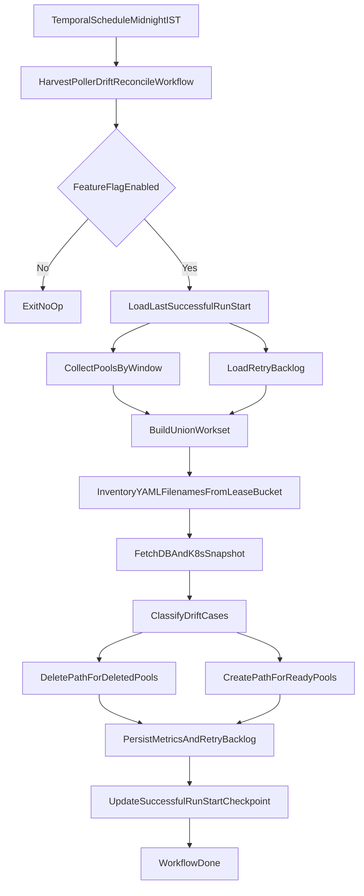

# Harvest Poller Drift Reconcile Job

> **Confluence:** [Harvest Poller Drift Reconcile Job](https://netapp.atlassian.net/wiki/spaces/VSCP/pages/634240496/Harvest+Poller+Drift+Reconcile+Job)

## TL;DR
- **Problem.** Harvest poller artifacts drift across DB, k8s leases, and lease-bucket YAML files.
- **Source of truth.** `pools` table decides expected poller state.
- **Decision scope.** Reconcile gating uses `pools` + `node_node_group_maps`; pool lookup on create/delete resolves `nodes.pool_id` via `GetNodeByID` (unscoped — includes soft-deleted nodes).
- **Schedule.** Run on configurable cron (default daily midnight IST), feature-flag gated.
- **Window.** Process pools from `last_successful_run_start_at` to current run time; first run scans all READY pools (full historical scan).
- **Create/Delete guard.** Never blindly create/delete YAML; act only after filename inventory lookup (`GET /config/list`).
- **Recovery.** Persist failed create/delete attempts in separate retry sub-states so no pool is skipped in future runs.

## Problem Statement
Today we have partial and inconsistent reconciliation between:
- DB entities (`pools`, `node_node_group_maps`, `node_groups`),
- Kubernetes lease objects,
- Harvest lease-bucket YAML files.

This can leave stale pollers after pool deletion or miss pollers for READY pools due to partial failures in register/reconcile flows.

## Goals
- Ensure poller lifecycle is consistent with `pools` state.
- Handle three required cases:
  - Case1: poller present in DB but not in k8s/bucket.
  - Case2: poller present in k8s/bucket but not in DB.
  - Case3: pool deleted but poller present in DB/k8s/bucket.
- Reconcile pools changed in the required window: from start of last successful run to now.
- Guarantee failed create/delete operations are retried in future runs.
- Reuse existing `reconcile_harvest` and `registerHarvest` logic where possible.

## Non-Goals
- YAML content validation or patching (presence-only checks).
- Replacing existing register/unregister workflows end-to-end.
- Rebuilding concurrency primitives already present in node-group-map handling.

## Existing Components to Reuse
- Scheduler and job manager:
  - [`core/scheduler/adminbackgroundjobs/admin_background_jobs.json`](../../../core/scheduler/adminbackgroundjobs/admin_background_jobs.json)
  - [`core/orchestrator/workflows/jobmanagerworkflows/job_manager_workflow.go`](../../../core/orchestrator/workflows/jobmanagerworkflows/job_manager_workflow.go)
- Reconcile/delete helpers:
  - [`core/orchestrator/workflows/reconcile_harvest_node_group_map_workflow.go`](../../../core/orchestrator/workflows/reconcile_harvest_node_group_map_workflow.go)
  - [`core/orchestrator/activities/unregister_node_to_harvest_activities.go`](../../../core/orchestrator/activities/unregister_node_to_harvest_activities.go)
- Create/register helpers:
  - [`core/orchestrator/workflows/register_node_to_harvest_farm_workflow.go`](../../../core/orchestrator/workflows/register_node_to_harvest_farm_workflow.go)
  - [`core/orchestrator/activities/register_node_to_harvest_farm.go`](../../../core/orchestrator/activities/register_node_to_harvest_farm.go)
- Kubernetes lease utility:
  - [`utils/kubernetes_lease.go`](../../../utils/kubernetes_lease.go)

## High-Level Architecture



## LLD

## 1) Job Registration and Flagging
- Add job type `HARVEST_POLLER_DRIFT_RECONCILE_JOB` in admin background jobs.
- Cron schedule must be configurable via job config/flag (not hardcoded):
  - default: `0 0 * * *`
  - timezone default: `Asia/Kolkata`
- Feature flag:
  - controls schedule enablement,
  - checked again at workflow start (defensive gate).

### Config Keys
- Cron expression must be read from config file key: `harvestReconcile.cron`.
- Timezone must be read from config file key: `harvestReconcile.timezone`.
- Recommended defaults in config:
  - `harvestReconcile.cron: "0 0 * * *"`
  - `harvestReconcile.timezone: "Asia/Kolkata"`
- `HARVEST_CONFIG_LIST_PATH` (default: `/config/list`)

## 2) Checkpoint Window Semantics
- Store and read `harvest_poller_drift_reconcile_last_successful_run_start_at`.
- Current run window is:
  - `windowStart = last_successful_run_start_at`
  - `windowEnd = now`
- This explicitly includes entities created/deleted during the previous run.
- If no prior successful run exists (or checkpoint is invalid), use a **full historical scan** of all non-deleted READY pools.
- After the first successful run, subsequent windows are incremental: `windowStart = last_successful_run_start_at`, `windowEnd = now`.

## 3) Candidate Set Construction
Build processing set as union of:
- READY pools in scope for the create path:
  - **Incremental run** (valid checkpoint): pools with `created_at` or `updated_at` in `windowStart..windowEnd`.
  - **First run** (missing or invalid checkpoint): **all** non-deleted `READY` pools (full historical scan; no time filter).
- unresolved create retry backlog rows (`create.should_retry=true` and `create.retries < 5`) — always included regardless of window.

Delete path is inventory-driven at run start (YAML-first), with delete retry backlog considered per entry. **Delete path does not use the checkpoint window.**

## 4) Desired vs Actual State Model
- Desired state derived from `pools` table:
  - `state = READY`: poller YAML should exist for active mappings.
  - `deleted_at` set: poller YAML should not exist for mapped entries.
- Actual state from:
  - DB (`pools`, `node_node_group_maps`, `node_groups`),
  - k8s leases,
  - lease-bucket YAML filename inventory.

Normalize by deterministic inventory key:
- `lease_name + node_id` (and filename `harvest-<node_id>.yaml`)

## 5) Drift Case Handling

### Case1: DB present, k8s/bucket missing
- For READY pool and active map:
  - ensure k8s lease exists,
  - upload YAML only if filename is not present in inventory (or create retry is pending).

### Case2: k8s/bucket present, DB missing (orphan YAML)
- Inventory entry exists but no `node_node_group_maps` row:
  - delete orphan YAML as stale inventory artifact.

### Case3: Pool deleted, poller still present
- For active map where mapped pool has `deleted_at` set:
  - delete YAML from inventory if present,
  - soft-delete corresponding map row.
- For soft-deleted map with YAML still present:
  - delete YAML and keep map cleaned.

## 6) Create/Delete Safety Rules
- Never issue delete blindly; always rely on bucket filename inventory.
- Never issue create blindly; create only when filename absent or create retry is pending.
- Treat already-absent delete target as idempotent success.
- Re-check pool state before mutating (TOCTOU protection).

## 6.1) Concise Execution Plan

### Delete flow
1. List Harvest YAML inventory once at run start (`GET /config/list` — file entries plus optional empty-lease markers).
2. For each **file** inventory entry (non-empty `leaseName` + `nodeID`):
   - resolve pool via `GetNodeByID(map.NodeID)` → `nodes.pool_id` → `GetPoolByID` (unscoped fallback when pool is soft-deleted),
   - if map is soft-deleted -> delete YAML,
   - if map is active and pool `deleted_at` is set -> delete YAML + soft-delete map (applies even when the **node** row is soft-deleted but YAML remains),
   - if map is active, pool not deleted, and `delete` retry is pending -> clear stale delete retry (`delete.should_retry=false`, `last_run_msg` documents pool-not-deleted); do **not** delete YAML or soft-delete map,
   - if map is active and pool not deleted with no delete retry -> skip,
   - if no map row (orphan YAML) -> delete YAML.
3. **Deleted-pool DB pass** (after inventory delete pass, before empty-lease cleanup): paginate all **active** `node_node_group_maps`; for each row whose pool has `deleted_at` set, delete YAML when still in inventory, then soft-delete the map. Catches maps left active when pool was deleted but YAML was already absent from `/config/list`.
4. On delete failure, update `delete` retry JSON.
5. On delete success, update `delete` retry success state when applicable.
6. After YAML and deleted-pool map cleanup, run **empty lease cleanup** for candidate leases (before create pass):
   - **DB-derived:** node groups with zero active pollers and no YAML remaining in inventory for that lease,
   - **Bucket-derived:** empty lease folders reported by harvest `GET /config/list` as `{ "leaseName": "<name>", "empty": true }` (no `fileName` / `nodeID`),
   - merge both sources into one cleanup pass (dedupe by lease name; prefer non-zero `node_group_id` when known),
   - triggered when the last poller YAML for a lease was deleted in this pass, when a deleted-pool map cleanup recorded the lease, or when a node group has zero active pollers and no YAML remains in inventory for that lease,
   - when the node group still has active pollers: if **any** active map belongs to a live (non-deleted) pool, skip lease cleanup; if **all** active maps are on deleted pools, soft-delete those maps first, then proceed when active map count reaches zero,
   - deletes the harvest lease config folder (`DELETE /config/delete`) then deletes the Kubernetes `coordination.k8s.io` lease object (drift reconcile light cleanup — does **not** invoke poller-rebalance `CleanupEmptyLeaseActivity`),
   - when active map count is zero after cleanup, soft-delete the `node_groups` row (`DeleteNodeGroup`),
   - skips cleanup if inventory still lists YAML for that lease.

### Create flow
1. Reuse the same inventory set from the run-start listing (entries with empty `leaseName` are rejected; `{ "empty": true }` lease markers are tracked separately for empty-lease cleanup).
2. List active `node_node_group_maps` in a **single paginated pass** (`ListNodeNodeGroupMapAfterID`, page size 100); include create-retry backlog from that pass (no second full-table scan).
3. Resolve mapped pools by **`nodes.pool_id`** (`GetNodeByID` → `GetPoolByID`, with unscoped fallback for soft-deleted pools) using an in-run pool cache keyed by `node_id` and `pool_id` (seeded from ready pools discovered for the window).
4. Keep only mappings where pool `state = READY` and pool is not deleted for normal create path; create-retry backlog entries are always candidates.
5. Ensure Kubernetes lease exists for each mapping (reuse existing lease ensure/create path).
6. For each mapping, check inventory key (`lease_name + node_id`):
   - if present and no create retry pending: skip create,
   - if absent (or create retry pending): upload YAML.
7. Credential fetch failure (non-SM-auth path): mark create retry for that entry and continue (do not abort the run).
8. If pool is non-READY/deleted and create retry is pending: terminalize create retry (`create.should_retry=false`).
9. On success, persist create retry success (`create.last_run_msg="success"`, `create.should_retry=false`).

## 7) Retry Backlog (Required for Future Runs)
Do not create a separate retry table. Persist retry state in a JSON column on `node_node_group_maps`.

Suggested JSON shape (split by flow):
```json
{
  "create": {
    "retries": 1,
    "last_run_msg": "upload failed: ...",
    "last_attempt_at": "2026-06-22T10:00:00Z",
    "should_retry": true
  },
  "delete": {
    "retries": 1,
    "last_run_msg": "delete failed: ...",
    "last_attempt_at": "2026-06-22T10:00:00Z",
    "should_retry": true
  }
}
```

Example (create retry terminalized while delete retry remains pending):
```json
{
  "create": {
    "retries": 2,
    "last_run_msg": "pool is non-READY; stopping create retry",
    "last_attempt_at": "2026-06-22T16:45:00Z",
    "should_retry": false
  },
  "delete": {
    "retries": 1,
    "last_run_msg": "prior delete failure",
    "last_attempt_at": "2026-06-22T16:40:00Z",
    "should_retry": true
  }
}
```

This shows independent flow state on one map row:
- **create** is terminalized (`should_retry=false`) because the pool is non-READY; no further upload attempts.
- **delete** remains in the retry backlog (`should_retry=true`, `retries < 5`) and can still run on the next reconcile.

- default value: `NULL`
- **Max retry limit (both flows):** `5` per flow, enforced by constant `harvestDriftReconcileRetryLimit` in `harvest_poller_drift_reconcile_activities.go`.
  - **On-board failures** (create/upload YAML, lease ensure, register path): tracked in `create`; retried while `create.retries < 5`.
  - **Off-board failures** (delete YAML / cleanup path): tracked in `delete`; retried while `delete.retries < 5`.
  - Limits are **independent** — one flow can be exhausted while the other still has retries remaining.
  - Not configurable via env today (hardcoded constant).

Behavior:
- On on-board (create) or off-board (delete) failure: increment that flow's retries and set `should_retry=true` while `retries < 5`.
- On success: do not clear to `NULL`; update flow-specific success fields (`last_run_msg="success"`, `should_retry=false`).
- On each run: include rows with flow-specific `should_retry=true` and `retries < 5`.
- Non-READY pool with pending create retry: terminalize create retry (no upload).
- Active pool with pending delete retry: clear stale delete retry (no delete); delete retry applies only when pool `deleted_at` is set.
- On retries exhausted (`retries >= 5`): set `should_retry=false` for that flow.

## 8) Concurrency and Idempotency
- Reuse existing DB-level constraints and transaction semantics in node-map repositories.
- Add workflow-level idempotency by inventory key to avoid duplicate external operations.
- Single paginated scan of active `node_node_group_maps` per run (page size 100); in-run pool cache avoids repeated pool lookups.
- Activity heartbeats during delete pass, create pass, map pagination, and lease cleanup so long runs survive Temporal activity timeouts.

## 9) Error Handling Policy
- Infra/system failures (DB/k8s/harvest globally unavailable): fail run, do not advance checkpoint.
- Per-entry failures (upload, delete, lease ensure, credential fetch): continue run, persist flow-specific retry JSON on `node_node_group_maps`.
- Advance checkpoint when run completes successfully.

## 10) Observability
- Metrics:
  - scanned pools/pollers,
  - drift counts by case,
  - created/deleted/backfilled YAML counts,
  - deleted empty Kubernetes leases,
  - soft-deleted maps for deleted pools (`SoftDeletedMaps`),
  - soft-deleted empty node groups (`SoftDeletedNodeGroups`),
  - retry-pending entries and retries-exhausted entries.
- Structured logs per poller key and operation.
- Run summary log at workflow completion.

## Edge Cases to Handle
- Pool state flips during run (READY to deleted or vice versa).
- Lease shared by multiple pollers; Kubernetes lease delete only after final poller YAML is removed **and** node group has zero active pollers.
- Partial success (DB update succeeded, YAML op failed) with guaranteed retry.
- Duplicate/conflicting poller artifacts due to historic inconsistency.
- First-run behavior without checkpoint: create path uses full historical scan of all non-deleted READY pools; delete path unchanged (inventory-driven). Repeats on every run until the first successful checkpoint commit.
- Race with register/unregister/reconcile operations on same poller key.
- Orphan YAML entries with no map row.

## Explicit Decisions from Review
- Window starts at last successful run **start time** (incremental runs only).
- First run (missing or invalid checkpoint): create path uses **full historical scan** of all non-deleted READY pools; no bootstrap lookback env/config.
- Delete path is **not** window-scoped; inventory listing drives delete/orphan/lease-cleanup behavior on every run.
- Bucket YAML filenames are listed before any create/delete call.
- No YAML content validation/update.
- Retry state is persisted in `node_node_group_maps` JSON column (no separate retry table).
- Delete gate for active maps is **only** `pool.deleted_at` (soft-delete), not pool lifecycle state alone.
- Create gate is `pool.state = READY`.
- Orphan YAML (no map row) is deleted.
- When deleting YAML for an **active** map whose pool has `deleted_at` set: soft-delete the `node_node_group_maps` row (`DeleteNodeNodeGroupMap`) after successful YAML delete.
- Empty lease cleanup (harvest folder + k8s lease) runs when no YAML remains for the lease and the node group has zero active pollers; merges DB zero-poller discovery with bucket `{ empty: true }` entries from `/config/list`; applies to deleted-pool cleanup and orphan YAML paths.
- **Deleted-pool DB pass:** after inventory delete, soft-delete active maps whose pool has `deleted_at` set even when YAML is absent from inventory; record lease for empty-lease cleanup.
- **Empty lease + active maps:** skip when any active map is on a live pool; when all active maps are on deleted pools, soft-delete maps then proceed with lease cleanup.
- **Node groups:** soft-delete (`DeleteNodeGroup`) only when zero active maps remain after cleanup (not during inventory-only delete).
- Pool resolution on create and delete paths uses `nodes.pool_id` (not `harvest_config.POOL_NAME`); `GetNodeByID` is unscoped so soft-deleted nodes still participate in delete gating when orphan YAML remains.
- harvest-multi `GET /config/list` empty-lease shape: `{ "leaseName": "<name>", "empty": true }` (Option A — no `fileName`/`nodeID`).
- Lease cleanup failures are logged and the run continues (warn-and-continue); checkpoint still advances on successful run completion.
- Create and delete retries are tracked independently (`create` / `delete` sub-states).
- Max automatic retries: **5** for on-board (create) failures and **5** for off-board (delete) failures (same limit, separate counters).
- Stale delete retry on live (non-deleted) pool: clear delete retry state; never delete YAML or soft-delete map.
- Inventory entries with empty `leaseName` are skipped (delete pass) and excluded from inventory set (create pass).
- `ENABLE_HARVEST_POLLER_DRIFT_RECONCILE` mirrored to **vcp-worker** chart (workflow executes on worker pods).

## Local Validation Status
- 2026-06-23 automated sweep: 35 PASS / 0 FAIL / 14 N/A (live pods).
- **2026-06-25:** Bootstrap lookback removed; first run uses full historical READY scan. PR review fixes: activity heartbeats, delete-safety (stale delete retry), credential fetch per-entry retry, paginated single-pass map scan + pool cache, empty leaseName guard, vcp-worker chart flag. Unit tests extended for pagination, stale delete retry, credential failure, inventory filtering.
- **2026-07-01 (VSCP-6694):** Pool lookup via `nodes.pool_id`; empty-lease cleanup merges DB zero-poller rows with harvest `/config/list` `{ empty: true }` markers; harvest-multi config-lister updated. Unit coverage ~94% on `harvest_poller_drift_reconcile_activities.go`.
- **2026-07-02 (VSCP-6694 follow-up):** Deleted-pool DB pass soft-deletes active maps without YAML in inventory; empty-lease cleanup reconciles deleted-pool maps before proceeding; soft-deletes `node_groups` when zero active maps remain. Result counters: `SoftDeletedMaps`, `SoftDeletedNodeGroups`.
- Test report (Confluence): [Harvest Poller Drift Reconcile - Test Execution Report](https://netapp.atlassian.net/wiki/spaces/VSCP/pages/636013508).
- Test report (repo): [`doc/testing/test-reports/harvest-poller-drift-reconcile-test-execution-report.md`](../../testing/test-reports/harvest-poller-drift-reconcile-test-execution-report.md).

## Proposed Implementation Phases
1. Scheduler + new workflow skeleton + detect-only mode. **Done**
2. Delete-path implementation with filename inventory and idempotent checks. **Done**
3. Create/backfill path implementation for READY pools. **Done**
4. Retry JSON column behavior + retry orchestration + observability hardening. **Done**

## File Touchpoints
- Scheduler job spec:
  - [`core/scheduler/adminbackgroundjobs/admin_background_jobs.json`](../../../core/scheduler/adminbackgroundjobs/admin_background_jobs.json)
- New/updated workflow and activities:
  - [`core/orchestrator/workflows/backgroundworkflows/harvest_poller_drift_reconcile_workflow.go`](../../../core/orchestrator/workflows/backgroundworkflows/harvest_poller_drift_reconcile_workflow.go)
  - [`core/orchestrator/activities/harvest_poller_drift_reconcile_activities.go`](../../../core/orchestrator/activities/harvest_poller_drift_reconcile_activities.go)
- harvest-multi (inventory API):
  - `container/pmsupervised/rest-server/config-lister.js` — `GET /config/list` file entries + `{ leaseName, empty: true }` markers
- DB layer:
  - [`database/datamodel/models.go`](../../../database/datamodel/models.go) — `NodeNodeGroupMap.RetryState` (`harvest_retry_state` JSONB); column added by GORM AutoMigrate (no hand-written SQL migration).
- Helm (feature flag):
  - [`kubernetes/vsa-control-plane/charts/google-proxy/values.yaml`](../../../kubernetes/vsa-control-plane/charts/google-proxy/values.yaml)
  - [`kubernetes/vcp-worker-chart/values.yaml`](../../../kubernetes/vcp-worker-chart/values.yaml)

## Open Questions
- None blocking for implementation based on current decisions.
