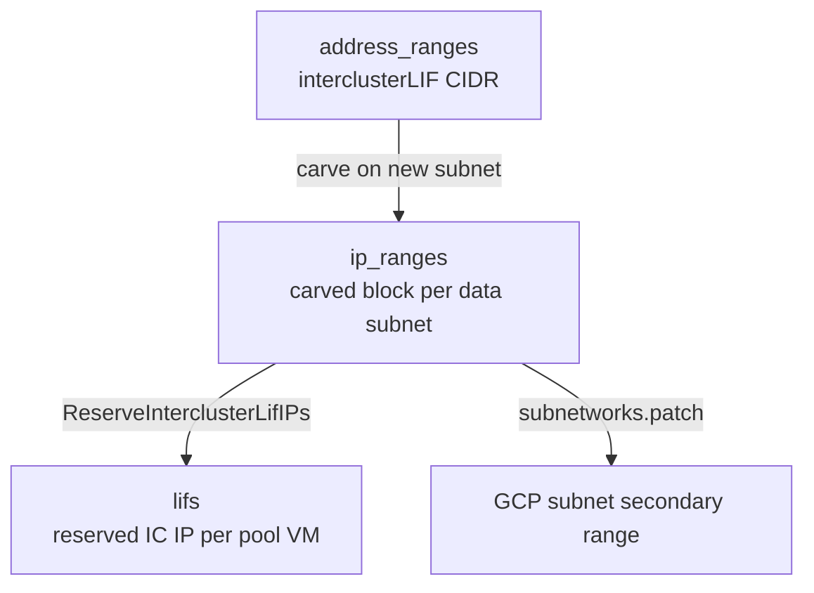
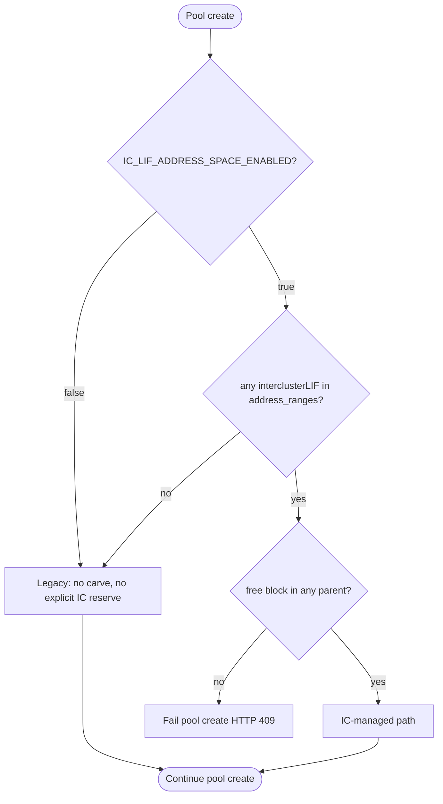
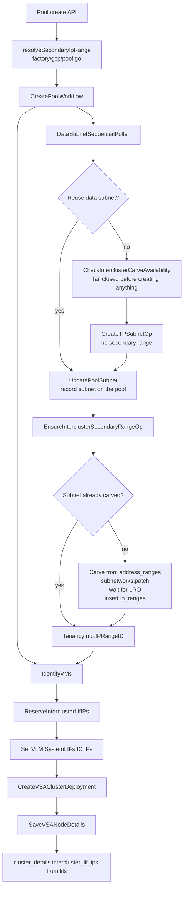
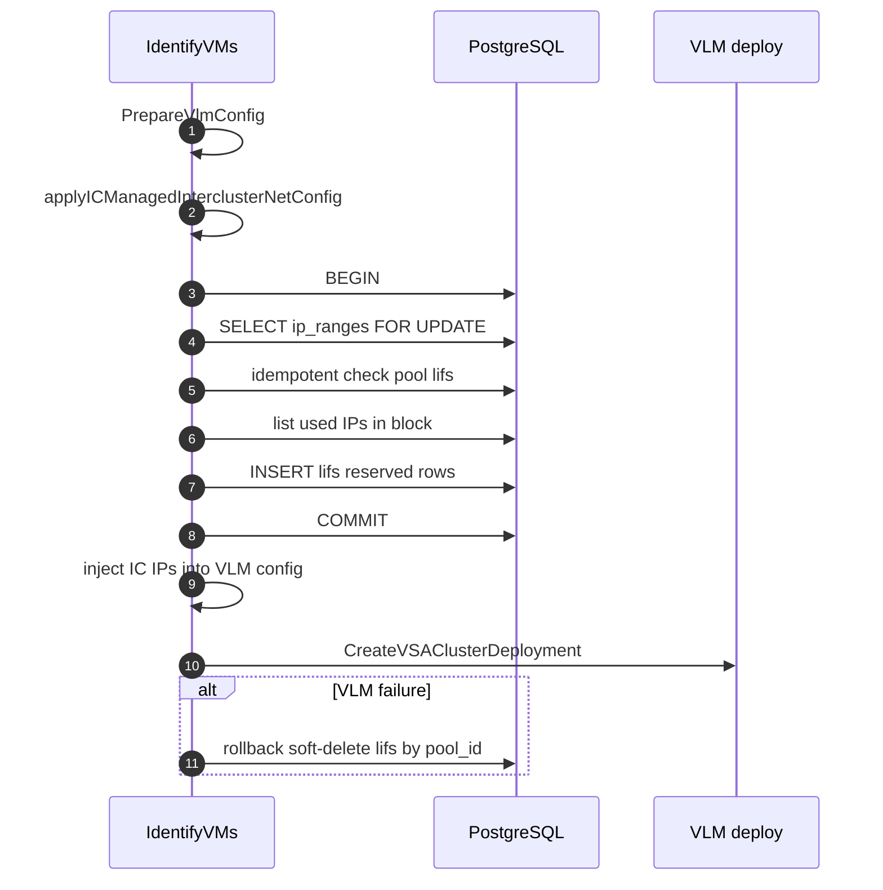
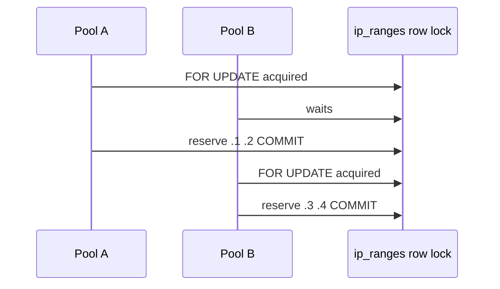

# IC LIF Address Space Management — Design

> **Confluence:** [IC LIF Address Space Management Design](https://netapp.atlassian.net/wiki/spaces/VSCP/pages/646253864) (page `646253864`) — keep in sync with this file; **this repo doc is source of truth**.  
> **Branch:** `ic-lif-with-new-secondary-range-table`  
> **Related:** [0024-address-space-management.md](./0024-address-space-management.md), **PR #3989 merged** on `main` (`47936c060`, 2026-06-30)

---

## Status

- **`address_ranges`:** on main (migration `0032`) — parent interclusterLIF CIDR.
- **`ip_ranges`:** on main via **PR #3989** — GORM AutoMigrate + CRUD + factory.
- **Next:** rebase `ic-lif-with-new-secondary-range-table` onto `main`, then lifs migration + IC orchestration.

| Topic | Plan assumption | PR #3989 actual |
|-------|-----------------|-----------------|
| Schema delivery | SQL `0045` (lifs) + AutoMigrate (ip_ranges) | **Mixed** — lifs via SQL migration `0045`, ip_ranges via GORM AutoMigrate in `datastore.go` |
| `vlan_id` | may be removed | **Removed** |
| Subnet key | `vendor_subnet_id` | **`network`** (`*string`) |
| `address_range_id` | our migration `0042` | **On model** (`AddressRangeID`) — set in orchestrator |
| CRUD | we add | **Shipped** — `ip_range.go`, handlers, `factory/gcp/ip_range.go` |
| Our `ip_ranges` migration | `0042` | **None** — only **lifs** migration on our branch |

---

## 1. Overview

### Problem

Intercluster LIF (IC LIF) IPs today are assigned implicitly by VLM during cluster deployment. There is no durable inventory of which IC IPs are reserved per pool, no carve from a VPC-wide intercluster address plan, and no safe way to assign explicit IPs before deploy without risk of double-booking when multiple pools share a data subnet.

### Solution

When enabled, VCP will:

1. Use registered **interclusterLIF** row(s) in `address_ranges` as carve sources (one or more non-overlapping parent CIDRs per VPC).
2. Carve a **GCP secondary IP range** on each data subnet and persist it as an **`ip_ranges`** row (`lif_type=interclusterLIF`).
3. **Reserve** per-VM IC LIF IPs in **`lifs`** before VLM deploy, using a short DB transaction.
4. Pass reserved IPs into VLM config, then deploy the cluster.

**No new `subnet_secondary_ranges` table.** Reuse PR #3989 `ip_ranges` + extend `lifs`.

### Three-table model

| Table | Source | Role |
|-------|--------|------|
| `address_ranges` | Main (0032) + migration **0046** | Parent **interclusterLIF** CIDR(s) per VPC — **multiple allowed** (non-overlapping) |
| `ip_ranges` | PR #3989 (AutoMigrate) | **Carved GCP secondary block** per data subnet (`network` + `lifType`) |
| `lifs` | Main + migration 0045 | **Reserved IC LIF IP** per pool / HA-pair VM |



---

## 2. Feature gates (opt-in, fail-open for missing range only)

| Gate | Default | If not met |
|------|---------|------------|
| `IC_LIF_ADDRESS_SPACE_ENABLED` | `false` | Full legacy pool create |
| Active `interclusterLIF` in `address_ranges` for VPC | per-VPC opt-in | Log WARN; legacy path (**no workflow failure**) |
| Free space in active IC LIF parent(s) | — | **Fail closed** — pool create returns **HTTP 409** (`ErrResourceStateConflictError`); operator adds another non-overlapping IC LIF address range |



**Check points:**

1. **Factory** `resolveSecondaryIpRange` — zero rows → leave `SecondaryIpRange` empty (legacy).
2. **`EnsureInterclusterSecondaryRangeOp`** — empty `SecondaryIpRange` → no-op, the subnet stays primary-only; non-empty → carve across **all** active parents and patch; exhaustion → non-retryable conflict.
3. **`ReserveInterclusterLifIPs`** — no `IPRangeID` → no-op; insufficient free IPs in carved block → conflict.

---

## 3. Environment variables

| Variable | Default | Purpose |
|----------|---------|---------|
| `IC_LIF_ADDRESS_SPACE_ENABLED` | `false` | Master gate |
| `TOTAL_IP_PER_HA_PAIR` | `6` | Primary subnet reuse check, flag on or off |

**The primary subnet budget is unchanged by this feature.** Moving intercluster LIFs into a
secondary range does not reduce the number of primary addresses a HA pair needs, so
`getSubnetToBeUsed` and `_isSubnetReusable` keep using `TOTAL_IP_PER_HA_PAIR` exactly as they did
before. There is no separate managed-mode budget.

**Subnet capacity:**

```
maxHAPairsOnSubnet = floor((2^(32-prefix) - 4) / TOTAL_IP_PER_HA_PAIR)
requiredSecondaryIPs = haPairs × 2   // interclusterLIFIPsPerHAPair = 2 (VM1 + VM2)
```

The carve block is `max(nextPowerOfTwo(requiredSecondaryIPs), /29)`, so 4 IPs → /29 and 12 IPs → /28.

| Pool type | Carve sizing | Example |
|-----------|--------------|---------|
| Standard shared /28 | `maxHAPairsOnSubnet` | 12 usable ÷ 6 = 2 HA pairs → 4 IC IPs → /29 |
| Large capacity /26 | `LargeVolumeHAPairs(accountName)` | 6 configured pairs → 12 IC IPs → /28 |

**Known limitation — the /26 does not stretch.** `DATA_SUBNET_CIDR_BLOCK_LV` is a single global
value read once at init in `hyperscaler/google/networks.go`, and its `/26` yields 60 usable
addresses. Real consumption is 5 addresses per HA pair (2 `dataprimary`, 2 SAN, 1 ILB NAS), so
anyone sizing a subnet must use 5. That puts 12
HA pairs at exactly 60 addresses, with no spare, and 24 HA pairs at 120, which does not fit. So the
supported ceiling is 12 HA pairs; 24 HA pair clusters need per-pool subnet sizing and are deferred
to separate follow-up work. The allowlist path (`EXPERIMENTAL_NUMBER_OF_HA_PAIRS_LARGE_CAPACITY`)
is therefore bounded by a value that cannot vary per account.

---

## 4. End-to-end pool create flow

**Workflow order:** `DataSubnetSequentialPoller` runs **before** `IdentifyVMs`.



### The HA pair count comes from configuration, not VMRS

LV carve sizing needs the HA pair count before the range is patched onto the subnet. **Do not**
reorder `CreatePoolWorkflow` or change `IdentifyVMs` signatures.

It does not need a VMRS decision either. VMRS never derives the HA pair count from requested
capacity, IOPS or throughput — those only select the VM *type*. The count comes from
`NUMBER_OF_HA_PAIRS_LARGE_CAPACITY`, or `EXPERIMENTAL_NUMBER_OF_HA_PAIRS_LARGE_CAPACITY` for an
allowlisted account. `resolveLargeCapacityHAPairs` reads that configuration directly through
`vmrs_decision.LargeVolumeHAPairs`, which `FindOptimalVMs` also calls, so the carve and the eventual
cluster cannot disagree. Standard pools use `maxHAPairsOnSubnet` only. `IdentifyVMs` still runs VMRS
as today, to pick the VM type.

An earlier revision ran `runVMRSDecision` inside `EnsureInterclusterSecondaryRangeOp` instead. That
was not merely wasteful, it was wrong: the decision ran with an empty `VLMConfig`, so
`Deployment.Labels["account_id"]` was never populated, the allowlist never applied, and an
allowlisted 12 HA pair account had its range carved for 6 pairs — running short later at IC
reservation. `LargeVolumeHAPairs` takes the account id as an argument precisely so it cannot be
skipped; it must be `params.AccountName`, the same value `CreatePoolWorkflow` puts in
`IdentifyVMsRequest.AccountID`.

**Not** the Confluence draft pattern: there is **no** single VMRS run in `CreatePoolWorkflow`, **no** `VMRSDecision` on `CreatePoolParams` / `IdentifyVMsRequest`, and **no** skip of the second VMRS in `IdentifyVMs`.

---

## 5. Data subnet paths

### 5.1 Create then patch — the subnet is never created with a secondary range

The secondary range is **not** part of the Service Networking `AddSubnetworkRequest`. `CreateTPSubnetOp` creates a bare subnet, and the carved IC LIF block is attached afterwards with a Compute [`subnetworks.patch`](https://cloud.google.com/compute/docs/reference/rest/v1/subnetworks/patch) call against the Shared-VPC host project.

The reason is allocation semantics. In a single `AddSubnetworkRequest`, Service Networking has to satisfy the primary allocation and every secondary spec together, and it reports the failure as a single opaque "Couldn't find free blocks in requested range" — with no way to tell which range was unsatisfiable. Splitting the two makes the primary allocation independent of IC LIF capacity, and makes the patch the authoritative check for whether the carved block is actually free: GCP rejects an overlapping or duplicate range outright, so no separate pre-check API is needed.

`AddSubnetSecondaryRangeOp` in [hyperscaler/google/networks.go](hyperscaler/google/networks.go) is a read-then-patch: it reads the subnet for its current `secondaryIpRanges` and `fingerprint`, appends the new range, and patches the full list back. Patch replaces the list wholesale, so the read is required to avoid dropping ranges. Behaviour on repeat:

| Subnet state | Result |
|---|---|
| Range already attached with the same name and CIDR | No patch; empty operation name (safe on retry) |
| Name or CIDR collides with a different existing range | `ErrResourceStateConflictError`, non-retryable |
| Patch rejected for overlap or duplicate (`409`) | `ErrResourceStateConflictError`, non-retryable |
| Stale `fingerprint` (`412`) | Retryable, so the next attempt re-reads the subnet |

### 5.1.1 New subnet — lock, claim, patch, then mark IN_USE

`EnsureInterclusterSecondaryRangeOp` runs after `GetTenancyInfo` (which supplies the SN host project) and after `UpdatePoolSubnet` has recorded the subnet on the pool, and it serves both the new and reused subnet. When the flag is on **and** `params.SecondaryIpRange` is non-empty:

1. Look up `ip_ranges` for `(accountUUID, dataSubnetName)`; if an `interclusterLIF` row already exists, re-issue `AddSubnetSecondaryRangeOp` for that CIDR only when GCP does not already carry it (idempotent if GCP already has it) and return the existing ID. This is the reuse path and Temporal retry after persist-first.
2. If lookup misses but GCP already has exactly one managed `ic-lif-*` secondary whose CIDR falls in an active parent range, **adopt** it into `ip_ranges` under the carve lock and skip patch.
3. Load **all** active parent `address_ranges` (`lif_type=interclusterLIF`, state `CREATED`/`IN_USE`) for the VPC.
4. `ClaimCarvedInterclusterIPRange`: take `pg_advisory_xact_lock` on `ic-lif-carve:{hostProject}/{vpc}` (skipped on SQLite tests), list reserved `ip_ranges` for those parents, first-fit carve, `INSERT` the claimed block. Concurrent creates for the same VPC serialize here so they cannot pick the same CIDR.
5. `AddSubnetSecondaryRangeOp(snHostProject, region, subnetName, rangeName, carvedCIDR)` — `rangeName` from `gcpSecondaryRangeName` (**not persisted in DB**). Returns a regional compute LRO. On leftover GCP overlap, soft-delete the claim and recarve **once**, excluding the rejected CIDR. If the conflict is the **same CIDR already on the subnet** under a different `ic-lif-*` name, adopt that range instead of carving forward. Any other patch failure also releases the claim.
6. The workflow waits for that LRO. On wait failure: `ReleaseInterclusterIPRangeClaim` so the CIDR is not leaked.
7. `PersistInterclusterIPRange` finds the existing row and runs `MarkAddressRangeInUseByID(addressRangeID)` → parent transitions `CREATED` → `IN_USE`.
8. Return `IPRangeID` in `TenancyInfo`.

The claim is persisted **before** the patch so the next create sees the reserved CIDR. A failed patch or wait must delete that row; otherwise the block is removed from the carve pool without being attached on GCP.

If no free block exists in any parent, fail with `ErrResourceStateConflictError` (HTTP 409). Operators extend capacity by creating an additional **non-overlapping** `interclusterLIF` address range for the VPC (migration `0046` dropped the one-IC-LIF unique index).

#### Why the subnet cannot be created before the carve is known to be possible

Attaching the range after the subnet exists opens a window where the subnet is real but the pool create can still fail. Two ordering rules close it, and both are load-bearing:

1. **`CheckInterclusterCarveAvailability` runs before `CreateTPSubnetOp`.** It performs the same carve computation against `address_ranges` and `ip_ranges` but writes nothing and calls no cloud API. Exhaustion is deterministic and knowable up front, so the common failure never creates a subnet at all. This restores the fail-fast behaviour the pre-patch design got for free, when the carve happened before the create call.
2. **`UpdatePoolSubnet` runs before `EnsureInterclusterSecondaryRangeOp`.** Both the in-workflow rollback and pool delete resolve the subnet from `cluster_details.subnet_names` on the pool row, and `ReleaseDataSubnetOp` returns early when that list is empty. If the subnet were recorded only after a successful patch, a patch failure would leave a subnet that no cleanup path can find. `UpdatePoolSubnet` also stores `RegionalTenantProject`, because `DeletePoolWorkflow` gates data subnet cleanup on `hasClusterDetails`, which tests exactly that field.

Together: exhaustion creates nothing, and a patch rejected by GCP for a genuine conflict leaves a subnet that rollback can still release. Neither ordering helps if the worker dies mid-create — that case needs a reconciler and is out of scope here.

On the reuse path the recorded subnet is shared, so releasing it is gated by `shouldReleaseSharedDataSubnet`: it is released only when no other pool is attached, or when every attached pool is already `DELETING`. A pool that reuses an otherwise-empty subnet and then fails therefore takes that subnet with it, which is the intended way stranded subnets get reclaimed.

### 5.1.2 Parent range lifecycle and delete protection

The `dataLIF` path marks a range `IN_USE` via CIDR containment of the pool's **primary** subnet (`MarkAddressRangeInUse`). That check cannot work for `interclusterLIF`: the primary subnet never falls inside the IC LIF parent CIDR — the carved **secondary** block does. IC LIF therefore keys off the parent ID recorded on the carved `ip_ranges` row:

| Event | Action |
|---|---|
| Carve persisted (`PersistInterclusterIPRange`) | `MarkAddressRangeInUseByID` → `CREATED` → `IN_USE` |
| Last carved block deleted (`DeleteInterclusterIPRangeForSubnet`) | `ReleaseInterclusterAddressRangeIfUnused` → `IN_USE` → `CREATED`, conditional on no surviving `ip_ranges` child |
| Other pools still hold blocks | Release is a no-op; parent stays `IN_USE` |

Both transitions are best-effort and logged rather than fatal, because `DeleteAddressRange` does **not** rely on the state alone: for `interclusterLIF` it also counts live `ip_ranges` rows referencing the range and refuses deletion (HTTP 409) while any remain. A lost state update can therefore leave a range stale, but never lets an occupied range be deleted out from under running pools.

### 5.2 Reuse subnet

1. `getSubnetToBeUsed` — unchanged by this feature; the reuse check keeps using `TOTAL_IP_PER_HA_PAIR` (6) whether the IC flag is on or off.
2. `UpdatePoolSubnet` records the reused subnet on the pool first, for the cleanup reason above. There is no carve pre-check on this path: nothing is created, so a carve failure here strands no new resource.
3. `EnsureInterclusterSecondaryRangeOp` runs here too. Its step-1 lookup normally finds the existing `interclusterLIF` row and returns it unchanged.
4. When lookup misses but GCP already carries a managed `ic-lif-*` secondary on that subnet, VCP **adopts** the CIDR into `ip_ranges` instead of carving a new block or patching under a new pool-specific name.
5. If the reused subnet has **no** carved range in DB or on GCP — a subnet created before the flag was enabled — the same activity carves one and patches it onto the existing subnet, so reuse converges to the managed layout instead of falling back to the legacy path.
6. Pass the resulting `IPRangeID` in `TenancyInfo`.

---

## 6. IC LIF reservation (before VLM deploy)

### Legacy vs new

| | Legacy | IC-managed |
|---|--------|------------|
| When IPs known | After VLM deploy | **Before** VLM deploy |
| Source | `GetInterClusterLifsFromVLMConfig` | `lifs` + VLM config |
| `net_config.intercluster.gcp_network_config` | `subnet_project_id` only | Also `is_secondary_ip: true` and `skip_ip_reservation: true` |

On the managed path, `IdentifyVMs` calls `applyICManagedInterclusterNetConfig` before
`ReserveInterclusterLifIPs` so VLM places IC LIFs on the carved secondary/alias IP range
and skips its own reservation for that NIC. Legacy keeps both flags omitted (`omitempty`).



### Concurrency — no table write lock

Use **short transaction + `FOR UPDATE` on parent `ip_ranges` row** (same pattern as Harvest port allocation in `node_nodegroup_map.go`).

| Step | Purpose |
|------|---------|
| `BEGIN` | Atomic read-pick-insert |
| `SELECT ip_ranges … FOR UPDATE` | Serialize allocators **per carved block** |
| Query `lifs` for used IPs | Inside same tx |
| Pick N free IPs (or validate user-requested) | Future: explicit IP list |
| `INSERT` intercluster `lifs` | `pool_id`, `ip_range_id`, `node_id` null (reserved, pre-deploy) |
| `COMMIT` | Release lock (~ms); VLM LRO runs **outside** tx |

**Safety net — unique partial index (main's `0043_lifs_ip_range_unique`):**

Uniqueness of `(ip_range_id, ip_address)` for reserved IC LIFs is enforced by the
index already shipped on `main`, so our branch migration (`0045`) only adds the
`pool_id` column + index and does **not** redefine this index:

```sql
CREATE UNIQUE INDEX idx_lifs_ip_range_ip_active
    ON lifs (ip_range_id, ip_address)
    WHERE deleted_at IS NULL AND ip_range_id IS NOT NULL;
```

**Idempotency (Temporal retry):** if `lifs` already exist for `pool_id` + `type=intercluster` + `ip_range_id`, return existing IPs.



### Concurrency — carving the block itself

The section above serializes handing out IPs from a block that already exists. Claiming the block
is a separate race, and it is the one that bites first: carving is deterministic, so two pools
starting together read the same reserved set and derive the **same CIDR**.

Two things settle it.

**1. The requested GCP range name carries a per-pool discriminator.** `gcpSecondaryRangeName`
appends an 8-character SHA-256 fingerprint of the pool UUID. Without it both pools would request
the same name *and* the same CIDR, and `subnetworks.patch` is idempotent: the loser's request would
match the winner's existing range exactly, GCP would report an already-attached no-op, and the
loser would go on to persist an `ip_ranges` row for a block it does not own. With distinct names
the loser collides on CIDR alone, which GCP rejects as a genuine conflict. The discriminator is
derived rather than random so a Temporal retry of the *same* pool rebuilds the same name and stays
idempotent.

**2. A partial unique index backs up the overlap check.** `CreateIPRange` rejects an overlapping
block with a `SELECT` followed by an `INSERT` inside one transaction, which two concurrent creates
can both pass under `READ COMMITTED` before either inserts. Migration `0047` closes that window:

```sql
CREATE UNIQUE INDEX idx_ip_ranges_unique_ic_block
    ON ip_ranges (network, start_ip, end_ip)
    WHERE deleted_at IS NULL AND lif_type = 'interclusterLIF';
```

Uniqueness is keyed on `(network, start_ip, end_ip)` because the carve is scoped to the data
subnet; blocks claimed on different subnets of one VPC are rejected earlier by GCP, which refuses
overlapping secondary ranges within a network. `CreateIPRange` maps the violation to
`ErrResourceStateConflictError`, so a losing pool fails closed with the same error the overlap
check would have produced rather than a generic insert failure.

---

## 7. Database schema

### 7.1 `ip_ranges` (PR #3989 — GORM AutoMigrate)

Model (`database/datamodel/models.go` on PR branch):

```go
type IPRange struct {
    Network        *string
    StartIP, EndIP string
    Gateway, Netmask string
    LifType        string        // dataLIF | interclusterLIF
    AddressRangeID sql.NullInt64
    // region, account, host IDs ...
}
```

**IC carve row mapping:**

| Field | Value |
|-------|-------|
| `lifType` | `interclusterLIF` |
| `network` | Data subnet name (e.g. `vsa-subnet-123…`) |
| `addressRangeID` | Parent `address_ranges.id` |
| `startIP` / `endIP` | Carved block bounds |
| `id` | `TenancyInfo.IPRangeID` |

**Not stored:** `gcp_secondary_range_name` (deterministic at GCP create).

**Reuse:** `GetIPRanges(accountUUID, &dataSubnetName)` + filter `lifType==interclusterLIF`.

### 7.2 `lifs` (our-branch SQL migration)

| Column / field | Change |
|----------------|--------|
| `pool_id` | nullable, indexed |
| `ip_range_id` | nullable, indexed |
| `node_id` | nullable at reservation |
| `type` | `'intercluster'` |
| `lif_details` | `protocol_type`, `ha_pair_index` |

---

## 8. Components changed / added

| Layer | File | Change |
|-------|------|--------|
| Env | `utils/env/env.go`, worker chart, skaffold, `launch.json` | `IC_LIF_ADDRESS_SPACE_ENABLED` |
| Factory | `core/orchestrator/factory/gcp/pool.go` | `resolveSecondaryIpRange` |
| Activities | `pool_activities.go` | `ReserveInterclusterLifIPs`; `GetCreateDataSubnetOp` creates the bare subnet |
| Activities | `ic_lif_subnet.go` | `CheckInterclusterCarveAvailability`, `EnsureInterclusterSecondaryRangeOp` (persist-first claim + patch), `PersistInterclusterIPRange` (mark IN_USE), `ReleaseInterclusterIPRangeClaim`, `gcpSecondaryRangeName` |
| Workflows | `pool_workflows.go` | carve pre-check, `UpdatePoolSubnet` before the patch, `ensureInterclusterSecondaryRange` (claim+patch, wait, mark IN_USE; release claim on wait failure) |
| DB | `database/vcp/ip_range.go` | `ClaimCarvedInterclusterIPRange`, `AdoptInterclusterIPRange` (advisory lock + carve/adopt + INSERT) |
| DB | `database/vcp/ic_lif_carve.go` | first-fit carve math |
| Activities | `common_activities.go` | `shouldReleaseSharedDataSubnet` (shared-subnet release gating); the reuse check itself is untouched |
| VMRS | `core/vmrs/decision/least_cost_large_volume_cluster.go` | `LargeVolumeHAPairs`, shared by `FindOptimalVMs` and the carve |
| Hyperscaler | `hyperscaler/google/networks.go` | `AddSubnetSecondaryRangeOp` (read-then-`subnetworks.patch`) |
| DB | `database/vcp/migrations/post/0049_ip_ranges_unique_ic_block.up.sql` | Partial unique index on active intercluster blocks |
| DB | `database/vcp/lif.go` | `ReserveInterclusterLifIPs`, list/delete by pool |
| Params | `core/orchestrator/common/params.go` | `SecondaryIpRange`, `IPRangeID` (no `VMRSDecision` on params) |

---

## 9. Pool delete

Soft-delete intercluster `lifs` where `pool_id` + `type=intercluster`.

Optionally soft-delete `ip_ranges` when no other pools reference the carved block (subnet lifecycle TBD).

---

## 10. Implementation phasing

| Phase | Scope | Blocked by |
|-------|-------|------------|
| **A** | Flags, factory, carve math, GCP specs, VMRS extract, lifs migration, `ReserveInterclusterLifIPs`, unit tests | — |
| **B** | Merge rebase + `CreateIPRange` wiring, reuse by `network`, E2E DB tests | **Unblocked** — rebase onto main |

Phase A may stub `ip_ranges` persistence behind an interface until Phase B.


---

## 11. Testing

| Area | Target |
|------|--------|
| Flag off | No carve, no reserve; unchanged behavior |
| Flag on, no interclusterLIF row | Legacy subnet create |
| Reuse | Second pool reuses same `ip_ranges` row |
| Carve | /28 → /29; /26 LV with VMRS pairs |
| Concurrency | Same subnet: distinct IPs via `FOR UPDATE` + unique index |
| Idempotency | Temporal retry returns existing pool reservations |
| VLM rollback | Soft-delete reserved lifs |
| Future user IPs | All-or-nothing validation in one tx |

---

## 12. Open questions

| # | Question | Notes |
|---|----------|-------|
| 1 | `network` field semantics for IC rows | Use data subnet name vs full VPC URL? |
| 2 | Soft-delete `ip_ranges` when last pool leaves subnet? | Defer or subnet-delete hook |
| 3 | User-provided IC IPs on create API | Future; same `ReserveInterclusterLifIPs` tx |

---

## 13. References

- Plan (repo): `.cursor/plans/ic-lif-address-space.plan.md`
- Parent address ranges: `database/vcp/migrations/post/0032_add_address_ranges.up.sql`
- Multi IC LIF per VPC: `database/vcp/migrations/post/0048_drop_address_ranges_unique_iclif.up.sql` (drops `idx_address_ranges_unique_iclif`)
- PR #3989: `ip_ranges` via GORM AutoMigrate + `factory/gcp/ip_range.go`
- Harvest port locking precedent: `database/vcp/node_nodegroup_map.go`

---

## 14. Confluence sync (page 646253864)

Apply these updates on Confluence so it matches this doc and the implementation on `ic-lif-with-new-secondary-range-table`.

### Replace: “VMRS — single run for large capacity”

Remove wording that says VMRS runs once in `CreatePoolWorkflow`, is passed into activities, or that `IdentifyVMs` skips a second run when decision is non-nil.

Use **§4 “VMRS for carve sizing — no workflow reorder”** in this file instead.

### Global find-replace on Confluence

| Old | New |
|-----|-----|
| `IPRangeUUID` | `IPRangeID` |
| `ip_range_uuid` | `ip_range_id` |
| `requiredSecondaryIPs = haPairs × 1` | `requiredSecondaryIPs = haPairs × 2` (VM1 + VM2) |
| 3 HA pairs → 3 IC IPs | 3 HA pairs → **6** IC IPs |
| 6 VMRS pairs → 6 IC IPs → /29 | 6 VMRS pairs → **12** IC IPs → **/28** |
| `lif_role: reserved` / `lif_role=reserved` | *(remove — reserved = `node_id IS NULL`)* |
| lifs migration `0043` | lifs migration **`0045`** |
| `idx_lifs_intercluster_ip_per_range` | `idx_lifs_ip_range_ip_active` (main `0043_lifs_ip_range_unique`; branch `0045` does not redefine) |

### Status table (schema delivery row)

| Topic | Plan assumption | PR #3989 actual |
|-------|-----------------|-----------------|
| Schema delivery | SQL `0045` (lifs) + AutoMigrate (ip_ranges) | **Mixed** — lifs via SQL migration `0045`, ip_ranges via GORM AutoMigrate in `datastore.go` |
