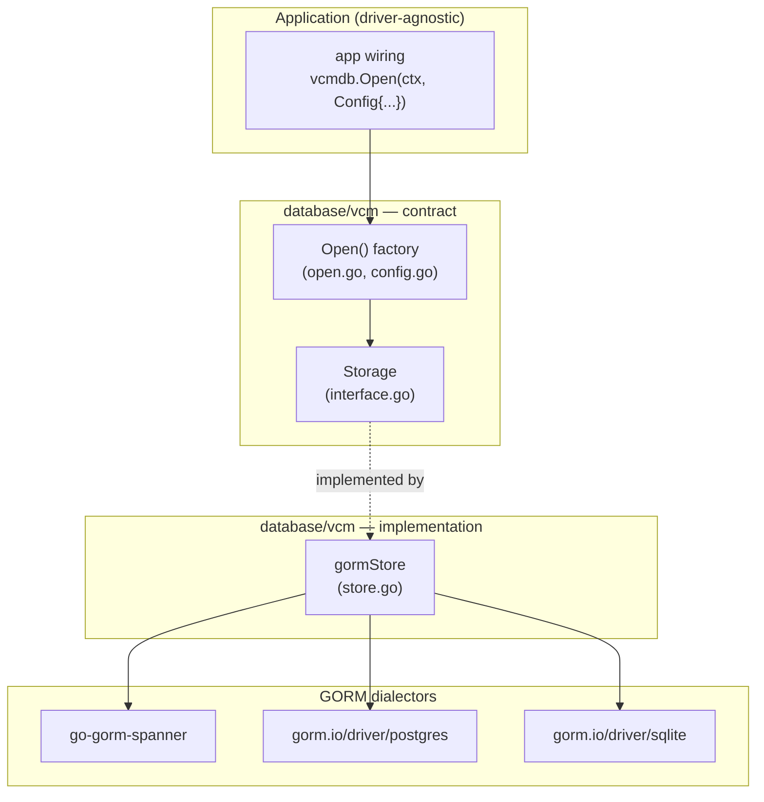
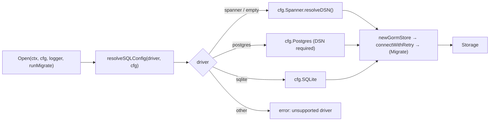

# VCM Database Persistence Layer — Low-Level Design

## TL;DR

- **One GORM-backed store for every backend.** The `database/vcm` package exposes a backend-agnostic `Storage` contract and a single `gormStore` implementation that serves **Cloud Spanner**, **PostgreSQL**, and **SQLite** through their respective GORM dialectors.
- **Backend-agnostic by design.** Callers depend only on the `Storage` interface — no driver types cross the boundary — so the backend is chosen at startup and never named in business code.
- **One construction seam.** A single `Driver` enum + generic `Config` + `Open(ctx, Config, …)` factory resolves the driver's DSN, connects with retry, and returns `Storage`.
- **GORM dialectors.** Spanner via `github.com/googleapis/go-gorm-spanner`, Postgres via `gorm.io/driver/postgres`, SQLite via `gorm.io/driver/sqlite`.
- **VCM schema is owned here.** The package owns the durable `Job` model (GORM table `jobs` in the VCM database) and data access because jobs are shared by VCM transports and workflow steps. `Migrate` applies that schema across supported backends.

---

## Overview

The persistence layer is built backend-first: application code talks to an interface, and a concrete driver is selected at construction time. Cloud Spanner is the default/production backend; PostgreSQL and SQLite are first-class alternatives (SQLite is the default for local development and tests).

All three backends run through GORM, so there is a single store lifecycle (connect-with-retry → health-check → optional migrate) regardless of driver. The only per-driver difference is the GORM dialector and how the DSN is built.

Scope of this document:

- The persistence contract (`Storage`).
- The driver-selection mechanism (`Driver`, `Config`, `Open`).
- The single GORM store and its three dialectors.
- How the design is extensible and how to add a new backend.

---

## Package layout

```
database/vcm/                  # Persistence package (driver selection + store lifecycle)
├── interface.go               # Storage (backend-agnostic contract)
├── config.go                  # Driver enum, Config, SpannerConfig, SQLConfig, DSN resolution
├── open.go                    # Open() factory + resolveSQLConfig + connect-with-retry
├── store.go                   # gormStore lifecycle for all three drivers
└── job.go                     # Durable VCM job model, progress updates, and recovery reads
```

GORM dialectors (consumed, not owned by `database/vcm`):

- `github.com/googleapis/go-gorm-spanner` — Cloud Spanner GORM dialector (over `go-sql-spanner`).
- `gorm.io/driver/postgres`, `gorm.io/driver/sqlite` — Postgres and SQLite dialectors.

---

## Architecture

### Layering



The crucial property: **everything above the `contract` box depends only on the interface.** The driver is selected at construction (`Open`) and never named by callers.

### The contract

`Storage` is the backend contract. It imports no driver package and exposes no driver-specific types, so any backend can satisfy it without touching callers.

```go
// database/vcm/interface.go
type Storage interface {
	Connect(isAdmin bool) error
	Close() error
	HealthCheck() error
	Migrate(ctx context.Context) error
	SetupDatabase(ctx context.Context) error
	DatabasePath() string
}
```

---

## Driver selection: `Driver`, `Config`, `Open`

A single enum names the backends; `Config` holds per-driver settings; `Open` is the only construction entry point and always returns `Storage`.

```go
// database/vcm/config.go
const (
	DriverSpanner  Driver = "spanner" // default when Config.Driver is empty
	DriverPostgres Driver = "postgres"
	DriverSQLite   Driver = "sqlite"
)
```



```go
// database/vcm/open.go
func Open(ctx context.Context, cfg Config, logger log.Logger, runMigrationOnStart bool) (Storage, error) {
	driver := cfg.driverOrDefault()

	sqlCfg, err := resolveSQLConfig(driver, cfg)
	if err != nil {
		return nil, err
	}

	store := newGormStore(driver, sqlCfg, logger)
	if err := connectWithRetry(ctx, logger, store); err != nil {
		_ = store.Close()
		return nil, err
	}
	if runMigrationOnStart {
		if err := store.Migrate(ctx); err != nil {
			_ = store.Close()
			return nil, fmt.Errorf("vcm: migration failed: %w", err)
		}
	}
	return store, nil
}
```

`resolveSQLConfig` maps the selected driver's settings to the store's DSN form and fails fast on non-transient misconfiguration (empty Postgres DSN, unresolvable Spanner path) before the retry loop. `connectWithRetry` uses capped exponential backoff with a finite attempt count so an unavailable backend fails terminally instead of hanging startup.

---

## The GORM store

One `gormStore` (`store.go`) serves all three drivers. The only per-driver branch is `dialector()`:

```go
// database/vcm/store.go
func (s *gormStore) dialector() (gorm.Dialector, error) {
	switch s.driver {
	case DriverSpanner:
		// DSN is projects/<p>/instances/<i>/databases/<d>[?auto_config_emulator=true]
		return spannergorm.New(spannergorm.Config{DriverName: "spanner", DSN: s.config.DSN}), nil
	case DriverPostgres:
		return postgres.Open(s.config.DSN), nil // DSN required
	case DriverSQLite:
		// empty DSN defaults to a shared in-memory database
		return sqlite.Open(s.config.DSN), nil
	}
	// ...
}
```

- **Lifecycle**: `Connect` opens GORM, applies optional pool tuning (`MaxOpenConns`/`MaxIdleConns`/`ConnMaxLifetime`), and health-checks via `sql.DB.Ping()`. `Close` releases the pool. `SetupDatabase` is a no-op.
- **Migrate hook**: `Migrate` applies the VCM-owned `Job` model with GORM `AutoMigrate` across all three dialects. Without a `TableName()` override, GORM uses the pluralized table name `jobs` in the VCM database (separate from the VCP control-plane DB).
- **Job deadline**: each durable job stores `deadline_at` (absolute UTC expiry), set at pool-create time from `now + VCM_POOL_CREATE_TIMEOUT_SECONDS`. On VCM restart recovery, ongoing jobs whose `deadline_at` has passed are marked `ERROR` instead of being resumed. A zero `deadline_at` means no timeout is enforced.
- **Logging**: GORM's built-in stdout logger is set to `Silent` so it can't leak the Postgres DSN (credentials) on errors; diagnostics flow through the returned errors.
- **`DatabasePath`**: a credential-free identifier — the Spanner path or SQLite path, but only `"postgres"` for Postgres (whose DSN carries credentials).

### Cloud Spanner specifics

`SpannerConfig` accepts either a fully-qualified `DatabasePath` or `Project`/`Instance`/`Database` parts (joined into the path). `resolveDSN` turns it into the `go-sql-spanner` DSN:

- Production: `projects/<p>/instances/<i>/databases/<d>` (the database is provisioned out-of-band).
- Emulator / local dev (`CreateIfMissing`): the `?auto_config_emulator=true` option is appended, which connects to the emulator and auto-creates the instance and database if absent.

```go
// database/vcm/config.go
func (c SpannerConfig) resolveDSN() (string, error) {
	path, err := c.ResolveDatabasePath()
	if err != nil {
		return "", err
	}
	if c.CreateIfMissing {
		path += "?auto_config_emulator=true"
	}
	return path, nil
}
```

`SQLConfig` (shared by Postgres and SQLite, and used internally to carry the resolved Spanner DSN):

```go
// database/vcm/config.go
type SQLConfig struct {
	DSN string

	// Connection-pool tuning; zero values leave the database/sql defaults.
	MaxOpenConns    int
	MaxIdleConns    int
	ConnMaxLifetime time.Duration
}
```

Example wiring:

```go
// Spanner (default) — emulator/local dev auto-creates instance + database
store, _ := vcmdb.Open(ctx, vcmdb.Config{
    Driver:  vcmdb.DriverSpanner,
    Spanner: vcmdb.SpannerConfig{
        Project: "p", Instance: "i", Database: "vcm",
        CreateIfMissing: true,
    },
}, logger, true)

// SQLite (local dev / tests) — empty DSN == shared in-memory
store, _ := vcmdb.Open(ctx, vcmdb.Config{
    Driver: vcmdb.DriverSQLite,
    SQLite: vcmdb.SQLConfig{DSN: "vcm.db"},
}, logger, true)

// Postgres
store, _ := vcmdb.Open(ctx, vcmdb.Config{
    Driver:   vcmdb.DriverPostgres,
    Postgres: vcmdb.SQLConfig{DSN: "host=... user=... password=... dbname=vcm sslmode=disable"},
}, logger, true)
```

---

## Extensibility — adding a new backend

The design is "interface-first": callers never see a driver type, so a new backend is additive and local to `database/vcm`. To add (e.g.) MySQL:

1. **Add the enum value** in `config.go`: `const DriverMySQL Driver = "mysql"`.
2. **Add settings** — reuse `SQLConfig` (it is dialect-neutral) and add a `MySQL SQLConfig` field to `Config`.
3. **Resolve it** — add a `case DriverMySQL` in `resolveSQLConfig`.
4. **Add the dialector** — add a `case DriverMySQL` in `gormStore.dialector()` returning `mysql.Open(dsn)`.

That is the entire surface area. No consumer changes.

### What makes it extensible (design properties)

- **No driver types in the contract.** `interface.go` imports zero driver packages, so any backend can satisfy `Storage` without touching callers.
- **Single construction seam.** `Open` is the only place drivers are named; dispatch is centralized and uniform (resolve DSN → connect-with-retry → optional migrate → return `Storage`).
- **One store implementation.** All backends share `gormStore`; a new GORM-compatible backend is just a dialector case.
- **Compile-time conformance.** `var _ Storage = (*gormStore)(nil)` guarantees the store satisfies the contract.

---

## Testing

- SQLite is the fast, dependency-free backend for unit tests: `Open(Config{Driver: DriverSQLite, SQLite: {DSN: "file:vcm-<test>?mode=memory&cache=shared"}}, …, true)` gives a connected, isolated store per test, exercising the shared `gormStore` lifecycle and `jobs` table migration.
- Driver-specific surface is covered without a live backend: `dialector()` construction (offline-safe), DSN resolution, and credential-free `DatabasePath` for each driver, plus the `Open` factory guards (unsupported driver, empty Postgres DSN, unresolvable Spanner path) and the retry loop's context-cancel abort.

---

## Design decisions & rationale

| Decision | Rationale | Alternative considered |
|---|---|---|
| One GORM store for all three backends | Single lifecycle/code path; a new backend is just a dialector case | Bespoke per-backend stores — more code, easy to drift |
| GORM dialector for Spanner (`go-gorm-spanner`) | Same ORM/migration model as Postgres/SQLite; no separate hand-written Spanner client/admin/DDL layer to maintain | Native `cloud.google.com/go/spanner` client + custom admin/DDL plumbing — rejected: duplicate machinery |
| Interface-first, driver types kept out of the contract | Lets the backend change without touching business code | Expose a concrete client on `Storage` — rejected: binds all callers to one backend |
| VCM job schema owned by `database/vcm` | Keeps one durable job contract across the API, workflow steps, and restart recovery | Put the model in one transport — rejected because recovery and workflow code also need it |
| Spanner emulator via `auto_config_emulator` | Local/dev provisioning handled by the driver; no admin-API code | Hand-rolled `EnsureInstance`/`EnsureDatabase` — rejected: extra surface |
| `DatabasePath` credential-free for Postgres | Avoids leaking DSN secrets in startup logs | Return raw DSN — rejected for Postgres |
| GORM logger set to `Silent` | GORM's stdout logger can emit the DSN (credentials) on errors | Default Warn logger to stdout — rejected: credential leak |
| Bounded connection-retry (capped backoff, finite attempts) | An unavailable backend fails terminally instead of hanging startup | Unbounded retry loop — rejected: can block shutdown/rollouts |
