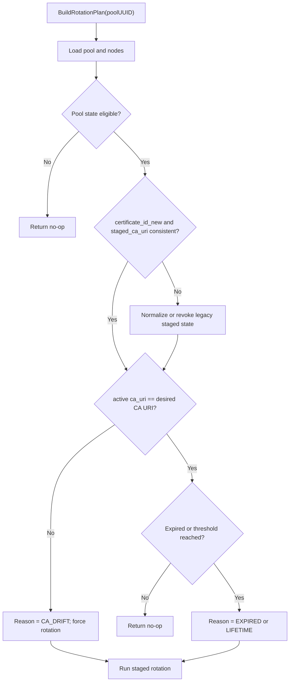
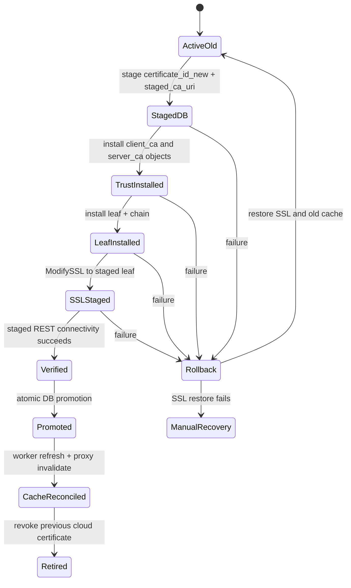
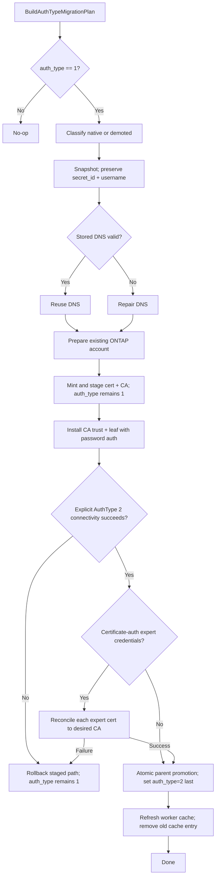
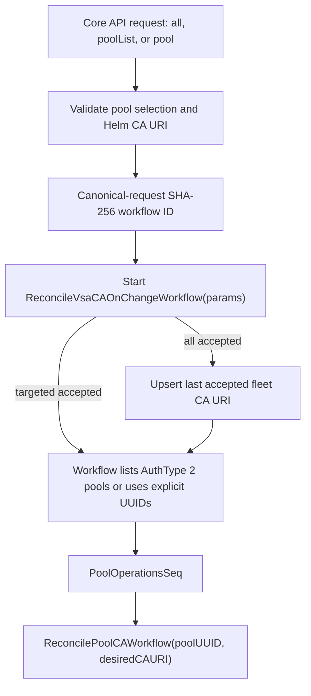

# VCP CA and Auth Type Reconciliation

## Status

Proposed

## Date

2026-08-25

## Implementation Status

The core implementation described here is present on branch `VSCP-7854`: CA drift and unknown legacy CA state force the existing certificate-rotation path, staged certificate/CA pairs use guarded database promotion, and only AuthType 1 pools retaining parent certificate-demotion evidence use the separate on-demand Core API reconciliation workflow. CA changes and forced certificate rotation are initiated explicitly through the Core API; worker startup never starts either operation.

The Core API validates the pool selection and always resolves the desired CA URI from the Helm CA configuration. Fleet-wide CA requests persist the last accepted desired URI in `app_config` only after Temporal accepts the workflow. A deterministic Temporal workflow ID derived from the canonical request deduplicates concurrent API requests. The workflow carries the resolved URI in Temporal history, so execution never depends on a worker's process environment.

Expert-mode credentials persist their own `ca_uri` / `staged_ca_uri` in [`database/datamodel/models.go`](../../../database/datamodel/models.go). [`core/orchestrator/activities/backgroundactivities/expert_certificate_reconciliation.go`](../../../core/orchestrator/activities/backgroundactivities/expert_certificate_reconciliation.go) reconciles each certificate-auth expert credential against the desired CA, then the parent pool is promoted. Password-only expert credentials are left unchanged. A pool remains AuthType 1 only when expert reconciliation itself fails.

The following remain follow-up phases rather than being silently treated as complete:

- ONTAP proxy cache invalidation is not distributed across proxy replicas. Previous cloud certificates remain paired in staged fields and are not revoked during AuthType promotion, so cached password/old-certificate paths remain usable until normal cache refresh.
- Dedicated reconciliation metrics and the internal proxy invalidation endpoint remain Phase 3 follow-ups; current workflow logging and existing rotation failure metrics remain in use.

---

## TL;DR

- **Problem.** Persisted per-pool `ca_uri` values override changed Helm CA values, so certificate rotation continues to use an expired or superseded CA and AuthType 1 pools can retain inconsistent certificate-era state.
- **CA desired state.** `CA_POOL_DEPLOYED_PROJECT_ID`, `CA_POOL_NAME`, and `CA_NAME` from the worker Helm values define the desired CA; a persisted mismatch forces rotation instead of blocking the Helm change.
- **Safe staging.** `staged_ca_uri` is staged and promoted atomically with `certificate_id_new`; active credentials remain usable until CA trust, the leaf certificate, SSL, connectivity, and expert-mode credentials are verified. The leaf retains its existing `certificate_id_new` name until a later compatibility migration.
- **Full trust path.** VCP installs every required CA PEM as separate, idempotent cluster-scoped ONTAP `client_ca` and `server_ca` objects before testing the staged certificate path.
- **AuthType migration.** A separate AuthType 1 -> 2 workflow selects only pools that retain a parent certificate ID, CA URI, or approved fallback username marker proving prior certificate authentication. Native AuthType 1 pools are excluded. Certificate-auth expert credentials are reconciled to the desired CA before the parent `auth_type` is promoted.
- **Emergency-fallback compatibility.** The production fallback patches preserve the original certificate usernames in `username_pre_cert_fix`. Reconciliation authenticates with the temporary `admin` / `gcnv_gadmin` password identities, mints and verifies certificates for the saved original identities, then restores those identities only during final promotion.
- **Missing fallback evidence.** A row using the known temporary `admin` or `gcnv_gadmin` identity without `username_pre_cert_fix` fails closed. VCP does not mint certificate credentials for the temporary identity or guess the original username.
- **Serialization and cache safety.** Both workflows run through `PoolOperationsSeq`, preserve `secret_id` and the certificate username, refresh the promoted worker certificate cache, and remove the old worker cache entry only after promotion.
- **Out of scope (v1):** public API changes, automatic removal of old ONTAP CA trust objects, and OCI certificate reconciliation.

---

## Overview

GCP pool creation snapshots the active CA into `PoolCredentials.CaURI` in [`core/orchestrator/factory/gcp/pool.go`](../../../core/orchestrator/factory/gcp/pool.go). Later reads prefer that persisted value through `GetCaURIWithFallback` in [`database/datamodel/models.go`](../../../database/datamodel/models.go). The certificate rotation dispatcher only fills an empty `ca_uri`; it does not reconcile a non-empty value against Helm desired state. `PopulateMissingCaURI` in [`core/orchestrator/activities/backgroundactivities/rotation_shared_activities.go`](../../../core/orchestrator/activities/backgroundactivities/rotation_shared_activities.go) therefore makes a Helm CA update ineffective for existing pools.

Certificate rotation already stages `certificate_id_new`, verifies the new certificate, and swaps IDs. However, `updatePoolCertificateIDNew` and `swapCertificateIDs` preserve the old `ca_uri`. Cache refresh also fetches the promoted certificate using process-level CA environment values rather than the staged certificate's CA. A CA transition can therefore mint, fetch, revoke, cache, or roll back a certificate against different CA identities.

This design makes Helm CA values desired state and extends the existing staged rotation contract to include CA identity. It also adds a separate AuthType reconciliation workflow for pools currently marked `USERNAME_PWD_SEC_MGR` (AuthType 1). That workflow does not reuse password rotation: it stages a complete certificate path while the pool remains on password authentication, then changes `auth_type` only after end-to-end certificate connectivity succeeds.

This document defines:

1. CA drift detection and forced certificate rotation.
2. CA-aware staging, ONTAP trust installation, cache handling, promotion, revocation, and rollback.
3. Deterministic classification and repair of native and demoted AuthType 1 pools.
4. Temporal serialization, testing, rollout, rollback, and observability.

The design introduces no customer-facing or public API.

---

## Goals and Non-Goals

### Goals

- Reconcile every eligible GCP AuthType 2 pool to the Helm CA URI without requiring direct database updates.
- Keep the active certificate path usable until the staged CA and certificate path passes an ONTAP connectivity check.
- Ensure every promoted `certificate_id` is paired with the `ca_uri` that issued it.
- Migrate eligible AuthType 1 pools to AuthType 2 without changing `auth_type` before staged certificate verification succeeds.
- Preserve `secret_id`, password-recovery capability, and the existing certificate username throughout rotation and migration.
- Reconcile every certificate-auth expert credential to the desired CA, with a proven issuer pairing, before promoting the parent pool AuthType or CA.
- Serialize reconciliation with update, delete, password rotation, and certificate rotation through `PoolOperationsSeq`.

### Non-Goals

- **Public API.** No Google Proxy, Core public API, or OpenAPI resource is added.
- **OCI reconciliation.** OCI uses external credential references and separate client certificates; its rotation workflow is unchanged.
- **Automatic old-CA deletion.** Old ONTAP `client_ca` and `server_ca` trust objects remain until an operationally approved cleanup phase.
- **AuthType 0 migration.** Plain in-row username/password pools are not migrated.
- **Account recreation.** The workflow does not delete or recreate ONTAP users; account-specific behavior is an [open question](#open-questions-and-future-work).

---

## Current State and Consistency Check

### Current code

| Concern | Current implementation | Consequence |
| --- | --- | --- |
| Desired CA | Worker Helm values populate `CA_POOL_DEPLOYED_PROJECT_ID`, `CA_POOL_NAME`, and `CA_NAME` in [`kubernetes/vcp-worker-chart/templates/configMap.yaml`](../../../kubernetes/vcp-worker-chart/templates/configMap.yaml). | The process has a deploy-time CA identity. |
| Persisted CA | `PoolCredentials.CaURI` is JSONB in [`database/datamodel/models.go`](../../../database/datamodel/models.go). | Existing pools retain the creation-time CA. |
| CA resolution | `GetCaURIWithFallback()` returns persisted `ca_uri` whenever it is non-empty. | Helm updates cannot supersede a populated row. |
| Dispatcher | `RotateVsaCertificateAndPasswordWorkflow` calls `PopulateMissingCaURI` before queueing AuthType 2 pools in [`core/orchestrator/workflows/backgroundworkflows/rotate_vsa_certificate_password_workflow.go`](../../../core/orchestrator/workflows/backgroundworkflows/rotate_vsa_certificate_password_workflow.go). | Only missing values are repaired. |
| Rotation staging | `updatePoolCertificateIDNew` stages only `certificate_id_new`; `swapCertificateIDs` preserves `ca_uri`. | Certificate and issuer CA can diverge. |
| ONTAP trust | `Provider.InstallClientCA` and `Provider.InstallServerCA` exist in [`core/vsa/provider.go`](../../../core/vsa/provider.go), and cluster scope is selected by an empty `SvmName` in [`core/vsa/security.go`](../../../core/vsa/security.go). | The required primitives exist. |
| Full certificate chain | `InstallServerCertificate` accepts `IntermediateCertificates`; generated GCP certificates expose `PemCertificateChain`. | Leaf installation can carry its chain. |
| Pool serialization | `PoolOperationsSeq` is `Pool_%s_Ops_All` in [`core/orchestrator/common/workflow_constants.go`](../../../core/orchestrator/common/workflow_constants.go). | New pool-level reconciliation can reuse the existing control workflow. |
| ONTAP proxy cache | Auth data is keyed in an in-memory map with a default seven-day lifetime in [`ontap-proxy/cache/auth_cache.go`](../../../ontap-proxy/cache/auth_cache.go). | A DB promotion alone can leave stale AuthType 1 or old-certificate entries. |
| Expert mode | Each `ExpertModeCredential` has independent auth type, certificate IDs, and `ca_uri` / `staged_ca_uri`. | Expert certificates must migrate, with a proven issuer, before parent promotion. |

### Related designs reviewed

- [`0015 — Workflow Supervisor Task`](0015-workflow-supervisor-task.md) defines conservative cleanup and idempotent retries. Reconciliation uses explicit compensation and does not rely on the supervisor to restore credentials.
- [`0018 — Workflow Cancellation Framework`](0018-workflow-cancellation-framework.md) defines checkpoint-based cancellation for create/delete conflicts. Reconciliation rechecks pool state before staging and promotion and remains serialized with delete through `PoolOperationsSeq`.
- [`0012 — VSA Control Plane Rollback Strategy`](0012-vsa-control-plane-rollback-strategy.md) covers binary and database rollback. This design adds a credential-state rollback contract that remains readable by the previous binary.

### Contradiction resolution

The OCI bootstrap path in [`core/orchestrator/activities/pool_activities.go`](../../../core/orchestrator/activities/pool_activities.go) states that ONTAP rejects a bundled intermediate chain in one `client_ca` install. This does not permit passing a chain through `InstallClientCA`. The approved full-chain requirement is implemented by parsing and installing each CA certificate as separate, idempotently named `client_ca` and `server_ca` trust objects. Exact GCP CA PEM retrieval and chain order remain open because the current `hyperscaler.Services` interface exposes issued certificates but not CA-certificate retrieval.

No existing design prohibits Helm-driven reconciliation, staged CA fields, or AuthType migration.

---

## Design Decisions

| Decision | Choice | Rationale |
| --- | --- | --- |
| CA authority | Helm worker values are desired state. | Operators must be able to move pools to a replacement CA through deployment configuration. |
| Persisted CA role | `ca_uri` records active issuer state; it is not desired state. | Existing certificates must remain fetchable and revocable from their actual issuing CA. |
| Staging | Add `staged_ca_uri` and require it whenever `certificate_id_new` is set by reconciliation. | Retries and rollback need an unambiguous certificate-to-CA pair. |
| Drift behavior | `active ca_uri != desired ca_uri` forces rotation regardless of leaf lifetime. | A valid leaf under an expiring intermediate CA is not the desired trust state. |
| ONTAP trust | Install each CA PEM separately as cluster-scoped `client_ca` and `server_ca` before the leaf. | ONTAP authenticates the cluster-admin client certificate at cluster scope, retains the matching server trust path, and does not accept a bundled chain in one trust install. |
| Promotion | After parent leaf verification, reconcile certificate-auth expert credentials, then promote parent CA, leaf, and AuthType in one guarded DB write. Expert rows use a separate JSONB compare-and-swap. | Readers never observe a new parent AuthType or certificate paired with unrepaired expert certificates. |
| AuthType migration | Use a separate workflow from periodic rotation. | Migration has classification, DNS, ONTAP account, expert-mode, and cache concerns that rotation does not have. |
| Demotion classification | Treat AuthType 1 pools as demoted only when parent credentials retain a certificate ID or CA URI; otherwise classify as native. | A username, DNS name, or expert credential alone is insufficient evidence and must never promote an explicitly created AuthType 1 pool. |
| Username | Preserve the stored pool username. Expert credential usernames stay on those rows and are used only for expert login and certificate subject. | Certificate subject/account binding must remain stable. |
| Password secret | Preserve `secret_id`; do not swap it during CA or AuthType reconciliation. | Password authentication is the recovery path until and after promotion. |
| DNS | Reuse stored `Node.HostDNSName` only after validation; do not create a duplicate DNS record. | Existing valid DNS is stable identity, while stale DNS must not be promoted blindly. |
| Cache | Worker certificate cache uses explicit `(certificateID, caURI)` inputs and removes the old active certificate after commit. | Cache operations must not silently fall back to the process CA during a transition. |
| Concurrency | Queue both workflows through `PoolOperationsSeq`. | Reconciliation must not race pool update, deletion, or another credential rotation. |
| Error surface | Add internal VCP errors only; no HTTP endpoint errors are exposed publicly. | These are background workflows. |

---

## Data Model

`Pool.pool_credentials` and `Pool.expert_mode_credentials` remain JSONB columns. No table or SQL column is added.

### `PoolCredentials`

The declaration in [`database/datamodel/models.go`](../../../database/datamodel/models.go) becomes:

```go
type PoolCredentials struct {
    SecretID         string `json:"secret_id"`
    SecretIDNew      string `json:"secret_id_new"`
    CertificateID    string `json:"certificate_id"`
    CertificateIDNew string `json:"certificate_id_new"`
    Password         string `json:"password"`
    AuthType         int    `json:"auth_type"`
    Username         string `json:"username"`
    CaURI            string `json:"ca_uri,omitempty"`
    StagedCaURI      string `json:"staged_ca_uri,omitempty"`

    ExternalSecret             *ExternalCredRef `json:"external_secret,omitempty"`
    ExternalCertificate        *ExternalCredRef `json:"external_certificate,omitempty"`
    ExternalClientCertificate  *ExternalCredRef `json:"external_client_certificate,omitempty"`
    ExternalServiceCertificate *ExternalCredRef `json:"external_service_certificate,omitempty"`
    ExpertModeSecret           *ExternalCredRef `json:"expert_mode_secret,omitempty"`
}
```

Invariants:

- `CertificateID` and `CaURI` are the active GCP certificate pair.
- `CertificateIDNew` and `StagedCaURI` are the staged pair.
- Reconciliation never writes only one field of a pair.
- Legacy rows with empty `staged_ca_uri` remain valid.
- A legacy `certificate_id_new` with empty `staged_ca_uri` belongs to `ca_uri`; the first reconciliation normalizes or revokes it before creating a new staged pair.
- `secret_id`, `secret_id_new`, `password`, and `username` are preserved byte-for-byte by CA promotion.
- GORM's existing `PoolCredentials.Scan` and `Value` JSON round trip includes `staged_ca_uri` automatically. No hand-written SQL migration is required.

### `ExpertModeCredential`

The declaration in [`database/datamodel/models.go`](../../../database/datamodel/models.go) includes per-credential issuer pairing:

```go
type ExpertModeCredential struct {
    SecretID         string `json:"secret_id"`
    CertificateID    string `json:"certificate_id"`
    CertificateIDNew string `json:"certificate_id_new"`
    CaURI            string `json:"ca_uri,omitempty"`
    StagedCaURI      string `json:"staged_ca_uri,omitempty"`
    Password         string `json:"password"`
    Username         string `json:"username"`
    AuthType         int    `json:"auth_type"`
}
```

Invariants:

- Certificate-auth expert credentials use the same active/staged certificate-and-CA pairing as the parent pool.
- Parked expert `certificate_id_new` follows the same deferred-cleanup rule as the parent pool: revoke on the next reconcile, not immediately after parent promotion.
- Password-only expert credentials are skipped.
- A legacy empty `ca_uri` is backfilled only when GCP certificate metadata proves the issuer. An unproven or wrong-CA leaf is reminted, not guessed.
- Expert rows are updated with `CompareAndSwapExpertModeCredentials` before parent AuthType or CA promotion.

### Workflow-only declarations

These types live in [`core/orchestrator/activities/backgroundactivities/ca_reconciliation_activities.go`](../../../core/orchestrator/activities/backgroundactivities/ca_reconciliation_activities.go):

```go
type CAIdentity struct {
    URI           string   `json:"uri"`
    ProjectID     string   `json:"project_id"`
    Location      string   `json:"location"`
    CAPoolName    string   `json:"ca_pool_name"`
    CAName        string   `json:"ca_name"`
    TrustChainPEM []string `json:"trust_chain_pem"`
}

type ReconciliationReason string

const (
    ReconciliationReasonLifetime ReconciliationReason = "LIFETIME"
    ReconciliationReasonExpired  ReconciliationReason = "EXPIRED"
    ReconciliationReasonCADrift  ReconciliationReason = "CA_DRIFT"
    ReconciliationReasonAuthType ReconciliationReason = "AUTH_TYPE_MIGRATION"
)

type PoolCredentialClass string

const (
    PoolCredentialClassNativeAuthType1  PoolCredentialClass = "NATIVE_AUTH_TYPE_1"
    PoolCredentialClassDemotedAuthType2 PoolCredentialClass = "DEMOTED_AUTH_TYPE_2"
)

type AuthTypeReconciliationEvidence struct {
    CertificateIDPresent       bool `json:"certificate_id_present"`
    StagedCertificatePresent   bool `json:"staged_certificate_present"`
    CaURIPresent               bool `json:"ca_uri_present"`
    CertificateUsernamePresent bool `json:"certificate_username_present"`
    HostDNSPresent             bool `json:"host_dns_present"`
    ExpertCertificatePresent   bool `json:"expert_certificate_present"`
}

type PoolCredentialSnapshot struct {
    PoolUUID             string                           `json:"pool_uuid"`
    Active               datamodel.PoolCredentials        `json:"active"`
    ExpertModeCredentials *datamodel.ExpertModeCredentials `json:"expert_mode_credentials,omitempty"`
    NodeDNSNames          map[int64]string                 `json:"node_dns_names"`
    SSL                   SSLBinding                       `json:"ssl"`
}

type SSLBinding struct {
    SVMName string `json:"svm_name"`
    CA      string `json:"ca"`
    Serial  string `json:"serial"`
}

type StagedCertificate struct {
    CertificateID string   `json:"certificate_id"`
    SecretID      string   `json:"secret_id"`
    CaURI         string   `json:"ca_uri"`
    LeafPEM       string   `json:"leaf_pem"`
    PrivateKeyPEM string   `json:"private_key_pem"`
    ChainPEM      []string `json:"chain_pem"`
    CommonName    string   `json:"common_name"`
    SerialNumber  string   `json:"serial_number"`
}

type ReconciliationPlan struct {
    PoolUUID       string                         `json:"pool_uuid"`
    Reason         ReconciliationReason           `json:"reason"`
    CredentialClass PoolCredentialClass           `json:"credential_class,omitempty"`
    Evidence       AuthTypeReconciliationEvidence `json:"evidence"`
    DesiredCA      CAIdentity                     `json:"desired_ca"`
    Snapshot       PoolCredentialSnapshot         `json:"snapshot"`
}
```

`PoolCredentialClass`, evidence, snapshots, and plans are Temporal payloads, not persisted columns. Sensitive PEM and private-key fields must use the existing encrypted Temporal payload policy; if that policy cannot be confirmed, `StagedCertificate` must carry secret identifiers only and each activity must refetch material.

### Atomic JSONB update

Add a typed storage method rather than constructing credential maps at each activity:

```go
type PoolCredentialMutation struct {
    ExpectedAuthType      int
    ExpectedCertificateID string
    Credentials           datamodel.PoolCredentials
    ExpertCredentials     *datamodel.ExpertModeCredentials
}

func (s *DataStoreRepository) CompareAndSwapPoolCredentials(
    ctx context.Context,
    poolUUID string,
    mutation PoolCredentialMutation,
) error
```

The method runs in one transaction and uses a guarded update:

```sql
UPDATE pools
SET pool_credentials = ?,
    expert_mode_credentials = ?,
    updated_at = now()
WHERE uuid = ?
  AND COALESCE((pool_credentials->>'auth_type')::int, -1) = ?
  AND COALESCE(pool_credentials->>'certificate_id', '') = ?;
```

Zero affected rows returns a non-retryable compare-and-swap conflict. The default PostgreSQL isolation level is sufficient because the predicate rejects stale snapshots. Existing JSONB indexes are not used by this UUID-targeted update; no new index is required.

---

## Internal API and Function Surface

### No public API

Google Proxy, Core public OpenAPI, and customer-visible resource schemas do not change.

### Internal ONTAP proxy cache invalidation

The worker cannot directly mutate another pod's in-memory cache. Add a cluster-internal endpoint to [`ontap-proxy/`](../../../ontap-proxy/) that is not included in public ingress or public OpenAPI:

| Method | Path | Auth | Purpose |
| --- | --- | --- | --- |
| `POST` | `/internal/v1/auth-cache/invalidate` | Existing service-to-service JWT plus workload identity policy | Remove all standard and dedicated cache entries for one pool. |

```go
type InvalidatePoolAuthCacheRequest struct {
    ProjectNumber string `json:"project_number" validate:"required"`
    PoolUUID      string `json:"pool_uuid" validate:"required,uuid"`
}

type InvalidatePoolAuthCacheResponse struct {
    Removed int `json:"removed"`
}
```

Success is HTTP `200` with `{"removed":0}` or greater; repeated calls are idempotent. Authentication failure is `401`/`403`, invalid input is `422`, and a transient proxy failure is `500`. This endpoint is internal and does not add a customer-visible error code.

```go
func RemovePoolFromAuthDataCache(projectNumber, poolUUID string) int

func (c *Client) InvalidatePoolAuthCache(
    ctx context.Context,
    request InvalidatePoolAuthCacheRequest,
) (*InvalidatePoolAuthCacheResponse, error)
```

The cache function removes keys matching both standard `{projectNumber}:{poolUUID}:*` and dedicated `hardware:{projectNumber}:{poolUUID}:*` namespaces under one write lock.

### Desired CA and cloud interfaces

```go
type CATrustProvider interface {
    GetCATrustChain(ctx context.Context, ca CAIdentity) ([]string, error)
}

type ReconciliationDependencies struct {
    Storage          database.Storage
    Cloud            hyperscaler.Services
    CATrust          CATrustProvider
    ProxyCacheClient OntapProxyCacheClient
    ProviderFactory  VSAProviderFactory
}

type OntapProxyCacheClient interface {
    InvalidatePoolAuthCache(
        ctx context.Context,
        request InvalidatePoolAuthCacheRequest,
    ) (*InvalidatePoolAuthCacheResponse, error)
}

type VSAProviderFactory interface {
    NewProvider(ctx context.Context, node *models.Node) (vsa.Provider, error)
}

func NewCAReconciliationActivityWithDeps(
    config CAReconciliationConfig,
    deps ReconciliationDependencies,
) *CAReconciliationActivity

type CAReconciliationConfig struct {
    ProjectID  string
    Location   string
    CAPoolName string
    CAName     string
}

func (c CAReconciliationConfig) DesiredCA() (CAIdentity, error)
```

`CAReconciliationConfig` is populated from Helm-backed process configuration. Startup validation rejects an empty component or a component containing `/`.

### Reconciliation activities

```go
func (a *CAReconciliationActivity) BuildRotationPlan(
    ctx context.Context,
    poolUUID string,
) (*ReconciliationPlan, error)

func (a *CAReconciliationActivity) StageCertificate(
    ctx context.Context,
    plan ReconciliationPlan,
) (*StagedCertificate, error)

func (a *CAReconciliationActivity) InstallStagedTrustAndCertificate(
    ctx context.Context,
    plan ReconciliationPlan,
    staged StagedCertificate,
) error

func (a *CAReconciliationActivity) VerifyStagedCertificate(
    ctx context.Context,
    plan ReconciliationPlan,
    staged StagedCertificate,
) error

func (a *CAReconciliationActivity) StageExpertModeCertificates(
    ctx context.Context,
    plan ReconciliationPlan,
) (*datamodel.ExpertModeCredentials, error)

func (a *CAReconciliationActivity) PromoteStagedCredentials(
    ctx context.Context,
    plan ReconciliationPlan,
    staged StagedCertificate,
    expert *datamodel.ExpertModeCredentials,
) error

func (a *CAReconciliationActivity) RollbackStagedCredentials(
    ctx context.Context,
    plan ReconciliationPlan,
    staged *StagedCertificate,
) error

func (a *CAReconciliationActivity) RetirePreviousCertificate(
    ctx context.Context,
    snapshot PoolCredentialSnapshot,
) error

func (a *CAReconciliationActivity) InvalidateProxyCache(
    ctx context.Context,
    poolUUID string,
) error
```

`BuildRotationPlan` returns a reason of `CA_DRIFT` whenever active and desired CA URIs differ. `StageCertificate` persists `certificate_id_new` and `staged_ca_uri` together before any ONTAP mutation. `PromoteStagedCredentials` is the only function that changes active CA, active certificate, or AuthType.

### AuthType classification and migration

```go
func (a *CAReconciliationActivity) BuildAuthTypeMigrationPlan(
    ctx context.Context,
    poolUUID string,
) (*ReconciliationPlan, error)

func ClassifyAuthType1Pool(
    pool *datamodel.Pool,
    nodes []*datamodel.Node,
) (PoolCredentialClass, AuthTypeReconciliationEvidence)

func (a *CAReconciliationActivity) ValidateOrRepairDNS(
    ctx context.Context,
    plan ReconciliationPlan,
) (map[int64]string, error)

func (a *CAReconciliationActivity) PrepareOntapCertificateAccount(
    ctx context.Context,
    plan ReconciliationPlan,
) error

func (a *ControlWorkflowActivity) ExecutePoolCAReconciliationSequentially(
    ctx context.Context,
    poolUUID string,
    desiredCAURI string,
    transitionWorkflowID string,
    workflowTimeout time.Duration,
) error

func (a *ControlWorkflowActivity) ExecutePoolAuthTypeReconciliationForDesiredCASequentially(
    ctx context.Context,
    poolUUID string,
    desiredCAURI string,
    requestWorkflowID string,
    workflowTimeout time.Duration,
) error

func ReconcilePoolCAWorkflow(ctx workflow.Context, poolUUID, desiredCAURI string) error

func ReconcilePoolAuthTypesAPIWorkflow(
    ctx workflow.Context,
    params ReconcilePoolAuthTypesAPIWorkflowParams,
) error
```

Both control activities use:

```go
controlWorkflowID := fmt.Sprintf(common.PoolOperationsSeq, poolUUID)
```

Add workflow names to [`core/orchestrator/common/workflow_constants.go`](../../../core/orchestrator/common/workflow_constants.go):

```go
const (
    ReconcilePoolCAWorkflowName           = "ReconcilePoolCAWorkflow"
    ReconcilePoolAuthTypesAPIWorkflowName = "ReconcilePoolAuthTypesAPIWorkflow"
)
```

---

## CA Reconciliation Algorithm

### Drift and rotation decision

1. Build `desiredCA.URI` from Helm-backed configuration without reading the pool.
2. Load the pool and nodes.
3. Reject nil credentials and skip `CREATING`, `DELETING`, or `UPGRADING` pools.
4. Normalize the active CA: use persisted `ca_uri`; use desired CA only for a legacy empty value.
5. If active CA differs from desired CA, set reason `CA_DRIFT` and force rotation.
6. Otherwise, reuse the existing expiry/lifetime decision from `certificateNeedsRotation`.
7. Normalize or revoke an abandoned staged pair using its own `staged_ca_uri`; never use desired CA implicitly.



### Staged rotation

1. Snapshot active pool credentials, expert credentials, node DNS, and active SSL binding.
2. Fetch the desired CA trust chain.
3. Mint the leaf certificate under desired CA using the existing stored username.
4. Persist `certificate_id_new` and `staged_ca_uri` together with a compare-and-swap guard.
5. Authenticate to ONTAP with the preserved username and password from `secret_id` for every certificate installation. If the active certificate is expired, log a warning and continue on the same password path. The active certificate is never used to install its replacement.
6. Parse and deduplicate CA PEMs by SHA-256 fingerprint.
7. Install each CA PEM as separately named, cluster-scoped `client_ca` and `server_ca` objects; duplicate/already-exists is success only when fingerprint readback matches.
8. Install the leaf through `InstallServerCertificate`, including `IntermediateCertificates`.
9. Save the previous SSL binding, call `ModifySSL` for the staged leaf, and test ONTAP REST connectivity with an explicit staged `(certificateID, caURI)` credential object.
10. Stage and verify each expert-mode certificate against the same desired CA.
11. Atomically promote active certificate, CA, and expert credentials. Move the prior certificate and CA into the staged fields for post-commit retirement.
12. Populate worker cache using explicit staged CA, remove the previous certificate cache entry, and invalidate ONTAP proxy pool cache.
13. Revoke the previous cloud certificate using its previous CA URI. Revocation failure is retried and alerted but does not revert a verified promotion.

### Trust chain install

Proposed helper signatures in [`core/vsa/security.go`](../../../core/vsa/security.go):

```go
type InstallClientCAChainParams struct {
    CertificateNamePrefix string
    Certificates          []string
}

func (rc *OntapRestProvider) InstallClientCAChain(
    params InstallClientCAChainParams,
) ([]*ServerCertificateResponse, error)

func NormalizePEMCertificateChain(chain []string) ([]string, error)

func CertificateFingerprint(pemValue string) (string, error)
```

`InstallClientCAChain` calls existing `InstallClientCA` once per normalized PEM with an empty `SvmName`. Names use `<prefix>-<fingerprint-prefix>`, making retries deterministic. The helper does not delete trust objects on partial failure because an added CA is non-disruptive; rollback records them as safe residue.

### CA-aware cache and revocation

Replace environment-dependent cache refresh with:

```go
func (a *CAReconciliationActivity) UpdateCertificateCache(
    ctx context.Context,
    certificateID string,
    caURI string,
) error

func (a *CAReconciliationActivity) RevokeCertificate(
    ctx context.Context,
    certificateID string,
    caURI string,
) error
```

Both parse the supplied URI and reject an empty or malformed value. No fallback to global CA configuration is allowed for a non-legacy certificate ID.

---

## Safe SSL Rollback

`ModifySSL` changes the active ONTAP server certificate and can make subsequent REST calls fail. The workflow therefore snapshots `SSLBinding` before mutation and treats SSL rollback as the first compensation step.

Rollback order:

1. If SSL switched, call `ModifySSL(snapshot.SSL)` using the password recovery provider.
2. Verify old-path ONTAP connectivity.
3. Restore the DB snapshot only if promotion occurred.
4. Remove the staged worker cache entry and restore the old cache entry.
5. Invalidate ONTAP proxy cache.
6. Revoke the staged cloud certificate using `staged.ca_uri`.
7. Attempt to delete the staged leaf from ONTAP; leave new CA trust objects installed.

If step 1 fails, rollback stops destructive cleanup, keeps both cloud certificates and ONTAP trust objects, leaves `auth_type` unchanged, and returns `ErrSSLBindingRollbackFailed`. This preserves the maximum number of recovery paths.



---

## AuthType 1 -> 2 Reconciliation

### Classification

The migration lists eligible AuthType 1 pools separately from password rotation. Classification is derived for each run and is not persisted.

A pool is `DEMOTED_AUTH_TYPE_2` only when parent credentials retain at least one of these certificate-era artifacts:

- `certificate_id` or `certificate_id_new`.
- `ca_uri` or `staged_ca_uri`.
- `username_pre_cert_fix`, written by the approved emergency fallback patch.

Expert credentials do not change classification. Certificate-auth expert rows are reconciled after parent leaf verification and before parent promotion.

It is `NATIVE_AUTH_TYPE_1` when none exists. Certificate-like usernames, DNS names, and expert-mode credentials are not sufficient demotion evidence because explicitly created AuthType 1 pools may also contain them. Native pools are filtered from on-demand API batches and defensively skipped again inside the per-pool activity.

Demoted pools may retain stale `certificate_id`, `ca_uri`, certificate username, and DNS data. None is trusted individually:

- Certificate IDs are fetched using their recorded CA only to determine whether they remain usable.
- CA drift still selects Helm desired state.
- The username is preserved.
- DNS is resolved and validated before reuse.
- Certificate-auth expert credentials are reconciled to the desired CA, with proven issuer pairing, before parent promotion. Password-only expert credentials are unchanged.

### Migration sequence

1. Load and classify the pool.
2. Snapshot all active and residual credential state.
3. Resolve desired CA from the Helm-configured URI carried in workflow history.
4. Preserve `secret_id` and username. Fetch password without changing DB AuthType.
   When `username_pre_cert_fix` is present, use the current `username` only for
   password bootstrap and use `username_pre_cert_fix` as the certificate identity.
5. Validate stored DNS. Reuse it when it resolves to a current node endpoint and matches the intended managed zone; otherwise repair through the existing DNS helpers.
6. Prepare the existing ONTAP account for certificate login. Do not delete or rename it.
7. Mint the staged pool certificate under desired CA, or reuse a valid staged candidate under that CA.
8. Persist `certificate_id_new` and `staged_ca_uri`; keep `auth_type=1`.
9. Install full client CA trust and the staged leaf using password authentication.
10. Verify certificate connectivity by constructing an in-memory AuthType 2 node. The DB remains AuthType 1.
11. If expert credentials exist, reconcile each certificate-auth expert credential to the desired CA. Leave password-only expert credentials unchanged. Abort parent promotion if any expert row fails.
    An expert credential patched to `gcnv_gadmin`/AuthType 1 is treated as a
    demoted certificate credential only when it has `username_pre_cert_fix`;
    it is reissued for that saved username and restored to AuthType 2.
    The fallback `secret_id` is left in place; it is the pool admin secret and
    is unused while `auth_type` is 2.
12. Re-fetch the pool and reject changed AuthType, eligible state, or staged certificate/CA pair.
13. In one guarded DB update, set the staged certificate and CA active and finally set `auth_type=2`.
14. Refresh the worker certificate cache using the explicit promoted CA and remove the old active certificate from that cache.
15. Keep the old cloud certificate and its recorded CA paired in the staged fields for deferred cleanup.



### Promotion invariants

- No activity before `PromoteStagedCredentials` writes `auth_type=2`.
- A failed migration leaves `auth_type=1`, `secret_id`, username, and active password path unchanged.
- `secret_id` is never swapped with certificate-secret IDs.
- The pool username is preserved.
- Parent `auth_type` is not promoted until every certificate-auth expert credential is on the desired CA or expert reconciliation has nothing to do.
- Worker cache refresh occurs after DB commit. Failure causes activity retry; it does not roll DB state back.

---

## Error Taxonomy

Add these internal security/credential errors to [`lib/errors/errors.go`](../../../lib/errors/errors.go), following the existing 8500-8599 rotation range and [`doc/api/error-taxonomy.md`](../../api/error-taxonomy.md):

| Code | Constant | HTTP mapping | Temporal retry | Meaning |
| --- | --- | --- | --- | --- |
| `8528` | `ErrCADesiredStateInvalid` | `500` | No | Helm CA components are empty or malformed. |
| `8529` | `ErrCATrustChainFetchFailed` | `500` | Yes | Desired CA PEM chain could not be retrieved. |
| `8530` | `ErrCATrustInstallationFailed` | `500` | Yes | ONTAP rejected a required `client_ca` or `server_ca` trust object. |
| `8531` | `ErrPoolCredentialCompareAndSwapFailed` | `409` | No | Pool credentials changed after the plan snapshot. |
| `8532` | `ErrSSLBindingRollbackFailed` | `500` | Yes | Previous ONTAP SSL binding could not be restored. |
| `8533` | `ErrAuthTypeReconciliationFailed` | `500` | Yes | AuthType migration failed before promotion. |
| `8534` | `ErrOntapProxyCacheInvalidationFailed` | `500` | Yes | Internal proxy cache invalidation failed. |
| `8535` | `ErrPoolDNSReconciliationFailed` | `500` | Yes | Stored DNS was invalid and repair failed. |

Continue to reuse `ErrCertificateGenerationFailed`, `ErrCertificateInstallationFailed`, `ErrCertificateConnectivityTestFailed`, `ErrCertificateRevocationFailed`, `ErrCertificateCacheUpdateFailed`, `ErrRotationRollbackFailed`, and `ErrCertificateStagingFailed`.

Errors are wrapped with `vsaerrors.NewVCPError(trackingID, err)` and `%w`. Invalid CA configuration and compare-and-swap conflicts are non-retryable Temporal application errors. Cloud, ONTAP, DNS, cache transport, and transient database errors use the existing bounded retry policy.

---

## Temporal and Concurrency

The existing dispatcher remains batched. It stops calling `PopulateMissingCaURI`; that activity is removed after rollout because it overwrites evidence rather than reconciling it.

AuthType 2 path:

1. An SRE submits a Core API request with `selectionType=all`, `poolList`, or `pool`. The target CA is always the Helm-configured CA.
2. Core API starts `ReconcileVsaCAOnChangeWorkflow` with a deterministic request-derived ID. An already-running execution is accepted as success. Fleet-wide requests persist the accepted CA URI in AppConfig.
3. List AuthType 2 pools in stable UUID-ordered batches.
4. Queue `ReconcilePoolCAWorkflow(poolUUID, desiredCAURI)` through `ExecutePoolCAReconciliationSequentially`.
5. Let the per-pool workflow compare and rotate using only the resolved desired URI carried in workflow history. Scheduled and forced certificate rotation retain the persisted pool CA unless `ENABLE_CA_CHANGE_DURING_CERTIFICATE_ROTATION=true`, in which case they may move the pool to the Helm-configured CA.

AuthType 1 migration path:

1. Accept requests only through the operator Core API. The promotion target CA is always the Helm-configured CA.
2. Reject a new request while another parent reconciliation job is active.
3. Start one parent Temporal workflow and run per-pool child workflows with bounded concurrency.
4. Queue each pool through the shared pool-operation sequencer and persist per-pool results on the parent job.
5. Do not run AuthType reconciliation from the scheduled certificate/password rotation workflow.

Configuration:

| Helm value / env var | Type | Default | Scope | Validation |
| --- | --- | --- | --- | --- |
| `workerConfig.enableVsaCaReconciliation` / `ENABLE_VSA_CA_RECONCILIATION` | bool | `false` | worker deployment | None |
| `workerConfig.caReconciliationBatchSize` / `CA_RECONCILIATION_BATCH_SIZE` | int | `10` | worker process | Greater than zero |
| `coreConfig.authTypeReconciliationChildWorkflowTimeoutMinutes` / `AUTH_TYPE_RECONCILIATION_CHILD_WORKFLOW_TIMEOUT_MINUTES` | int | `20` | Core API | Greater than zero; covers sequencer queue time plus reconciliation runtime |
| `coreConfig.authTypeReconciliationParentWorkflowTimeoutMinutes` / `AUTH_TYPE_RECONCILIATION_PARENT_WORKFLOW_TIMEOUT_MINUTES` | int | `60` | Core API | Greater than zero |
| `workerConfig.enableCaChangeDuringCertificateRotation` / `ENABLE_CA_CHANGE_DURING_CERTIFICATE_ROTATION` | bool | `false` | worker deployment | Does not affect explicit CA reconciliation |
| Existing CA values | string | existing chart value | worker deployment | All non-empty; no `/` |

Each per-pool workflow uses the existing rotation activity timeout and retry policy initially. Timeouts are revisited after canary duration metrics exist.



---

## Cache, Revocation, and Cleanup Matrix

| Transition | Worker cert cache | ONTAP proxy cache | Cloud certificate | ONTAP leaf | ONTAP CA trust |
| --- | --- | --- | --- | --- | --- |
| Stage | Do not expose staged cert globally | No change | Create under `staged_ca_uri` | Install | Install each CA PEM |
| Verify failure | Remove staged entry | No change | Revoke using `staged_ca_uri` | Best-effort delete after SSL restore | Retain |
| Promote | Add active by explicit `(id, ca_uri)`; remove old | Invalidate pool keys | Keep old until cache invalidation succeeds | Keep old during stabilization | Retain old and new |
| Retirement | No old entry | Already invalidated | Revoke old using old `ca_uri` | Optional later cleanup | No automatic deletion |
| Rollback after commit | Restore old cache pair | Invalidate again | Keep both until restored path verifies | Restore old SSL first | Retain |

Cloud revocation never derives CA from Helm. It always receives the CA URI paired with the target certificate.

---

## Testing Strategy

### Unit tests

Use table-driven tests with constructor-injected mockery interfaces and `AssertExpectations(t)`.

`database/datamodel/models_test.go`:

- JSONB round trip with and without `staged_ca_uri`.
- Legacy staged certificate with missing staged CA.
- Active/staged pair preservation.

`core/orchestrator/activities/backgroundactivities/ca_reconciliation_activities_test.go`:

- Active CA equals desired CA plus fresh leaf -> no rotation.
- Active CA differs plus fresh leaf -> forced `CA_DRIFT`.
- Empty legacy CA -> normalize to desired without losing evidence.
- Stage writes certificate and CA together.
- Cache fetch and revoke use explicit staged or active CA.
- Trust chain normalization handles empty PEM, duplicate PEM, malformed PEM, and multiple intermediates.
- Duplicate ONTAP trust install is idempotent only for the same fingerprint.
- SSL switch failure restores no DB state because promotion has not occurred.
- Connectivity failure restores prior SSL before cloud revocation.
- SSL rollback failure retains both cloud certs and reports manual recovery.
- Compare-and-swap conflict does not overwrite concurrent pool updates.

Classification matrix:

| AuthType | Cert artifact | DNS | Expert cert | Expected |
| --- | --- | --- | --- | --- |
| 1 | none | none | none | Native AuthType 1 |
| 1 | `certificate_id` | any | any | Demoted AuthType 2 |
| 1 | `ca_uri` only | none | none | Demoted AuthType 2 |
| 1 | none | present | none | Native AuthType 1; DNS alone is not demotion evidence |
| 1 | none | none | present | Native AuthType 1; expert credentials alone are not demotion evidence |
| 2 | any | any | any | Not eligible |

AuthType migration:

- `auth_type` remains 1 after each injected failure before promotion.
- `secret_id` and username remain unchanged on success and rollback.
- Valid DNS is reused; stale DNS is repaired; repair failure aborts.
- Demoted stale certificate fetch failure does not block minting a new staged certificate.
- Native AuthType 1 uses its existing account and does not fabricate a new username.
- Certificate-auth expert credentials are promoted under the desired CA before parent AuthType changes; password-only expert credentials are skipped.
- Worker cache refresh failure retries after commit without reverting AuthType.

`ontap-proxy/cache/auth_cache_test.go`:

- Standard and dedicated keys for one pool are removed.
- Other pools in the same project remain.
- Repeated invalidation returns zero.
- Concurrent reads and invalidation pass `-race`.

### Workflow tests

Use Temporal's test environment:

- CA drift queues rotation even when lifetime check is false.
- Both new workflows execute through `PoolOperationsSeq`.
- Delete/update serialization prevents promotion after state changes.
- Activity retry does not mint duplicate certs or duplicate trust objects.
- AuthType workflow never schedules password rotation as a substitute.
- Expert credential failure aborts parent promotion and leaves AuthType 1 unchanged.
- Continue-as-new/batch pagination does not skip pools whose AuthType changes during a run.

### Database tests

- `CompareAndSwapPoolCredentials` updates both JSONB columns atomically.
- `CompareAndSwapExpertModeCredentials` updates the expert JSONB blob only when the expected document still matches.
- Stale expected AuthType or certificate ID affects zero rows.
- Transaction rollback preserves both JSONB values on injected write failure.
- Existing rows with no `staged_ca_uri` remain readable by old and new binaries.

### Integration tests

- GCP Private CA test project: mint under CA A, change desired state to CA B, reconcile, and prove revocation addresses CA A explicitly.
- ONTAP simulator/cluster: install each CA PEM, install leaf with chain, switch SSL, and verify old binding restoration.
- AuthType 1 canary: stage through password auth, verify in-memory AuthType 2, promote, and confirm ONTAP proxy refetches after invalidation.
- ONTAP-mode canary: verify parent promotion occurs only after expert certificate-auth credentials are on the desired CA.

No test overrides package globals. New cloud, provider, cache client, and storage dependencies use constructor injection.

---

## Monitoring and Observability

Structured logs include `pool_uuid`, `workflow_id`, `correlation_id` when available, `reason`, `credential_class`, `active_ca_uri_hash`, and `desired_ca_uri_hash`. Logs never include PEM, private keys, passwords, secret values, or full certificate usernames.

Metrics:

| Metric | Type | Labels |
| --- | --- | --- |
| `vcp.ca_reconciliation.attempts` | counter | `reason`, `result` |
| `vcp.ca_reconciliation.duration` | histogram | `reason` |
| `vcp.ca_reconciliation.drift_pools` | gauge | `location` |
| `vcp.auth_type_reconciliation.attempts` | counter | `credential_class`, `result` |
| `vcp.auth_type_reconciliation.pools` | gauge | `credential_class`, `auth_type` |
| `vcp.credential_reconciliation.rollback` | counter | `stage`, `result` |
| `vcp.credential_reconciliation.cache_invalidation` | counter | `result` |
| `vcp.credential_reconciliation.ssl_rollback` | counter | `result` |

Alerts:

- Any SSL rollback failure.
- Repeated compare-and-swap conflicts for one pool.
- CA drift gauge not decreasing after reconciliation enablement.
- Proxy cache invalidation failures after successful promotion.
- AuthType promotion with subsequent connectivity failure.

---

## Security Considerations

- Desired CA comes only from trusted Helm configuration, not request payloads.
- CA URI parsing rejects traversal-like separators and malformed component counts.
- PEM is parsed before ONTAP installation; fingerprints provide idempotent identity.
- Private keys are never logged or persisted in pool JSONB.
- The internal cache invalidation endpoint is excluded from public ingress and requires service identity.
- `secret_id` remains available as a recovery credential but its secret value is fetched only inside activities.
- Old CA trust is retained because deleting trust prematurely can remove the last recovery path.

---

## Rollout and Operations

### Standard rollout

1. Deploy additive JSONB parsing, typed storage mutation, metrics, and cache invalidation with both feature flags disabled.
2. Enable CA reconciliation in one non-production region while desired CA equals active CA.
3. Change desired CA in that region and canary a small pool set.
4. Expand CA reconciliation region by region.
5. Enable AuthType classification in observe-only mode and compare classes against production incident records.
6. Enable AuthType migration for an allowlisted canary set, then expand by region.

### Operational rollback

- AuthType 1→2 has no feature flag or scheduler; stop issuing `POST /v1/pools/reconcileAuthType` to pause new promotions.
- Disable `ENABLE_VSA_CA_RECONCILIATION` to pause scheduled CA drift repair.
- Do not roll Helm CA values backward merely because reconciliation is paused; active rows record their actual issuer.
- New binaries can resume from staged pairs idempotently.
- Old binaries ignore `staged_ca_uri` during JSON unmarshalling, so the additive JSONB field is backward compatible.
- Do not deploy an old binary while a staged pair exists unless reconciliation flags are disabled and operators accept that the old binary cannot complete CA-aware cleanup.
- For a promoted pool requiring reversal, run the same staged workflow toward the previous CA. Do not directly edit `auth_type` or `ca_uri`.

### Manual recovery trigger

An SSL rollback failure requires:

1. Disable both reconciliation flags.
2. Preserve active and staged cloud certificates.
3. Use the password `secret_id` path to restore the recorded `SSLBinding`.
4. Verify ONTAP REST connectivity.
5. Invalidate ONTAP proxy cache.
6. Resume the workflow only after the binding is confirmed.

---

## Failure Modes and Risks

| Risk | Mitigation |
| --- | --- |
| GCP returns a chain in unexpected order. | Parse issuer/subject relationships; fail closed when a single unambiguous chain cannot be built. |
| ONTAP rejects an intermediate as `client_ca`. | Install each PEM independently, preserve successful trust installs, and canary against supported ONTAP versions. |
| Stored AuthType 1 artifacts misclassify a native pool as demoted. | Classification changes repair behavior only; it never deletes credentials or bypasses staged verification. |
| ONTAP account does not permit adding certificate login while password login remains. | Abort before AuthType promotion and retain password auth; resolve behavior in the open question. |
| SSL switch breaks REST access. | Snapshot SSL, keep password recovery, restore SSL before any destructive compensation. |
| Proxy cache invalidation endpoint is unavailable. | Retry after commit; cache's host-reconcile path remains a fallback, and alerts identify stale-cache risk. |
| Concurrent pool update overwrites staged state. | `PoolOperationsSeq`, state rechecks, and guarded compare-and-swap. |
| Old certificate revocation uses the new CA. | Every revoke call requires explicit `(certificateID, caURI)`. |
| Expert-mode credentials inherit a parent CA that no longer matches their certificate. | Persist per-credential `ca_uri` / `staged_ca_uri`. Backfill a legacy empty issuer only when GCP metadata proves it. Remint unproven or wrong-CA leaves. Promote the parent only after expert certificate-auth rows succeed. |
| Temporal payload exposes private key material. | Confirm payload encryption or carry secret references only before implementation. |

---

## Implementation Phases

Five independently mergeable and deployable phases. Estimates exclude generated mocks.

### Phase 1 — Add CA-aware persistence and helpers

PR size estimate: ~12 files, ~900 lines. Generated (excluded): storage/provider mocks.

What lands:

- `staged_ca_uri` JSONB field and round-trip tests.
- Desired CA config and strict parser.
- Typed compare-and-swap storage method.
- Explicit-CA cache and revoke helpers.
- CA trust-chain normalization and fingerprint helpers.

Acceptance:

- Legacy pool rows round trip unchanged.
- Staged certificate and CA cannot be written separately.
- No runtime behavior changes while flags are disabled.
- Independently mergeable: repository builds, migrations are unnecessary, and tests pass.

### Phase 2 — Reconcile AuthType 2 CA drift

PR size estimate: ~16 files, ~1,800 lines. Generated (excluded): activity/provider mocks.

What lands:

- `ReconcilePoolCAWorkflow`, activities, compensation, and `PoolOperationsSeq` integration.
- Full CA trust installation and safe SSL rollback.
- Expert-mode CA reconciliation.
- Metrics and feature flag.

Acceptance:

- A fresh leaf under the wrong CA rotates.
- Failure before promotion leaves active credentials unchanged.
- Previous-CA revocation uses previous `ca_uri`.
- Independently mergeable and disabled by default.

### Phase 3 — Add internal proxy cache invalidation

PR size estimate: ~10 files, ~700 lines. Generated: none.

What lands:

- Internal authenticated invalidation endpoint and client.
- Standard/dedicated pool-key eviction.
- Post-promotion workflow integration and metrics.

Acceptance:

- All cache entries for one pool are removed without affecting another pool.
- Repeated invalidation is idempotent.
- Endpoint is absent from public ingress and public OpenAPI.
- Independently mergeable; reconciliation tolerates the client being disabled until configured.

### Phase 4 — Classify and migrate AuthType 1 pools

PR size estimate: ~18 files, ~2,200 lines. Generated (excluded): activity mocks.

What lands:

- Native-versus-demoted classifier and observe-only metrics.
- DNS validation/repair and ONTAP account preparation.
- Separate staged AuthType migration workflow.
- Expert certificate reconciliation before atomic parent credential promotion.

Acceptance:

- Every pre-promotion failure leaves `auth_type=1`.
- `secret_id` and usernames are preserved.
- Demoted stale artifacts are repaired without direct DB updates.
- Independently mergeable and disabled by default.

### Phase 5 — Canary, rollout, and cleanup

PR size estimate: ~6 files, ~350 lines. Generated: none.

What lands:

- Runbook updates and rollout dashboards.
- Region canary allowlist configuration.
- Removal of `PopulateMissingCaURI` after all supported worker versions understand `staged_ca_uri`.

Acceptance:

- CA drift reaches zero in canary without connectivity regression.
- AuthType observe-only classification is reviewed before migration enablement.
- Rollback drill restores SSL and cache state.
- Independently mergeable after the prior phases are stable.


---

## Open Questions and Future Work

- **CA PEM retrieval and chain ordering** — The current GCP `hyperscaler.Services` interface has no CA-certificate retrieval method. Default plan: add a narrow `CATrustProvider` in `hyperscaler/google` that fetches the issuing CA chain and orders PEMs by parsed issuer/subject relationships. Alternatives: a Helm-mounted trust bundle or using only `PemCertificateChain` from a newly issued leaf. Decide in Phase 1.
- **ONTAP account behavior** — Confirm whether the existing AuthType 1 account can retain password login while adding certificate login and whether certificate login requires an explicit account/authentication-method update. Default plan: preserve the account and both methods until certificate verification. Decide before Phase 4.
- **Certificate username detection** — Confirm the complete historical naming patterns for demoted pools. Default plan: use the current suffix plus artifact evidence and never classify from username alone when the pattern is unknown. Decide during observe-only rollout.
- **Trust cleanup** — Old `client_ca` and `server_ca` objects accumulate. Default plan: retain them in v1 and add fingerprint-based cleanup only after fleet-wide ONTAP compatibility is measured.
- **Temporal payload encryption** — Confirm private-key payload protection. Default plan: pass secret references rather than PEM through workflow history when encryption is not guaranteed. Decide in Phase 1.
- **Internal cache invalidation transport** — Confirm the existing service JWT audience and network policy for worker-to-ONTAP-proxy calls. Default plan: reuse current service-to-service authentication and no public ingress. Decide in Phase 3.

---

## References

- [`database/datamodel/models.go`](../../../database/datamodel/models.go) — pool and expert credential JSONB models.
- [`core/orchestrator/activities/backgroundactivities/expert_certificate_reconciliation.go`](../../../core/orchestrator/activities/backgroundactivities/expert_certificate_reconciliation.go) — expert credential issuer pairing, reuse, and promotion.
- [`core/orchestrator/activities/backgroundactivities/rotation_shared_activities.go`](../../../core/orchestrator/activities/backgroundactivities/rotation_shared_activities.go) — current staging, cache, revocation, and rollback.
- [`core/orchestrator/workflows/backgroundworkflows/rotate_pool_certificate_workflow.go`](../../../core/orchestrator/workflows/backgroundworkflows/rotate_pool_certificate_workflow.go) — current per-pool rotation.
- [`core/orchestrator/workflows/backgroundworkflows/rotate_vsa_certificate_password_workflow.go`](../../../core/orchestrator/workflows/backgroundworkflows/rotate_vsa_certificate_password_workflow.go) — current dispatcher.
- [`core/orchestrator/activities/backgroundactivities/control_workflow_activities.go`](../../../core/orchestrator/activities/backgroundactivities/control_workflow_activities.go) — `PoolOperationsSeq` queueing.
- [`core/vsa/security.go`](../../../core/vsa/security.go) — ONTAP certificate and trust installation.
- [`hyperscaler/provider.go`](../../../hyperscaler/provider.go) — cloud abstraction boundary.
- [`kubernetes/vcp-worker-chart/values.yaml`](../../../kubernetes/vcp-worker-chart/values.yaml) — Helm CA desired state.
- [`ontap-proxy/cache/auth_cache.go`](../../../ontap-proxy/cache/auth_cache.go) — ONTAP proxy auth cache.
- [`0018 — Workflow Cancellation Framework`](0018-workflow-cancellation-framework.md)
- [`0015 — Workflow Supervisor Task`](0015-workflow-supervisor-task.md)
- [`0012 — VSA Control Plane Rollback Strategy`](0012-vsa-control-plane-rollback-strategy.md)
- [`.cursor/rules/go-project-rule.mdc`](../../../.cursor/rules/go-project-rule.mdc)
- [`.cursor/rules/database.mdc`](../../../.cursor/rules/database.mdc)
- [`.cursor/rules/testing.mdc`](../../../.cursor/rules/testing.mdc)
