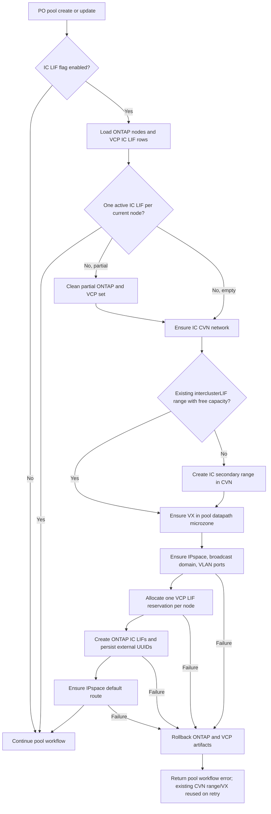

# Intercluster LIFs for Extreme and Premium ONTAP-Mode Pools

## Status

Proposed

## TL;DR

- **Problem.** Extreme and Premium ONTAP-mode pools do not provision the intercluster LIFs required for FlexCache.
- **Scope.** VCP ensures one intercluster LIF per ONTAP node for each account and host during eligible pool create and update.
- **Networking.** VCP asks CVN for an `interclusterLIF` secondary IP range, creates a VX network in the pool datapath microzone, and leaves those resources to CVN reclaim.
- **Reuse.** Ensure is reuse-first: an existing `interclusterLIF` `ip_ranges` row with capacity is reused across pool creates and after a mid-flight ONTAP failure; CVN is called for a new secondary range only when no usable range exists.
- **ONTAP.** VCP mirrors CVS naming and creates a dedicated IPspace, broadcast domain, per-node VLAN ports, intercluster LIFs, and a default route.
- **Persistence.** Active reservations use the existing VCP `lifs` and `ip_ranges` tables with `type`/`lifType` set to `interclusterLIF`; no database migration is required.
- **Rollout.** `ENABLE_IC_LIFS_FOR_PO_POOLS` controls the behavior and defaults to `true`; `PO_IC_LIF_SUBNET_MASK_SIZE` defaults to `28`.
- **Out of scope (v1).** Pool-delete cleanup, automatic backfill, CVS runtime calls, CVN service behavior changes, and address-range policy changes are excluded.

---

## Overview

Performance Offering (PO) pools are ONTAP-mode pools with an `EXTREME` or `PREMIUM` service level. The create path in [`core/orchestrator/workflows/pool_workflows.go`](../../../core/orchestrator/workflows/pool_workflows.go) currently creates the pool datapath, ONTAP IPspace, broadcast domain, VLAN ports, SVM, data LIFs, and route. The update path only updates VCP pool metadata. Neither path ensures the account has intercluster LIFs on the selected host.

FlexCache requires intercluster connectivity. Before an eligible pool create or update completes, VCP will ensure one intercluster LIF per current ONTAP node for the pool's account and host. A complete existing set is reused. A missing or incomplete set is rebuilt through CVN, ONTAP, and VCP database activities.

VCP already constructs a CVN client in [`clients/cvn/client.go`](../../../clients/cvn/client.go). CVN already supports secondary ranges with `lifType=interclusterLIF` and direct VX-network creation. The CVN SDK needs additive plumbing to expose `lifType` through its secondary-range helper; the CVN service needs no new endpoint or orchestration behavior.

The ONTAP sequence mirrors CVS [`storage/orchestrator/intercluster_lifs.go`](../../../../cloud-volumes-service/storage/orchestrator/intercluster_lifs.go): account-and-VLAN-based names, `default-intercluster` service policy, one LIF per node, and a default route in the dedicated IPspace.

This document defines:

1. The account-and-host idempotency contract.
2. Direct CVN secondary-range and VX-network orchestration.
3. ONTAP and VCP database creation and rollback.
4. Pool create/update integration, testing, and rollout.

---

## Goals and Non-Goals

### Goals

- An eligible pool create or update leaves exactly one active `interclusterLIF` row and one ONTAP intercluster LIF for every current node on the account's host.
- A complete account-and-host LIF set causes no CVN, ONTAP, or database writes.
- A new host gets its own set when the account first creates or updates an eligible pool on that host.
- Temporal activity retries do not allocate duplicate IPs or create duplicate ONTAP resources.
- A failed ensure removes VCP and ONTAP resources created by that attempt while leaving CVN range and VX resources for reclaim.
- Disabling `ENABLE_IC_LIFS_FOR_PO_POOLS` restores the pre-feature pool behavior without a database rollback.

### Non-Goals

- **Pool delete cleanup.** Pool deletion does not remove intercluster LIFs, routes, ports, broadcast domains, IPspaces, VX networks, or secondary ranges.
- **Automatic backfill.** Existing pools are provisioned only when they pass through pool update; no scanner or migration job is added.
- **Non-PO pools.** FLEX, STANDARD, and non-ONTAP-mode pools do not enter this flow.
- **CVS integration.** VCP uses CVS as design prior art but does not call CVS at runtime.
- **CVN service changes.** The REST resources and CVN orchestration already exist; only backward-compatible SDK plumbing is added.
- **Address-range policy.** VCP does not create or validate an `interclusterLIF` address range in this workflow.
- **Public API changes.** No Google Proxy or vcp-core endpoint, request field, response field, or authentication rule changes.
- **Database schema changes.** Existing `lifs.type`, `lifs.ip_range_id`, `ip_ranges.lif_type`, and `nodes.node_attributes.host_id` are sufficient.

---

## Design Decisions

| Decision | Choice | Rationale |
|---|---|---|
| Eligibility | `common.IsPORequest`/`common.IsPOPool`: ONTAP mode and `EXTREME` or `PREMIUM` | Reuses the existing PO classification; Premium remains subject to `ENABLE_PO_PREMIUM_POOLS`. |
| Trigger | Ensure during PO pool create and every PO pool update | Existing accounts receive the capability on their next update without a separate backfill job. |
| Ownership | One complete set per account and host | The same host-level cluster network is shared by all eligible pools for that account. |
| Cardinality | One LIF per current ONTAP node | Matches the CVS requirement and supports node-local intercluster traffic. |
| Existing-set behavior | Skip only when every current host node has one active `interclusterLIF` row | A count-only check can accept stale or duplicate rows; node identity is authoritative. |
| Incomplete set | Roll back the active partial set, then create a full set | Avoids combining unknown legacy state with a new VLAN/IPspace. |
| Post-failure reuse | Reuse the existing `interclusterLIF` `ip_ranges` row and VX for the same microzone | A prior ONTAP failure leaves CVN range/VX intact; the next attempt must not create a duplicate range. |
| Secondary subnet | `PO_IC_LIF_SUBNET_MASK_SIZE`, default `28` | Separates IC capacity policy from the data-LIF subnet setting. |
| VX placement | Reuse the pool datapath `MicrozoneUUID` | Places IC networking on the same service-switch microzone as the pool datapath. |
| ONTAP naming | CVS naming conventions | Makes operational inspection consistent across VCP and CVS. |
| Database type | `interclusterLIF` | Matches existing VCP and CVN enum values. |
| SVM association | `lifs.svm_id = NULL` | Intercluster LIFs are cluster-scoped, not pool-SVM-scoped. |
| Feature gate | `ENABLE_IC_LIFS_FOR_PO_POOLS`, default `true` | Supports immediate rollout and emergency behavioral rollback. |
| Normal deletion | Leave all IC resources | The set belongs to account+host, not to an individual pool. |
| Failure rollback | Delete VCP rows and ONTAP resources; retain CVN range/VX | CVN reclaim owns orphan network and range reclamation. |

---

## Data Model

No GORM model or SQL migration changes are required. The existing models in [`database/datamodel/models.go`](../../../database/datamodel/models.go) are used as follows:

```go
type Lif struct {
	BaseModel
	Name        string        `gorm:"column:name;type:text"`
	Description string        `gorm:"column:description;type:text"`
	LifDetails  *LifDetails   `gorm:"column:lif_details;type:jsonb"`
	AccountID   int64         `gorm:"column:account_id;type:bigint"`
	Type        string        `gorm:"column:type;type:text"`
	IPAddress   string        `gorm:"column:ip_address;type:text"`
	NodeID      int64         `gorm:"column:node_id;type:bigint"`
	SubnetMask  string        `gorm:"column:subnet_mask;type:text"`
	IPRangeID   sql.NullInt64 `gorm:"column:ip_range_id;index"`
	SvmID       sql.NullInt64 `gorm:"column:svm_id;index"`
}

type LifDetails struct {
	ExternalUUID string `json:"external_uuid"`
	ProtocolType string `json:"protocol_type"`
}

type IPRange struct {
	BaseModel
	Network        *string       `json:"network" gorm:"size:2048"`
	StartIP        string        `json:"startIp"`
	EndIP          string        `json:"endIp"`
	Gateway        string        `json:"gateway"`
	Netmask        string        `json:"netmask"`
	RegionID       sql.NullInt64 `json:"-" gorm:"index"`
	HostID         sql.NullInt64 `json:"-" gorm:"index"`
	AccountID      sql.NullInt64 `json:"-" gorm:"index"`
	LifType        string        `json:"lifType" gorm:"default:'dataLIF'"`
	AddressRangeID sql.NullInt64 `json:"-" gorm:"index"`
}
```

An active IC LIF row has:

| Field | Value |
|---|---|
| `name` | `ic-lif-<UUID>` |
| `account_id` | Pool account database ID |
| `type` | `interclusterLIF` |
| `ip_address` | Address reserved from the IC `ip_ranges` row |
| `node_id` | VCP node mapped from the ONTAP node name |
| `subnet_mask` | Netmask from the IC `ip_ranges` row |
| `ip_range_id` | IC range database ID |
| `svm_id` | `NULL` |
| `lif_details.external_uuid` | ONTAP LIF UUID after ONTAP creation |
| `lif_details.protocol_type` | Empty; `lifs.type` is the authoritative IC classification |

### Storage interface

Add these methods to `Storage` in [`database/vcp/interface.go`](../../../database/vcp/interface.go) and implement them in a new [`database/vcp/intercluster_lif.go`](../../../database/vcp/intercluster_lif.go):

```go
GetInterclusterLifsForAccountHost(
	ctx context.Context,
	accountID int64,
	hostID int64,
) ([]*datamodel.Lif, error)

GetInterclusterLifIPRanges(
	ctx context.Context,
	accountUUID string,
	network string,
) ([]*datamodel.IPRange, error)

AllocateInterclusterLifIPs(
	ctx context.Context,
	ipRangeUUID string,
	reservations []*datamodel.Lif,
) ([]*datamodel.Lif, error)

UpdateInterclusterLifExternalUUID(
	ctx context.Context,
	lifUUID string,
	externalUUID string,
) error

DeleteInterclusterLifsForAccountHost(
	ctx context.Context,
	accountID int64,
	hostID int64,
) error
```

`GetInterclusterLifsForAccountHost` selects active `lifs` rows with `type = ?` and joins `nodes` through `lifs.node_id`. Host ownership is resolved from `nodes.node_attributes->>'host_id'`, matching [`GetNodesByHostIDAndNames`](../../../database/vcp/node.go).

```sql
SELECT lifs.*
FROM lifs
JOIN nodes ON nodes.id = lifs.node_id
WHERE lifs.deleted_at IS NULL
  AND nodes.deleted_at IS NULL
  AND lifs.account_id = ?
  AND lifs.type = ?
  AND (nodes.node_attributes->>'host_id')::bigint = ?;
```

`AllocateInterclusterLifIPs` follows the allocation algorithm in [`database/vcp/data_lif_ip.go`](../../../database/vcp/data_lif_ip.go), but fixes `Lif.Type` to `interclusterLIF` and leaves `SvmID` null. It allocates all requested node reservations in one transaction. The transaction:

1. Loads the `ip_ranges` row by UUID and validates `lif_type = interclusterLIF`.
2. Locks the range row for update.
3. Reads active addresses for that range regardless of LIF type.
4. Calls `common.AllocateIPAddressesFromRange`.
5. Inserts one row per node with generated UUID and name.
6. Commits only when every row is inserted.

The existing partial unique index on active `(ip_range_id, ip_address)` reservations prevents cross-workflow duplicate allocation. No new index is required.

`UpdateInterclusterLifExternalUUID` updates `lif_details.external_uuid` only after ONTAP returns the created LIF. `DeleteInterclusterLifsForAccountHost` soft-deletes only `type = interclusterLIF` rows for the account+host pair.

`GetInterclusterLifIPRanges` returns active `ip_ranges` rows for the account+network with `lif_type = 'interclusterLIF'`. It mirrors `GetDataLIFIPRanges` in [`database/vcp/ip_range.go`](../../../database/vcp/ip_range.go) and is consumed by the ensure activity for reuse detection:

```go
GetInterclusterLifIPRanges(
	ctx context.Context,
	accountUUID string,
	network string,
) ([]*datamodel.IPRange, error)
```

Capacity of a candidate range is validated with `ValidateIPAddressesAvailableInIPRange` in [`database/vcp/data_lif_ip.go`](../../../database/vcp/data_lif_ip.go); it already counts active `lifs` rows regardless of LIF type.

---

## Configuration

Add constants to [`utils/env/env.go`](../../../utils/env/env.go) and consume them through a configuration struct injected into the IC activities:

```go
const (
	EnvEnableICLifsForPOPools = "ENABLE_IC_LIFS_FOR_PO_POOLS"
	EnvPOICLifSubnetMaskSize  = "PO_IC_LIF_SUBNET_MASK_SIZE"
)

type POICLifConfig struct {
	Enabled        bool
	SubnetMaskSize int
	BasePort       string
}

func DefaultPOICLifConfig() POICLifConfig
```

| Variable | Type | Default | Scope | Validation |
|---|---|---:|---|---|
| `ENABLE_IC_LIFS_FOR_PO_POOLS` | boolean | `true` | vcp-worker process | Invalid boolean fails existing env parsing/startup behavior. |
| `PO_IC_LIF_SUBNET_MASK_SIZE` | integer | `28` | vcp-worker process | Only `27` or `28` is accepted; invalid values fail the IC activity as non-retryable configuration errors. |
| `PO_LIF_BASE_PORT` | string | Existing default | vcp-worker process | Reused for per-node IC VLAN ports. |

The workflow receives the resolved `Enabled` value through its activity dependency/configuration; tests inject `POICLifConfig` and do not override globals.

---

## CVN Integration

### SDK plumbing

The generated CVN request model already contains `LifType *string`. Add a hand-written SDK method without changing the existing `CreateSecondaryIPRangeV1` signature:

```go
CreateSecondaryIPRangeWithLifTypeV1(
	accountUUID string,
	remoteAccountID string,
	subnetMaskSize int64,
	lifType string,
) (*models.SecondaryIPRangeV1, error)
```

The method builds the existing generated `CreateSecondaryIPRangeV1` body and sets `LifType`. Existing callers retain the current `dataLIF` default. The CVN service endpoint and orchestration do not change.

### VCP client contract

`POICVNActivity` uses [`clients/cvn.NewFromContext`](../../../clients/cvn/client.go) and a narrow injected interface:

```go
type POICLifCVNClient interface {
	ListNetworksV1(accountUUID *string, remoteAccountID *string) ([]*sdkmodels.NetworkV1, error)
	CreateSecondaryIPRangeWithLifTypeV1(
		accountUUID string,
		remoteAccountID string,
		subnetMaskSize int64,
		lifType string,
	) (*sdkmodels.SecondaryIPRangeV1, error)
	GetSecondaryIPRangeV1(secondaryIPRangeUUID string) (*sdkmodels.SecondaryIPRangeV1, error)
	CreateVXNetworkV1(networkUUID, microzoneUUID, ipRangeUUID string) (*sdkmodels.VXNetworkV1, error)
	DescribeVXNetworkV1(uuid string) (*sdkmodels.VXNetworkV1, error)
	DescribeJobV1(jobUUID string) (*sdkmodels.JobV1, error)
	GetBorderPollTimeout() time.Duration
	GetServicePollTimeout() time.Duration
	GetPollInterval() time.Duration
}

type POICLifCVNClientFactory func(
	ctx context.Context,
	accountUUID string,
) (POICLifCVNClient, error)

type POICVNActivity struct {
	SE            database.Storage
	ClientFactory POICLifCVNClientFactory
	Config        POICLifConfig
}
```

### Activity contract

```go
type EnsurePOICNetworkInput struct {
	AccountUUID     string
	RemoteAccountID string
	MicrozoneUUID   string
	HostUUID        string
	NodeCount       int
}

type POICNetworkOutput struct {
	NetworkUUID string
	IPRangeUUID string
	VXNetworkUUID string
	VlanID      int
	Gateway     string
	Netmask     string
}

func (a *POICVNActivity) EnsurePOICNetwork(
	ctx context.Context,
	in EnsurePOICNetworkInput,
) (*POICNetworkOutput, error)
```

The activity is **reuse-first**. It never creates a new secondary range while a usable `interclusterLIF` range already exists for the account+network. This is what makes the next pool create resume against the same CVN resources when a previous attempt failed after CVN succeeded but before ONTAP finished.

1. Call `ListNetworksV1(&accountUUID, &remoteAccountID)` and require exactly one matching active network. Its UUID is `networkUUID`.
2. Call `SE.GetInterclusterLifIPRanges(accountUUID, remoteAccountID)` to list existing IC ranges.
3. Try to reuse an existing range:
   1. Iterate candidates in a deterministic order (by `created_at`, then by UUID).
   2. Require `LifType == "interclusterLIF"` and `ValidateIPAddressesAvailableInIPRange(range.UUID, NodeCount)` to succeed.
   3. On the first hit, set `ipRangeUUID = range.UUID`, `gateway = range.Gateway`, `netmask = range.Netmask`; skip to step 5.
4. Create a new IC range only when no candidate was reused:
   1. Call `CreateSecondaryIPRangeWithLifTypeV1` with `lifType = "interclusterLIF"` and `subnetMaskSize = Config.SubnetMaskSize`.
   2. Poll its job through `DescribeJobV1` using `GetBorderPollTimeout` and `GetPollInterval`, recording a Temporal heartbeat each interval.
   3. Call `GetSecondaryIPRangeV1` and read `IprangeUUID` as `ipRangeUUID`.
   4. Load the CVN-created range through `SE.GetIPRangeByUUID(ctx, ipRangeUUID)` and validate `LifType == "interclusterLIF"` and that it can supply `NodeCount` addresses.
5. Ensure the VX network for `(networkUUID, in.MicrozoneUUID, ipRangeUUID)`:
   1. Call `CreateVXNetworkV1(networkUUID, in.MicrozoneUUID, ipRangeUUID)`. A CVN response indicating the VX already exists for the same `(microzone, ipRange)` is treated as success and its UUID is used.
   2. Poll its job through `DescribeJobV1` using `GetServicePollTimeout` and `GetPollInterval`, recording a Temporal heartbeat each interval.
   3. Call `DescribeVXNetworkV1` and read `L2VlanID` and `IprangeUUID`; require the returned `IprangeUUID` to equal `ipRangeUUID`.
6. Return `NetworkUUID`, `IPRangeUUID`, `VXNetworkUUID`, `VlanID`, `Gateway`, and `Netmask`.

The pool datapath already uses `hostUUID` as `MicrozoneUUID` through `common.BuildPODataPathParams`. The IC call uses that same value, so the VX row is deterministically keyed by `(networkUUID, hostUUID, ipRangeUUID)` across retries.

CVN failures are retryable Temporal activity errors unless input/configuration validation fails. VCP does not delete the range or VX network if a later step fails; the next attempt reuses them through step 3.

Reuse depends on the `ip_ranges` row persisted by CVN. If a previous attempt failed before CVN wrote that row (for example the secondary-range job never reached success), reuse cannot find it and a new range is created. Range accumulation from this narrow window is expected and handled by CVN reclaim.

---

## ONTAP Integration

### Naming

Add the IC naming helper alongside [`core/orchestrator/common/po_network.go`](../../../core/orchestrator/common/po_network.go):

```go
const POInterclusterServicePolicy = "default-intercluster"

func POICLifName(id string) string {
	return "ic-lif-" + id
}
```

Existing `POIPSpaceName(accountUUID, vlanID)` and `POBroadcastDomainName(accountUUID, vlanID)` already produce the CVS-compatible patterns:

```text
ipspace_<account UUID without dashes>_<VLAN>
bdomain_<account UUID without dashes>_<VLAN>
ic-lif-<UUID>
<PO_LIF_BASE_PORT>-<VLAN>
```

### Cluster client contract

Extend the injected `POClusterClient` in [`core/orchestrator/activities/po_ontap_activities.go`](../../../core/orchestrator/activities/po_ontap_activities.go):

```go
type POInterclusterLifSpec struct {
	Name          string
	IPAddress     string
	Netmask       string
	HomeNode      string
	HomePort      string
	ServicePolicy string
}

type POInterclusterLifResult struct {
	Name         string
	ExternalUUID string
}

type POClusterClient interface {
	// Existing methods omitted.
	GetInterclusterLifs(servicePolicy string) ([]*vsa.InterclusterLif, error)
	CreateInterclusterLif(in POInterclusterLifSpec) (*POInterclusterLifResult, error)
	DeleteInterclusterLif(externalUUID string) error
	EnsureIPSpaceDefaultRoute(ipSpace, gateway string) (created bool, err error)
	DeleteIPSpaceDefaultRoute(ipSpace, gateway string) error
	DeleteVlanNetPorts(ipSpace, broadcastDomain, basePort string, vlanTag int, nodeNames []string) error
	DeleteBroadcastDomain(ipSpace, name string) error
	DeleteIPSpace(name string) error
}
```

`CreateInterclusterLif` maps to ONTAP REST with:

| ONTAP field | Value |
|---|---|
| Scope | `cluster` |
| Name | `ic-lif-<UUID>` |
| IP address | Reserved VCP address |
| Netmask | IC `ip_ranges.netmask` |
| Home node | Current ONTAP node |
| Home port | `<PO_LIF_BASE_PORT>-<VLAN>` |
| Service policy | `default-intercluster` |
| IPspace | Dedicated account/VLAN IPspace through the home port |

The route is IPspace-scoped. It does not use `CreatePODefaultRoute`, which is SVM-scoped.

### Activity contracts

```go
type CreatePOInterclusterLifInput struct {
	HostUUID string
	Lif      POInterclusterLifSpec
}

type RollbackPOInterclusterLifsInput struct {
	HostUUID        string
	AccountID       int64
	IPSpace         string
	BroadcastDomain string
	BasePort        string
	VlanID          int
	Gateway         string
	NodeNames       []string
	CreatedLifs     []POInterclusterLifResult
	RouteCreated    bool
}

func (a *POOntapActivity) CreatePOInterclusterLif(
	ctx context.Context,
	in CreatePOInterclusterLifInput,
) (*POInterclusterLifResult, error)

func (a *POOntapActivity) RollbackPOInterclusterLifs(
	ctx context.Context,
	in RollbackPOInterclusterLifsInput,
) error
```

The workflow invokes `CreatePOInterclusterLif` once per node. It retains each successful result and immediately persists the external UUID to its preallocated VCP row through a database activity that calls `UpdateInterclusterLifExternalUUID`. Rollback therefore has the exact successfully created subset even when a later node fails. Rollback deletes in reverse dependency order:

1. Default route, only when this attempt created it.
2. Created ONTAP intercluster LIFs.
3. VCP `interclusterLIF` rows for the account+host.
4. Per-node VLAN ports.
5. Broadcast domain.
6. IPspace.

Every rollback step is attempted even if an earlier cleanup step fails. The activity returns a joined cleanup error after recording each failure. It never calls a CVN delete API.

---

## Ensure Algorithm

### Workflow input

```go
type EnsurePOInterclusterLifsInput struct {
	AccountUUID     string
	AccountID       int64
	HostUUID        string
	RemoteAccountID string
	MicrozoneUUID   string
}

type EnsurePOInterclusterLifsOutput struct {
	Skipped      bool
	IPRangeUUID  string
	VXNetworkUUID string
	LifUUIDs     []string
}
```

### Contract

1. If `ENABLE_IC_LIFS_FOR_PO_POOLS` is false, return `Skipped=true`.
2. Enumerate current ONTAP node names with `GetPONodeNames`.
3. Resolve node names to VCP node IDs with `ResolvePONodeIDs`.
4. Load active `interclusterLIF` rows for the account+host.
5. If exactly one row exists for every current node, return `Skipped=true`.
6. If a partial set exists, delete its ONTAP LIFs and soft-delete its VCP rows before continuing.
7. Ensure the IC CVN network. The activity reuses an existing `interclusterLIF` range with `NodeCount` free addresses when available; otherwise it creates a new secondary range and then ensures the VX network for the pool datapath microzone. Returns IP range UUID, VLAN, gateway, and netmask.
8. Derive the IPspace and broadcast-domain names from account UUID and VLAN.
9. Ensure the IPspace, broadcast domain, and one VLAN port per node.
10. Allocate one IC IP and VCP `lifs` row per node in one database transaction.
11. Create one ONTAP IC LIF per reservation and persist each external UUID.
12. Ensure the IPspace default route.
13. Return the created range, VX, and LIF UUIDs.
14. On failure after step 8, run best-effort ONTAP/VCP rollback and return the original error with cleanup errors attached.



### Concurrency

Pool workflows for the same account can run concurrently. `AllocateInterclusterLifIPs` serializes allocation on the IC `ip_ranges` row, but that alone does not prevent two workflows from creating separate ranges.

The ensure activity therefore uses the existing account-scoped Temporal workflow/job serialization applied to PO pool operations. The database completeness check is repeated immediately before allocation. If concurrent PO pool workflows are not account-serialized at merge time, this PR must add an account+host workflow mutex before `ENABLE_IC_LIFS_FOR_PO_POOLS` is turned on in any stamp; relying only on the read-before-create check is prohibited.

### Temporal retry policy

- Input, missing-node, invalid subnet, and wrong-`lifType` failures are non-retryable.
- CVN job, ONTAP connectivity, and transient database failures use the existing PO activity retry policy.
- Activities are idempotent by deterministic account+host checks and persisted VCP reservations.
- Workflow retry always starts with completeness detection; it never assumes the prior attempt reached a specific step.

---

## Pool Workflow Integration

### Create

In `runPOPoolCreate` in [`core/orchestrator/workflows/pool_workflows.go`](../../../core/orchestrator/workflows/pool_workflows.go), run the IC ensure after the primary pool datapath is available and before pool state becomes ready:

1. Create/resolve the primary data path as today.
2. Call `EnsurePOInterclusterLifs` with the primary datapath `MicrozoneUUID`.
3. Continue SVM/data-LIF/QoS/KMS provisioning.
4. Mark the pool ready.

This placement provides the datapath microzone and fails pool creation before a ready pool can be used for FlexCache.

### Update

In `runPOPoolUpdate`, call `EnsurePOInterclusterLifs` before persisting metadata updates. The call runs for every Extreme/Premium PO update. A complete set makes it a read-only no-op.

### Delete

`runPOPoolDelete` is unchanged. IC resources remain because their lifecycle is account+host, not pool.

### Premium interaction

Premium pool creation remains gated by `ENABLE_PO_PREMIUM_POOLS`. The IC LIF flag does not bypass that gate. Once a Premium pool reaches the PO create/update workflow, it follows the same ensure algorithm as Extreme.

---

## Error Taxonomy

No new public endpoint or error code is introduced. New code reuses existing VCP errors and preserves the original cause:

| Failure | VCP constant | Retry |
|---|---|---|
| Empty account/host/microzone, invalid node count, invalid subnet | `ErrInputValidationError` (`1009`) | Non-retryable |
| VCP LIF insert | `ErrDatabaseDataInsertError` (`2003`) | Existing DB classification |
| VCP LIF read | `ErrDatabaseDataReadError` (`2004`) | Existing DB classification |
| VCP LIF update | `ErrDatabaseDataUpdateError` (`2005`) | Existing DB classification |
| VCP LIF cleanup | `ErrDatabaseDataDeleteError` (`2006`) | Existing DB classification |
| Host node absent | `ErrDatabaseDataNotFoundError` (`2007`) | Non-retryable |
| ONTAP known failure | Existing ONTAP classifier (`5000` range) | Classifier result |
| CVN host missing | `ErrCVNHostNotFound` (`15000`) | Non-retryable |
| Unclassified CVN/ONTAP failure | `ErrInternalServerError` (`1011`) with wrapped cause | Retryable when the underlying operation is transient |

All Temporal activities propagate the request context. No production path uses `context.TODO()` or `context.Background()`.

---

## Failure Modes and Risks

| Risk | Mitigation |
|---|---|
| CVN range/VX succeeds and ONTAP fails | Remove ONTAP and VCP artifacts; the next ensure reuses the same range through `GetInterclusterLifIPRanges` and reuses the VX by `(microzone, ipRange)`. |
| Duplicate secondary ranges accumulate over failed retries | Reuse-first `EnsurePOICNetwork` and deterministic candidate ordering by `created_at`; only ranges without capacity are skipped, and CVN is only called to create when no candidate is usable. |
| Existing IC range is full | `EnsurePOICNetwork` continues to the next candidate and, if none has capacity, creates a new secondary range. Old ranges with no active `lifs` rows are left for CVN reclaim. |
| Rollback partially fails | Attempt every cleanup step, return joined errors, and let the next ensure clean the partial account+host set. |
| Route existed before this attempt | Delete it only when `EnsureIPSpaceDefaultRoute` reports `created=true`. |
| Incomplete VCP rows hide ONTAP LIFs | Partial-set cleanup uses persisted external UUIDs, then queries ONTAP `default-intercluster` LIFs to detect deterministic-name/IP leftovers. |
| Two pool workflows race | Use account-scoped serialization and repeat completeness check before allocation. |
| Host gains a node after initial provisioning | Next eligible pool update detects the missing node and rebuilds a complete set. |
| Host loses a node | Next eligible update treats the extra row as incomplete and rebuilds against current nodes. |
| Feature defaults on at deployment | Emergency rollback sets `ENABLE_IC_LIFS_FOR_PO_POOLS=false`; existing resources remain harmless. |
| Address-space management behavior differs by environment | VCP passes `interclusterLIF` and delegates range source selection to existing CVN/PSA behavior. |

---

## Testing Strategy

### Unit tests

- **Eligibility and flag:** Extreme/Premium + enabled enters ensure; disabled, FLEX, STANDARD, or non-ONTAP skips it.
- **Completeness matrix:**
  - No rows + two nodes → provision two LIFs.
  - Two matching rows + two nodes → skip without CVN/ONTAP writes.
  - One row + two nodes → clean and rebuild two.
  - Rows for another host or account → ignored.
  - Extra/stale node row → clean and rebuild.
- **CVN activity:** verifies `lifType=interclusterLIF`, subnet `/28`, datapath microzone reuse, job polling, VLAN extraction, IP-range loading, and wrong-type rejection.
- **CVN reuse matrix:**
  - No IC range exists → create secondary range, then VX.
  - IC range exists with capacity → reuse it; `CreateSecondaryIPRangeWithLifTypeV1` is not called; VX ensure returns success for the same `(microzone, ipRange)`.
  - IC range exists without capacity → skip that candidate and create a new range.
  - Multiple IC ranges exist, one with capacity → deterministic reuse of the oldest candidate with capacity.
  - VX already exists for `(microzone, ipRange)` → treated as success without recreating.
- **Allocation:** verifies one IP per node, `SvmID.Valid=false`, `Type=interclusterLIF`, transaction rollback, duplicate-IP conflict, and idempotent retry.
- **ONTAP mapping:** verifies `cluster` scope, `default-intercluster`, CVS names, node-local VLAN home ports, and route creation.
- **Rollback matrix:** failure at IPspace, broadcast domain, VLAN, allocation, each LIF index, DB external-UUID update, and route; CVN delete methods are never called.
- **Update path:** verifies every eligible update invokes ensure before metadata persistence.

Tests use table-driven cases, constructor-injected configuration/dependencies, mockery-generated `Storage`/CVN/ONTAP mocks, and `AssertExpectations(t)`.

### Workflow tests

Use the Temporal test suite for:

- Successful two-node create.
- Successful update backfill.
- Complete-set skip.
- Feature-disabled create/update.
- Retry after a partial previous attempt.
- Rollback activity invocation and propagation of the original failure.
- Premium disabled by `ENABLE_PO_PREMIUM_POOLS`.
- Pool delete with no IC cleanup activity.

### Integration tests

- CVN test environment: create an `interclusterLIF` secondary range, create VX in the pool datapath microzone, and verify the returned `ip_ranges.lif_type`.
- ONTAP test cluster: verify IPspace, broadcast domain, VLAN ports, one IC LIF per node, `default-intercluster`, and route.
- Failure injection after VX creation: verify VCP/ONTAP cleanup and eventual CVN reclaim.
- Failure after VX creation followed by a fresh pool create for the same account+host: verify the second attempt reuses the same `ip_ranges` UUID and VX and never calls `CreateSecondaryIPRangeWithLifTypeV1`.
- Re-run ensure twice: the second run performs reads only and returns the same complete set.

---

## Rollout and Operations

1. **Deploy** the single PR with `ENABLE_IC_LIFS_FOR_PO_POOLS=false` in every stamp; new code paths remain unreachable.
2. **Canary enable:** flip `ENABLE_IC_LIFS_FOR_PO_POOLS=true` in a single stamp.
3. **Validation:** verify an Extreme pool on a test account creates one LIF per node and a later update skips.
4. **Premium validation:** enable existing Premium support (`ENABLE_PO_PREMIUM_POOLS`) and run the same checks.
5. **Broader rollout:** flip the flag on in remaining stamps.
6. **Operational rollback:** set `ENABLE_IC_LIFS_FOR_PO_POOLS=false`; do not delete existing IC infrastructure.

Operators should monitor:

- IC ensure latency and failure count by step.
- Partial-set cleanup attempts and failures.
- CVN secondary range/VX jobs left for reclaim.
- Account+host LIF cardinality versus current ONTAP node count.

The change is rollback-compatible. It uses existing nullable columns, adds no schema constraint, and old binaries ignore `interclusterLIF` rows. Existing pool delete behavior remains unchanged.

---

## Delivery

The feature ships as a **single PR** wired behind `ENABLE_IC_LIFS_FOR_PO_POOLS`. It is not split into deploy-then-adopt phases; there is no dormant intermediate state.

PR size estimate: approximately 18 files and 3,000 lines of authored code. Generated files excluded: regenerated CVN SDK mocks, VCP storage mocks, and ONTAP cluster-client mocks.

What lands:

- Additive `CreateSecondaryIPRangeWithLifTypeV1` SDK method (existing `CreateSecondaryIPRangeV1` callers unchanged).
- `POICLifConfig` and both env variables (`ENABLE_IC_LIFS_FOR_PO_POOLS`, `PO_IC_LIF_SUBNET_MASK_SIZE`).
- VCP account+host IC LIF storage methods (`GetInterclusterLifsForAccountHost`, `GetInterclusterLifIPRanges`, `AllocateInterclusterLifIPs`, `UpdateInterclusterLifExternalUUID`, `DeleteInterclusterLifsForAccountHost`) with transactional per-node IP allocation.
- `POICVNActivity.EnsurePOICNetwork` (reuse-first) with CVN job polling.
- IC naming helpers and ONTAP cluster-client operations (IPspace, broadcast domain, per-node VLAN ports, IC LIF, IPspace default route).
- `EnsurePOInterclusterLifs` workflow, completeness detection, and rollback activities.
- PO pool create/update workflow integration behind `ENABLE_IC_LIFS_FOR_PO_POOLS`; pool delete unchanged.
- Unit, workflow, rollback, and integration tests; regenerated mocks.

Acceptance:

- Existing SDK callers compile and retain the current `CreateSecondaryIPRangeV1` behavior.
- Extreme and enabled Premium pool create/update ensure exactly one IC LIF per current host node.
- Complete account+host sets skip CVN, ONTAP, and database writes.
- A new host receives an independent set for the same account on its next eligible pool op.
- Reuse-first: an existing `interclusterLIF` range with capacity is reused; a new CVN range is only created when none is usable.
- Failure removes ONTAP/VCP artifacts and leaves CVN range/VX for reuse-on-retry.
- Pool delete invokes no IC cleanup.
- Disabling `ENABLE_IC_LIFS_FOR_PO_POOLS` restores prior create/update behavior with no schema changes.

---

## Open Questions and Future Work

- **Address-range policy.** This version assumes existing CVN/PSA behavior when `lifType=interclusterLIF`; a later design can require, validate, or create a dedicated address range when address-space management becomes a PO prerequisite.
- **Proactive node reconciliation.** This version repairs cardinality on pool create/update; a host reconciliation task can ensure new nodes receive IC LIFs without waiting for a pool operation.
- **Explicit CVN ownership metadata.** This version relies on CVN reclaim; a future lifecycle record can associate the retained range/VX with the account+host IC set for faster leak diagnosis.

---

## References

- [0032 — Thin Provisioning for Extreme ONTAP-Mode Pools](0032-thin-provisioning-extreme-ontap-mode-pools.md)
- [`core/orchestrator/workflows/pool_workflows.go`](../../../core/orchestrator/workflows/pool_workflows.go)
- [`core/orchestrator/activities/cvn_activities.go`](../../../core/orchestrator/activities/cvn_activities.go)
- [`core/orchestrator/activities/po_ontap_activities.go`](../../../core/orchestrator/activities/po_ontap_activities.go)
- [`core/orchestrator/activities/po_data_lif_activities.go`](../../../core/orchestrator/activities/po_data_lif_activities.go)
- [`database/vcp/data_lif_ip.go`](../../../database/vcp/data_lif_ip.go)
- [`cloud-volumes-network/app/pkg/sdk/secondary_ip_range.go`](../../../../cloud-volumes-network/app/pkg/sdk/secondary_ip_range.go)
- [`cloud-volumes-network/app/pkg/sdk/vxnetwork.go`](../../../../cloud-volumes-network/app/pkg/sdk/vxnetwork.go)
- [`cloud-volumes-service/storage/orchestrator/intercluster_lifs.go`](../../../../cloud-volumes-service/storage/orchestrator/intercluster_lifs.go)
- [`.cursor/rules/go-project-rule.mdc`](../../../.cursor/rules/go-project-rule.mdc)
- [`.cursor/rules/database.mdc`](../../../.cursor/rules/database.mdc)
- [`.cursor/rules/testing.mdc`](../../../.cursor/rules/testing.mdc)
