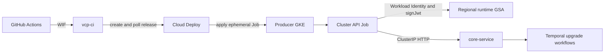
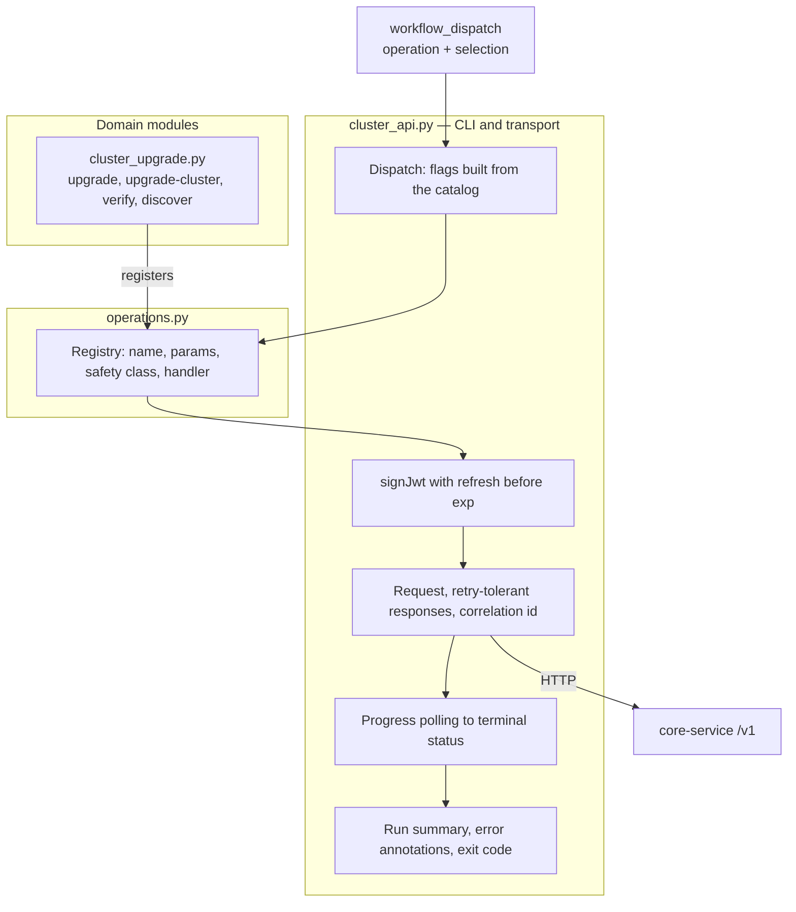
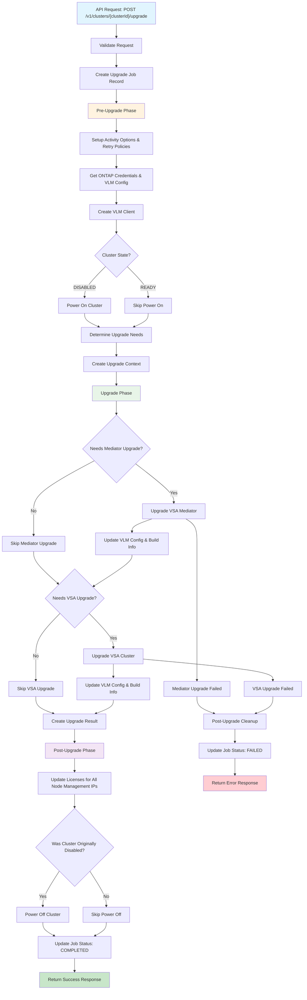
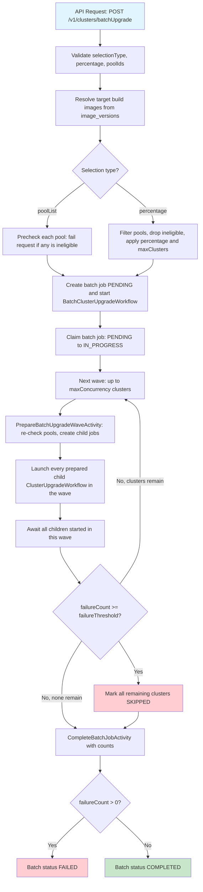
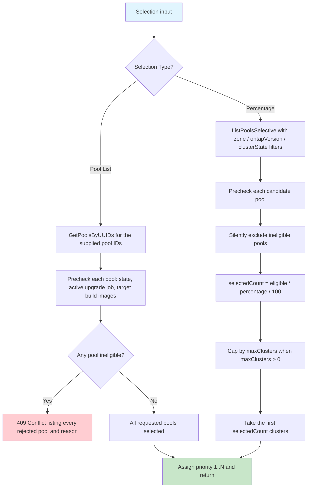
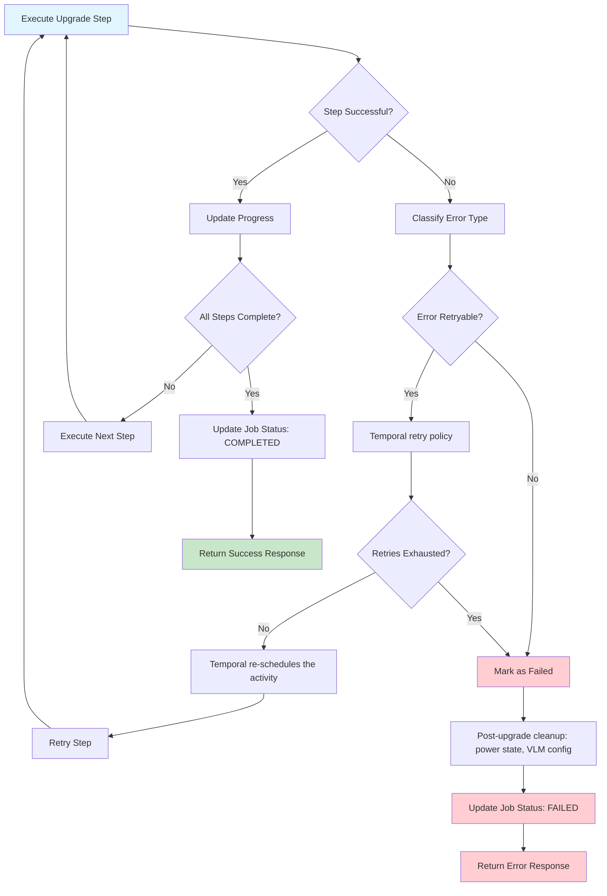
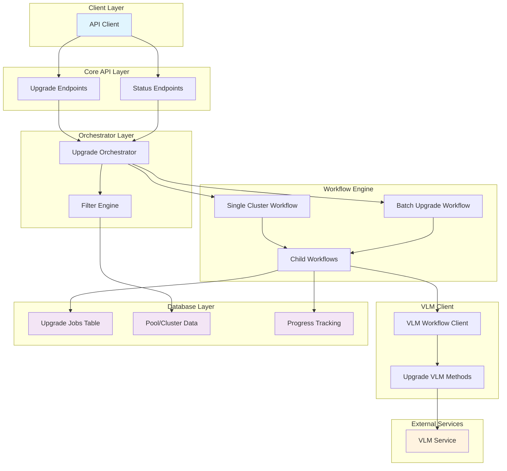
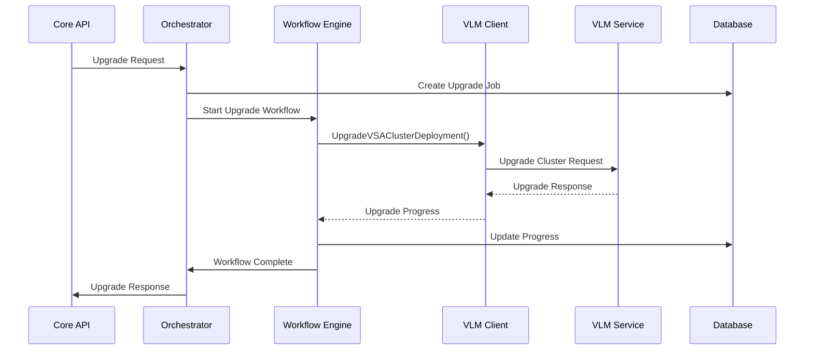

# VSA Cluster Upgrade Workflow Design

## Overview

This document outlines the design for implementing VSA cluster upgrade workflows in the VCP (VSA Control Plane). The upgrade workflow supports both single cluster upgrades and batch upgrades with various filtering and selection criteria.

## Current Implementation Status

### ✅ **Phase 1: Single Cluster Upgrade - COMPLETED**

The single cluster upgrade functionality has been implemented with a three-phase architecture and includes:

#### **Key Features Implemented:**
- **Three-Phase Architecture**: Pre-upgrade, upgrade, and post-upgrade phases for better separation of concerns
- **Build Image-Based Upgrades**: Uses VSA and mediator build images for precise upgrade decisions
- **Incremental Progress Updates**: Updates build info and VLM config after each successful upgrade step
- **Selective Component Upgrades**: Only upgrades VSA or mediator components that don't match target build images
- **Force Upgrade Support**: Allows arbitrary build image combinations with proper validation
- **Disabled Cluster Support**: Automatic power on/off management for disabled clusters
- **License Update Integration**: Updates licenses for all node management IPs after upgrades
- **Enhanced Error Handling**: Phase-specific error handling with cleanup on failure
- **Soft Delete for Jobs**: Completed upgrade jobs are soft-deleted but remain visible in status queries
- **Comprehensive Error Handling**: Detailed error responses and retry logic
- **Version Management**: Database-driven version management with environment variable fallback

#### **API Endpoints Available:**
- `POST /v1/clusters/{clusterId}/upgrade` - Single cluster upgrade
- `GET /v1/clusters/upgrade/{jobId}` - Get upgrade status
- `GET /v1/imageVersions` - List available image versions

#### **Database Schema:**
- `cluster_upgrade_jobs` table for tracking upgrade jobs
- `image_versions` table for supported build image combinations
- `pools.build_info` JSONB column for tracking current build images

### ✅ **Phase 2: Batch Cluster Upgrade - COMPLETED**

Batch upgrade builds on the single cluster foundation: the parent batch workflow selects clusters and drives one child `ClusterUpgradeWorkflow` per cluster.

#### **Key Features Implemented:**
- **Selection Modes**: `percentage` of eligible clusters, or an explicit `poolList`
- **Pre-Selection Prechecks**: Every candidate pool is validated (pool state, no active upgrade job, target build images differ) before the batch job is created. `poolList` fails the whole request with `409` if any pool is ineligible; percentage selection silently excludes ineligible pools
- **Wave-Based Concurrency**: Clusters are processed in waves of `maxConcurrency` (default 5). All children in a wave are launched before any child is awaited
- **Failure Threshold**: `failureThreshold` (default `0` = no limit) aborts the *remaining* waves once the cumulative failure count reaches the threshold. Clusters that were never started are recorded as skipped
- **Deterministic Child Job IDs**: Child job UUIDs are derived from batch ID + cluster ID, so Temporal replays and activity retries never create duplicate child jobs
- **Detached Children**: Children run with `PARENT_CLOSE_POLICY_ABANDON`, so an aborted or failed batch never kills an in-flight cluster upgrade
- **Atomic Job Claim**: `PENDING` → `IN_PROGRESS` is a single conditional `UPDATE`, which makes the status activity idempotent across activity retries
- **Pickup Timeout Supervisor**: Upgrade jobs still `PENDING` beyond `UPGRADE_JOB_PICKUP_TIMEOUT` are failed with error code `UPGRADE_PICKUP_TIMEOUT`
- **Aggregated Progress**: Batch status reports per-child cluster status plus batch-level error details and a warning when clusters were skipped

#### **API Endpoints Available:**
- `POST /v1/clusters/batchUpgrade` - Batch cluster upgrade
- `GET /v1/clusters/batchUpgrade/{batchUpgradeId}` - Get batch upgrade status

#### **Database Schema:**
- `batch_cluster_upgrade_jobs` table for batch-level tracking (counts, concurrency, failure threshold, selection data)
- `cluster_upgrade_jobs.batch_upgrade_id` links each child job to its batch

### Important Note: Cluster ID and Pool UUID

In the VCP system, **Cluster ID is the same as Pool UUID**. This means:
- When referring to a cluster in the context of upgrades, we use the pool's UUID
- The API endpoints use `{clusterId}` as the path parameter, which maps to the pool UUID
- All database references use the pool UUID as the cluster identifier
- This maintains consistency with the existing VCP data model where pools represent VSA clusters

## Table of Contents

1. [Architecture Overview](#architecture-overview)
2. [API Design](#api-design)
3. [Data Models](#data-models)
4. [Version Management](#version-management)
5. [VLM Worker Selection](#vlm-worker-selection)
6. [Workflow Design](#workflow-design)
7. [Filtering and Selection Logic](#filtering-and-selection-logic)
8. [Batch Processing](#batch-processing)
9. [Upgrade Job Lifecycle](#upgrade-job-lifecycle)
10. [Handling Disabled Clusters](#handling-disabled-clusters)
11. [License Updates](#license-updates)
12. [Error Handling and Rollback](#error-handling-and-rollback)
13. [Operational Automation](#operational-automation)
14. [Implementation Plan](#implementation-plan)

## Architecture Overview

The VSA cluster upgrade workflow follows the existing VCP architecture patterns:

```
Core API → Orchestrator → Workflow Engine → VLM Client → VLM Service
    ↓           ↓              ↓              ↓
Database ← Activities ← Child Workflows ← VLM Workflows
```

### Key Components

1. **Core API Layer**: REST endpoints for upgrade operations
2. **Orchestrator Layer**: Business logic and workflow coordination
3. **Workflow Engine**: Temporal-based workflow execution
4. **VLM Client**: Interface to VLM service for cluster operations
5. **Database Layer**: Persistent storage for upgrade state and metadata

## Operational Automation

The upgrade engine remains in VCP. GitHub Actions is only the authenticated
kickoff and status surface; it does not connect to a producer GKE control plane
and does not port-forward `core-service`.



### Operation catalog

The automation is a generic authenticated client for core-api, not an
upgrade-only script. Upgrade is one entry in a catalog, so the same auth,
polling, reporting and safety behaviour applies to any operation SRE needs to
run against a producer project.



Layers:

| Layer | Location | Responsibility |
|---|---|---|
| CLI and transport | `automations/cluster-api/scripts/cluster_api.py` | Dispatch plus producer resolution from the environment catalog, JWT minting with pre-expiry refresh, request execution, progress polling, run summary and exit codes |
| Catalog | `automations/cluster-api/scripts/operations.py` | Registry, shared helpers, and image ops until they get a dedicated module |
| Upgrade module | `automations/cluster-api/scripts/cluster_upgrade.py` | `upgrade`, `upgrade-cluster`, `verify`, `discover` |
| Dispatch surface | `.github/workflows/vsa-cluster-api.yaml` | Maps the ten allowed dispatch inputs onto the selected operation's flags |

The initial catalog covers the runbook's four steps plus two retained helpers:

| Operation | Safety | Core API |
|---|---|---|
| `list-images` | read | `GET /health`, `GET /v1/imageVersions` |
| `verify` | read | `GET /v1/imageVersions`, plus the progress endpoint for a supplied id |
| `discover` | read | VCP Postgres (no core-api); pool inventory for an explicit `poolList` |
| `register-image` | mutate | `POST /v1/imageVersions`, skipped when the version is already registered |
| `upgrade` | mutate | `POST /v1/clusters/batchUpgrade`, then polls to a terminal status |
| `upgrade-cluster` | mutate | `POST /v1/clusters/{clusterId}/upgrade`, then polls to a terminal status |

Safety classes are enforced by the entry points rather than being descriptive.
A `read` operation runs unattended. A `mutate` operation honours a dry run that
prints the exact request body without sending it, and is refused where
`governance.require_change_ticket` is set (production) unless a change record is
supplied. The change record travels as request metadata alongside the
dispatching actor, and the GitHub run id is sent as `x-correlation-id` so a
rollout is traceable in VCP logs. `destructive` is reserved and unused; nothing
in the catalog deletes an image version or cancels a workflow.

Extending the catalog means adding a domain module (upgrade work stays in
`cluster_upgrade.py`) that registers one decorated handler; the CLI loads that
module and derives flags from the declared parameters. Only the workflow's
operation list needs a corresponding entry. Candidate additions are pool
inventory (`GET /v1/pools`), host and address-range reads, and image
deactivation, which would be the first `destructive` entry.

Two constraints shape what `verify` can assert. `UpgradeProgress_v1` exposes
`clusterId`, `status` and `currentStep` only, so per-pool ONTAP version
confirmation is not available from core-api and remains an ONTAP-side check
that the automation reports rather than performs. Batch selection filters
`ontapVersions` with SQL `IN` against `build_info->>'ontapVersion'`, not a
prefix match, so every source version must be listed exactly as stored
(`9.17.1P1`, not `9.17.1`).

Dispatch inputs are capped at ten by GitHub, so only per-run decisions are
dispatch fields: environment, project, operation, target ONTAP version, pool
list, percentage, concurrency, progress id, change ticket, and dry run.
Failure threshold, the percentage blast-radius cap, the poll budget, and the
producer GKE cluster are reviewed values in `config.<environment>.yaml`, which
also means a dispatch cannot widen them.

### Read-only Cloud Deploy POC

The first implementation uses delivery pipeline
`gcnv-vsa-cluster-api-stg-us-e4` in `netapp-us-e4-staging-sde`, region
`us-east4`, releases named `gcnv-release-<run>-<attempt>`, with a dedicated
standard GKE target for `netapp-us-e4-staging-sde/us-e4-gke-stg`. The target
uses that project's private `cloud-deploy-worker-pool`; the public default pool
cannot reach the private GKE API, and pools peered to other VPCs cannot route to
this cluster.

- Workflow:
  `.github/workflows/vsa-cluster-api-cloud-deploy-poc.yaml`
- Cloud Deploy source:
  `automations/cluster-api/cloud-deploy-poc/`
- The required `poc_image` dispatch input must be a BusyBox-compatible image
  admitted in us-e4 and pinned by `@sha256`.
- The ephemeral Job calls only `GET /health` and
  `GET /v1/imageVersions`. It never submits an upgrade.
- The POC KSA `vcp/cluster-api-poc` maps to the existing
  `otel-collector-sa@netapp-us-e4-staging-sde.iam.gserviceaccount.com`.
- Each release substitutes a unique Job name, has a five-minute execution
  deadline, no retries, and TTL cleanup.

The POC passes only when Cloud Deploy reports `SUCCEEDED`, the Job reaches
`core-service` by cluster DNS, self-signs a JWT through IAM Credentials, and
the authenticated image-version response is recognized. The JWT is never
logged.

### Production runtime identity

Productionization uses a keyless GSA in every producer project:

`cluster-api-sa@PROJECT_ID.iam.gserviceaccount.com`

It requires exactly these IAM relationships:

1. `roles/iam.serviceAccountTokenCreator` on itself, granted to itself, for
   `iam.serviceAccounts.signJwt`.
2. `roles/iam.workloadIdentityUser` on the GSA, granted to
   `serviceAccount:PROJECT_ID.svc.id.goog[vcp/cluster-api]`.
3. `roles/storage.objectViewer` for objects under
   `gs://vsa-reporting-bucket-prod-us-c1/vsa-cluster-upgrade/*`, preferably
   enforced with:
   `resource.name.startsWith("projects/_/buckets/vsa-reporting-bucket-prod-us-c1/objects/vsa-cluster-upgrade/")`.

Enable `iamcredentials.googleapis.com`, create no user-managed keys, and add
the GSA email to Core's `gcpAuthAcceptedServiceAccounts` before rolling Core.
Persist the service account and bindings in the IAM source of truth because
manual grants are removed by the IAM reconciler.

The runtime GSA needs no GKE role, Kubernetes RBAC, or port-forward
permission. Cloud Deploy applies the Job; the running pod calls
`http://core-service.vcp.svc.cluster.local:8080`. The GitHub WIF identity and
Cloud Deploy execution identity must not receive Token Creator on the runtime
GSA.

The customer project list is read from the generation-pinned object:

`gs://vsa-reporting-bucket-prod-us-c1/vsa-cluster-upgrade/unique-customer-projects.csv`

It has one exact header, `Customer_Projects`, and values are numeric GCP
project numbers treated as strings. The automation must fail closed for a
missing, stale, malformed, duplicate, or changed object.

### Approved batch execution

A successful read-only POC does not automatically submit an upgrade. Batch
execution is a separate, manually approved dispatch with these defaults:

- `selectionType=poolList` with explicit, unique pool UUIDs;
- `maxConcurrency=1` (stage maximum `2`);
- `failureThreshold=1`;
- `forceUpgrade=false`;
- one `x-correlation-id` and change ticket in request metadata;
- status polling every 30–60 seconds with JWT refresh and a bounded timeout.

The automation records `batchUpgradeId` and supports a status-only resume. It
does not automatically resubmit, retry failed pools, terminate Temporal
workflows, or edit database rows.

### Customer-scoped dispatch limitation

The intended dispatch scopes are `all`, `customers`, `non-customers`, and
`specific-customer-projects`. All must resolve to an explicit reviewed
`poolList`.

The current batch API cannot inventory eligible pools with their customer GCP
project number. Therefore `customers` and `non-customers` remain disabled
until a read-only candidate-inventory API exposes pool UUID, customer project
number, lifecycle state, current build/version, eligibility reason, and
active-upgrade state using the same precheck code as batch execution.
`specific-customer-projects` is allowed only with already reviewed pool UUIDs.

## API Design

### 1. Single Cluster Upgrade

```yaml
POST /v1/clusters/{clusterId}/upgrade
```

**Request Body:**
```json
{
  "vsaBuildImage": "vsa:9.17.1-build456",        // Optional: VSA build image to upgrade to (requires forceUpgrade=true)
  "mediatorBuildImage": "mediator:9.17.1-build456", // Optional: Mediator build image to upgrade to (requires forceUpgrade=true)
  "forceUpgrade": false,                          // Optional: Required when specifying build images, or when upgrade gap > 1
  "metadata": {                                   // Optional: Custom metadata for the upgrade
    "reason": "security-patch",
    "maintenance-window": "2024-01-15T02:00:00Z"
  }
}
```

**Response:**
```json
{
  "clusterId": "cluster-67890",
  "status": "IN_PROGRESS",
  "jobId": "job-abc123",
  "createdAt": "2024-01-15T02:00:00Z",
  "updatedAt": "2024-01-15T02:00:00Z"
}
```

### 2. Batch Cluster Upgrade

```yaml
POST /v1/clusters/batchUpgrade
```

**Request Body:**

Selection parameters are flat (there is no nested `selectionCriteria` object). `selectionType` is the only required field. The example below lists every field for reference; `percentage` and `poolIds` are mutually exclusive and only the one matching `selectionType` is read.

```json
{
  "selectionType": "percentage",                   // Required: "percentage" or "poolList"
  "percentage": 25,                                // Required when selectionType is "percentage" (1-100)
  "poolIds": ["pool-uuid-1", "pool-uuid-2"],       // Required when selectionType is "poolList" (must be unique UUIDs)
  "maxClusters": 100,                              // Optional: caps the selection; 0 (default) means no cap
  "maxConcurrency": 5,                             // Optional: clusters upgraded per wave; default 5
  "failureThreshold": 0,                           // Optional: failures that abort remaining waves; 0 (default) means no limit
  "vsaBuildImage": "vsa:9.17.1-build456",          // Optional: VSA build image to upgrade to (requires forceUpgrade=true)
  "mediatorBuildImage": "mediator:9.17.1-build456",// Optional: Mediator build image to upgrade to (requires forceUpgrade=true)
  "forceUpgrade": false,                           // Optional: Required when specifying build images, or when upgrade gap > 1
  "metadata": {                                    // Optional: Custom metadata for the batch upgrade
    "reason": "quarterly-upgrade"
  },
  "filters": {                                     // Optional: only applied to "percentage" selection
    "zones": ["us-central1-a", "us-central1-b"],
    "ontapVersions": ["9.17.1", "9.16.1"],
    "clusterStates": ["READY", "DISABLED"]
  }
}
```

**Response (`202 Accepted`):**
```json
{
  "batchUpgradeId": "b1f9c0d2-3c4e-4a5b-8c7d-9e0f1a2b3c4d",
  "totalClusters": 25,
  "selectedClusters": [
    {
      "clusterId": "cluster-1",
      "poolId": "pool-1",
      "currentVersion": "9.17.1",
      "priority": 1
    }
  ],
  "status": "PENDING",
  "jobId": "b1f9c0d2-3c4e-4a5b-8c7d-9e0f1a2b3c4d"
}
```

`batchUpgradeId` and `jobId` are the same UUID, which is also the Temporal workflow ID of the parent batch workflow.

**Error responses:**

| Status | Cause |
|---|---|
| `400` | Invalid `selectionType`, `percentage` outside 1-100, empty/malformed/duplicate `poolIds`, unresolvable target build images, or a selection that matched no eligible clusters |
| `409` | `poolList` selection where one or more pools failed prechecks (wrong state, active upgrade job, already at target build images) |

### 3. List Available Image Versions

```yaml
GET /v1/imageVersions
```

**Response:**
```json
{
  "versions": [
    {
      "ontapVersion": "9.17.1",
      "vsaImagePath": "/path/to/vsa:9.17.1-build456",
      "vsaName": "vsa:9.17.1-build456",
      "mediatorName": "mediator:9.17.1-build456",
      "isCurrent": true,
      "isActive": true
    },
    {
      "ontapVersion": "9.18.0",
      "vsaImagePath": "/path/to/vsa:9.18.0-build452",
      "vsaName": "vsa:9.18.0-build452",
      "mediatorName": "mediator:9.18.0-build452",
      "isCurrent": false,
      "isActive": true
    }
  ],
  "current": "9.17.1"
}
```

### 4. Upgrade Status and Progress

```yaml
GET /v1/clusters/upgrade/{jobId}
GET /v1/clusters/batchUpgrade/{batchUpgradeId}
```

Both endpoints return the same `UpgradeProgress` shape. For a single upgrade, `clusters` holds one entry; for a batch, it holds one entry per child upgrade job created so far. Clusters skipped because the failure threshold was reached never get a child job, so they appear only in the batch counters and in `warnings`.

**Response:**
```json
{
  "jobId": "b1f9c0d2-3c4e-4a5b-8c7d-9e0f1a2b3c4d",
  "status": "FAILED",
  "clusters": [
    {
      "clusterId": "cluster-1",
      "status": "COMPLETED",
      "startTime": "2024-01-15T02:00:00Z",
      "endTime": "2024-01-15T03:30:00Z"
    },
    {
      "clusterId": "cluster-2",
      "status": "FAILED",
      "startTime": "2024-01-15T02:30:00Z",
      "endTime": "2024-01-15T03:05:00Z"
    }
  ],
  "errors": [
    {
      "code": "BATCH_UPGRADE_PARTIAL",
      "message": "Batch upgrade aborted: failure threshold (1) reached. Succeeded: 1, Failed: 1, Skipped: 2",
      "type": "BATCH_UPGRADE_ERROR",
      "retryable": false
    }
  ],
  "warnings": ["Some clusters were skipped during batch upgrade"]
}
```

## Data Models

### 1. Upgrade Request Models

```go
// Single cluster upgrade request
type ClusterUpgradeRequest struct {
    ClusterID           string                 `json:"clusterId"`
    VSABuildImage       *string                `json:"vsaBuildImage,omitempty"`      // Optional: VSA build image to upgrade to (requires forceUpgrade=true)
    MediatorBuildImage  *string                `json:"mediatorBuildImage,omitempty"`  // Optional: Mediator build image to upgrade to (requires forceUpgrade=true)
    ForceUpgrade        bool                   `json:"forceUpgrade,omitempty"`        // Required when specifying build images, or when upgrade gap > 1
    Metadata            map[string]string      `json:"metadata,omitempty"`
}

// Batch cluster upgrade request, as passed from the endpoint to the orchestrator
// (core/orchestrator/common/params.go). Selection fields are flat: there is no
// nested selectionCriteria object.
type BatchUpgradeClusterParams struct {
    SelectionType      string            `json:"selectionType"`              // "percentage" or "poolList"
    Percentage         int               `json:"percentage,omitempty"`       // Required when type is "percentage"
    PoolIDs            []string          `json:"poolIds,omitempty"`          // Required when type is "poolList"
    MaxClusters        int               `json:"maxClusters,omitempty"`      // Maximum clusters to upgrade
    MaxConcurrency     int               `json:"maxConcurrency,omitempty"`   // Max parallel upgrades (default 5)
    FailureThreshold   int               `json:"failureThreshold,omitempty"` // Max failures before aborting (0 = no limit)
    VSABuildImage      string            `json:"vsaBuildImage,omitempty"`
    MediatorBuildImage string            `json:"mediatorBuildImage,omitempty"`
    ForceUpgrade       bool              `json:"forceUpgrade,omitempty"`
    Metadata           map[string]string `json:"metadata,omitempty"`
    Filters            *ClusterFilters   `json:"filters,omitempty"`
}

type SelectionType string
const (
    SelectionTypePercentage SelectionType = "percentage"
    SelectionTypePoolList   SelectionType = "poolList"
)

// Filters are applied to percentage selection only; poolList selection resolves
// the supplied pool UUIDs directly.
type ClusterFilters struct {
    Zones         []string `json:"zones,omitempty"`
    OntapVersions []string `json:"ontapVersions,omitempty"`
    ClusterStates []string `json:"clusterStates,omitempty"`
}

```

### 2. Upgrade Response Models

```go
// Single cluster upgrade response
type ClusterUpgradeResponse struct {
    ClusterID          string        `json:"clusterId"`
    Status             UpgradeStatus `json:"status"`
    JobID              string        `json:"jobId"`
    CreatedAt          time.Time     `json:"createdAt"`
    UpdatedAt          time.Time     `json:"updatedAt"`
}

// Batch cluster upgrade response
type BatchClusterUpgradeResponse struct {
    BatchUpgradeID     string              `json:"batchUpgradeId"`
    TotalClusters      int                 `json:"totalClusters"`
    SelectedClusters   []SelectedCluster   `json:"selectedClusters"`
    Status             UpgradeStatus       `json:"status"`
    JobID              string              `json:"jobId"`
    CreatedAt          time.Time           `json:"createdAt"`
    UpdatedAt          time.Time           `json:"updatedAt"`
}

type SelectedCluster struct {
    ClusterID      string `json:"clusterId"`
    PoolID         string `json:"poolId"`
    CurrentVersion string `json:"currentVersion"`
    Priority       int    `json:"priority"`
}

type UpgradeStatus string
const (
    UpgradeStatusPending     UpgradeStatus = "PENDING"
    UpgradeStatusInProgress  UpgradeStatus = "IN_PROGRESS"
    UpgradeStatusCompleted   UpgradeStatus = "COMPLETED"
    UpgradeStatusFailed      UpgradeStatus = "FAILED"
    UpgradeStatusCancelled   UpgradeStatus = "CANCELLED"
    UpgradeStatusRollingBack UpgradeStatus = "ROLLING_BACK"
)
```

### 3. Database Models

```go
// Upgrade job tracking
type ClusterUpgradeJob struct {
    BaseModel
    ClusterID          string                 `gorm:"column:cluster_id;index"`
    PoolID             string                 `gorm:"column:pool_id;index"`
    TargetVersion      string                 `gorm:"column:target_version"`
    CurrentVersion     string                 `gorm:"column:current_version"`
    VSABuildImage      string                 `gorm:"column:vsa_build_image"`
    MediatorBuildImage string                 `gorm:"column:mediator_build_image"`
    Status             string                 `gorm:"column:status"`
    ErrorDetails       *UpgradeErrorDetails   `gorm:"column:error_details;type:jsonb"`
    StartedAt          *time.Time             `gorm:"column:started_at"`
    CompletedAt        *time.Time             `gorm:"column:completed_at"`
    Metadata           *JSONB                 `gorm:"column:metadata;type:jsonb"`
    BatchUpgradeID     *string                `gorm:"column:batch_upgrade_id;index"`
    ForceUpgrade       bool                   `gorm:"column:force_upgrade;default:false"`
}

// Batch-level tracking. Child jobs are ClusterUpgradeJob rows whose
// BatchUpgradeID points at this batch.
type BatchClusterUpgradeJob struct {
    BaseModel
    TargetVersion    string               `gorm:"column:target_version"`
    VSABuildImage    string               `gorm:"column:vsa_build_image"`
    MediatorBuild    string               `gorm:"column:mediator_build_image"`
    Status           string               `gorm:"column:status"`
    TotalClusters    int                  `gorm:"column:total_clusters"`
    SucceededCount   int                  `gorm:"column:succeeded_count;default:0"`
    FailedCount      int                  `gorm:"column:failed_count;default:0"`
    SkippedCount     int                  `gorm:"column:skipped_count;default:0"`
    MaxConcurrency   int                  `gorm:"column:max_concurrency;default:5"`
    FailureThreshold int                  `gorm:"column:failure_threshold;default:0"`
    ForceUpgrade     bool                 `gorm:"column:force_upgrade;default:false"`
    SelectionType    string               `gorm:"column:selection_type"`
    SelectionData    *JSONB               `gorm:"column:selection_data;type:jsonb"`
    ErrorDetails     *UpgradeErrorDetails `gorm:"column:error_details;type:jsonb"`
    StartedAt        *time.Time           `gorm:"column:started_at"`
    CompletedAt      *time.Time           `gorm:"column:completed_at"`
    Metadata         *JSONB               `gorm:"column:metadata;type:jsonb"`
}

type UpgradeErrorDetails struct {
    ErrorCode    string            `json:"errorCode"`
    ErrorMessage string            `json:"errorMessage"`
    ErrorType    string            `json:"errorType"`
    Retryable    bool              `json:"retryable"`
    Details      map[string]string `json:"details"`
    StackTrace   string            `json:"stackTrace,omitempty"`
}
```

Both job tables use soft delete: reaching `COMPLETED` or `FAILED` sets `completed_at` and `deleted_at`, so finished jobs disappear from normal listings but remain readable by status queries (which use `Unscoped`).

### 4. Version Management Models

```go
// Image version for supported ONTAP versions
type ImageVersion struct {
    BaseModel
    OntapVersion      string `gorm:"column:ontap_version;uniqueIndex;not null" json:"ontapVersion"`
    VSAImagePath      string `gorm:"column:vsa_image_path;not null" json:"vsaImagePath"`
    MediatorImagePath string `gorm:"column:mediator_image_path;not null" json:"mediatorImagePath"`
    VSAName           string `gorm:"column:vsa_name;not null" json:"vsaName"`
    MediatorName      string `gorm:"column:mediator_name;not null" json:"mediatorName"`
    IsActive          bool   `gorm:"column:is_active;default:true" json:"isActive"`
}

// Available version for API responses
type AvailableVersion struct {
    OntapVersion      string `json:"ontapVersion"`
    VSAImagePath      string `json:"vsaImagePath"`
    MediatorImagePath string `json:"mediatorImagePath"`
    VSAName           string `json:"vsaName"`
    MediatorName      string `json:"mediatorName"`
    IsCurrent         bool   `json:"isCurrent"` // Computed field
    IsActive          bool   `json:"isActive"`
}

// Response for listing available versions
type ListAvailableVersionsResponse struct {
    Versions []AvailableVersion `json:"versions"`
    Current  string             `json:"current"` // From ONTAP_VERSION env var
}
```

## Build Information Management

### Pool Build Info

The VSA cluster upgrade system now tracks build information for each pool to enable precise upgrade decisions and progress tracking:

```go
// Pool build information stored as JSONB in pools table
type PoolBuildInfo struct {
    VSABuildImage      string     `json:"vsaBuildImage"`      // VSA build image used
    MediatorBuildImage string     `json:"mediatorBuildImage"` // Mediator build image used
    OntapVersion       string     `json:"ontapVersion"`       // ONTAP version
    BuildTimestamp     *time.Time `json:"buildTimestamp,omitempty"`
}
```

### Incremental Progress Updates

The upgrade workflow now updates both build information and VLM configuration after each successful upgrade step:

#### After Mediator Upgrade
- **Build Info**: Updates `MediatorBuildImage` and `OntapVersion`
- **VLM Config**: Updates with `mediatorUpgradeResponse.VLMConfig`
- **Preservation**: Maintains existing VSA build info

#### After VSA Upgrade
- **Build Info**: Updates `VSABuildImage` and `OntapVersion`
- **VLM Config**: Updates with `upgradeResponse.VLMConfig`
- **Preservation**: Maintains existing mediator build info

### Upgrade Decision Logic

The system now compares build images instead of ONTAP versions to determine if an upgrade is needed:

```go
// Check if mediator needs upgrade
if params.Pool.BuildInfo.MediatorBuildImage == params.MediatorImageName {
    needsMediatorUpgrade = false
}

// Check if VSA needs upgrade
if params.Pool.BuildInfo.VSABuildImage == params.VSAImageName {
    needsVSAUpgrade = false
}
```

## Version Selection Logic

### Target Build Image Handling

The upgrade workflow uses the following logic to determine the target build images:

#### Normal Upgrade (Default Behavior)
1. **VSA Build Image**: Use `VSA_IMAGE_NAME` from environment variable
2. **Mediator Build Image**: Use `VSA_MEDIATOR_IMAGE_NAME` from environment variable
3. **Target Version**: Get from `image_versions` table using environment VSA image
4. **Validation**: No build images required in request

#### Force Upgrade (Arbitrary Version)
1. **VSA Build Image**: Use `vsaBuildImage` from request
2. **Mediator Build Image**: Use `mediatorBuildImage` from request
3. **Validation**: Both build images must be provided and exact combination must exist in `image_versions` table
4. **Force Flag**: `forceUpgrade` must be `true` when specifying build images

```go
func determineTargetBuildImages(params *ClusterUpgradeParams) (string, string, string, string, error) {
    // Get VSA image from environment
    vsaImageFromEnv := env.GetString("VSA_IMAGE_NAME", "")
    
    // If VSA build is not sent in request, use environment VSA image
    if params.VSABuildImage == "" {
        // Find version details from image_versions table using environment VSA image
        imageVersions, err := se.ListImageVersions(ctx, true)
        if err != nil {
            return "", "", "", "", err
        }
        
        var targetVersion *datamodel.ImageVersion
        for i := range imageVersions {
            if imageVersions[i].VSAName == vsaImageFromEnv {
                targetVersion = imageVersions[i]
                break
            }
        }
        
        return targetVersion.OntapVersion, targetVersion.VSAImagePath, 
               targetVersion.VSAName, targetVersion.MediatorName, nil
    }
    
    // VSA build is sent in request - validate force flag
    if params.VSABuildImage != vsaImageFromEnv && !params.ForceUpgrade {
        return "", "", "", "", errors.New("Force flag must be true when specifying a VSA build image different from environment")
    }
    
    // Validate that both VSA and mediator build images are provided
    if params.VSABuildImage == "" || params.MediatorBuildImage == "" {
        return "", "", "", "", errors.New("Both VSA and mediator build images are required when specifying build images")
    }
    
    // Find the version details from image_versions table using specified combination
    imageVersions, err := se.ListImageVersions(ctx, true)
    if err != nil {
        return "", "", "", "", err
    }
    
    var targetVersion *datamodel.ImageVersion
    for i := range imageVersions {
        if imageVersions[i].VSAName == params.VSABuildImage && 
           imageVersions[i].MediatorName == params.MediatorBuildImage {
            targetVersion = imageVersions[i]
            break
        }
    }
    
    if targetVersion == nil {
        return "", "", "", "", errors.New("Specified VSA and mediator build image combination not found in available versions")
    }
    
    return targetVersion.OntapVersion, targetVersion.VSAImagePath, 
           targetVersion.VSAName, targetVersion.MediatorName, nil
}
```

This approach allows for:
- **Standard Upgrades**: Use VCP's configured build images for consistent upgrades
- **Force Upgrades**: Upgrade to any supported build image combination in the database
- **Build Validation**: Ensure only supported build image combinations can be used for force upgrades

### Already Upgraded Cluster Handling

The upgrade workflow includes logic to check if clusters are already upgraded to the target build images:

```go
func checkClusterUpgradeStatus(pool *datamodel.Pool, targetVSABuild, targetMediatorBuild string) (bool, bool, error) {
    if pool.BuildInfo == nil {
        return true, true, nil  // No build info means both need upgrade
    }
    
    needsVSAUpgrade := pool.BuildInfo.VSABuildImage != targetVSABuild
    needsMediatorUpgrade := pool.BuildInfo.MediatorBuildImage != targetMediatorBuild
    
    return needsVSAUpgrade, needsMediatorUpgrade, nil
}

func shouldSkipUpgrade(pool *datamodel.Pool, targetVSABuild, targetMediatorBuild string, forceUpgrade bool) (bool, error) {
    if forceUpgrade {
        return false, nil  // Force upgrade - don't skip
    }
    
    needsVSAUpgrade, needsMediatorUpgrade, err := checkClusterUpgradeStatus(pool, targetVSABuild, targetMediatorBuild)
    if err != nil {
        return false, err
    }
    
    // Skip if both components are already up to date
    return !needsVSAUpgrade && !needsMediatorUpgrade, nil
}
```

**Behavior:**
- **Normal Upgrade**: Skip clusters where both VSA and mediator are already at target build images
- **Force Upgrade**: Upgrade all clusters regardless of current build images (useful for re-running upgrades or testing)
- **Selective Upgrade**: Only upgrade components that are not matching (VSA or mediator)

## Workflow Charts

### 1. Single Cluster Upgrade Flow



### 2. Batch Cluster Upgrade Flow



**Wave and threshold semantics:**
- Waves are sized by `maxConcurrency`; there is **no configured delay between waves**.
- The failure count is cumulative across the whole batch, and the threshold is evaluated after wave preparation and again after each child result.
- The threshold aborts only the **remaining** waves. Children already launched in the current wave are always awaited to completion, so a batch with `maxConcurrency=5, failureThreshold=1` can still attempt five upgrades.
- `failureThreshold = 0` (the default) disables the abort entirely.
- Children run with `PARENT_CLOSE_POLICY_ABANDON`, so aborting the batch never cancels an in-flight cluster upgrade.

### 3. Cluster Selection and Filtering Flow



Notes:
- Filters apply to percentage selection only; `poolList` selection resolves the supplied UUIDs directly.
- Only `zones`, `ontapVersions`, and `clusterStates` are supported. There is no account or tag filtering, and no `createdAfter` / `createdBefore`.
- The percentage count uses integer division, but any non-zero percentage over a non-empty eligible set selects at least one cluster.
- Percentage selection first collects **all** candidates (percentage 100, no `maxClusters`), runs prechecks, and only then applies the requested percentage, so the percentage is taken over eligible clusters rather than over raw matches.

### 4. Error Handling and Retry Flow



### 5. System Architecture Overview



### 6. VLM Client Integration Flow



## Version Management

### Overview

The VSA cluster upgrade system supports two types of version management based on build images:

1. **Normal Upgrades**: Clusters are upgraded using VCP's current build images from environment variables
2. **Force Upgrades**: Clusters can be upgraded to any supported build image combination using the `forceUpgrade` flag

### Version Sources

#### Current VCP Build Images (Environment Variables)
- **VSA Image**: `VSA_IMAGE_NAME` environment variable
- **Mediator Image**: `VSA_MEDIATOR_IMAGE_NAME` environment variable
- **Usage**: Default target for normal upgrades
- **Storage**: Not stored in database, retrieved at runtime

#### Supported Build Image Combinations (Database)
- **Source**: `image_versions` database table
- **Usage**: Available build image combinations for force upgrades
- **Images**: Stored in database with both image paths and names
- **Storage**: Persistent storage for previous/supported build image combinations

### Database Schema

```sql
CREATE TABLE image_versions (
    id SERIAL PRIMARY KEY,
    ontap_version VARCHAR(20) NOT NULL UNIQUE,
    vsa_image_path VARCHAR(255) NOT NULL,
    mediator_image_path VARCHAR(255) NOT NULL,
    vsa_name VARCHAR(100) NOT NULL,
    mediator_name VARCHAR(100) NOT NULL,
    is_active BOOLEAN DEFAULT true,
    created_at TIMESTAMP DEFAULT CURRENT_TIMESTAMP,
    updated_at TIMESTAMP DEFAULT CURRENT_TIMESTAMP
);

-- Indexes
CREATE INDEX idx_image_versions_ontap_version ON image_versions(ontap_version);
CREATE INDEX idx_image_versions_vsa_name ON image_versions(vsa_name);
CREATE INDEX idx_image_versions_mediator_name ON image_versions(mediator_name);
CREATE INDEX idx_image_versions_is_active ON image_versions(is_active);
```

### Version Resolution Logic

#### Normal Upgrade Flow
```go
// 1. Get VCP's current build images from environment
vsaImageFromEnv := env.GetString("VSA_IMAGE_NAME", "")
mediatorImageFromEnv := env.GetString("VSA_MEDIATOR_IMAGE_NAME", "")

// 2. Find version details from image_versions table using environment VSA image
imageVersions, err := se.ListImageVersions(ctx, true)
if err != nil {
    return "", "", "", "", err
}

var targetVersion *datamodel.ImageVersion
for i := range imageVersions {
    if imageVersions[i].VSAName == vsaImageFromEnv {
        targetVersion = imageVersions[i]
        break
    }
}

// 3. Use database values for target build images
targetOntapVersion := targetVersion.OntapVersion
vsaImagePath := targetVersion.VSAImagePath
vsaImageName := targetVersion.VSAName
mediatorImageName := targetVersion.MediatorName
```

#### Force Upgrade Flow
```go
// 1. Validate both VSA and mediator build images are provided
if params.VSABuildImage == "" || params.MediatorBuildImage == "" {
    return "", "", "", "", errors.New("Both VSA and mediator build images are required when specifying build images")
}

// 2. Find the version details from image_versions table using specified combination
imageVersions, err := se.ListImageVersions(ctx, true)
if err != nil {
    return "", "", "", "", err
}

var targetVersion *datamodel.ImageVersion
for i := range imageVersions {
    if imageVersions[i].VSAName == params.VSABuildImage && 
       imageVersions[i].MediatorName == params.MediatorBuildImage {
        targetVersion = imageVersions[i]
        break
    }
}

if targetVersion == nil {
    return "", "", "", "", errors.New("Specified VSA and mediator build image combination not found in available versions")
}

// 3. Use database values for target build images
targetOntapVersion := targetVersion.OntapVersion
vsaImagePath := targetVersion.VSAImagePath
vsaImageName := targetVersion.VSAName
mediatorImageName := targetVersion.MediatorName
```

### API Behavior

#### Normal Upgrade (Default)
```json
POST /v1/clusters/{clusterId}/upgrade
{
  "clusterId": "cluster-123"
  // Uses VCP's current build images from VSA_IMAGE_NAME and VSA_MEDIATOR_IMAGE_NAME env vars
}
```

#### Force Upgrade to Specific Build Images
```json
POST /v1/clusters/{clusterId}/upgrade
{
  "clusterId": "cluster-123",
  "vsaBuildImage": "vsa:9.18.0-build452",
  "mediatorBuildImage": "mediator:9.18.0-build452",
  "forceUpgrade": true
  // Upgrades to specified build images if combination exists in image_versions table
}
```

#### Invalid Force Upgrade
```json
POST /v1/clusters/{clusterId}/upgrade
{
  "clusterId": "cluster-123",
  "vsaBuildImage": "vsa:9.99.0-build999",
  "mediatorBuildImage": "mediator:9.99.0-build999",
  "forceUpgrade": true
  // Returns error: "Specified VSA and mediator build image combination not found in available versions"
}
```

#### Force Upgrade Without Build Images
```json
POST /v1/clusters/{clusterId}/upgrade
{
  "clusterId": "cluster-123",
  "forceUpgrade": true
  // Uses VCP's current build images but skips already upgraded check
}
```

### Migration Strategy

#### Database Migration Scripts
```sql
-- 0007_create_image_versions_table.sql
-- 0008_insert_initial_image_versions.sql
-- 0009_add_build_info_to_pools.sql
-- 0010_add_image_names_to_image_versions.sql
-- 0011_add_build_images_to_cluster_upgrade_jobs.sql
```

#### Data Migration
```go
// Insert previous/supported build image combinations into database
// Current build images remain in environment variables
// Add build_info JSONB column to pools table for tracking current build images
// No need to migrate current build images to database
```

### Error Handling

#### Build Image Combination Not Found
- **Error Code**: `4001`
- **Message**: "Specified VSA and mediator build image combination not found in available versions"
- **Resolution**: Check available versions via the `/v1/imageVersions` endpoint

#### Missing Build Images
- **Error Code**: `4002`
- **Message**: "Both VSA and mediator build images are required when specifying build images"
- **Resolution**: Provide both VSA and mediator build images in the request

#### Force Flag Required
- **Error Code**: `4003`
- **Message**: "Force flag must be true when specifying a VSA build image different from environment"
- **Resolution**: Set `forceUpgrade: true` when specifying custom build images

#### Build Image Not Active
- **Error Code**: `4004`
- **Message**: "Requested build image combination is not active"
- **Resolution**: Contact administrator to activate the build image combination

## VLM Worker Selection

### Overview

The VSA cluster upgrade system uses VLM (VSA Lifecycle Manager) workers to perform the actual cluster upgrade operations. The system automatically selects the appropriate VLM worker based on the target ONTAP version for the upgrade.

### Worker Selection Logic

#### Current Version Upgrades (Normal Flow)
- **Target Version**: VCP's current version from `ONTAP_VERSION` environment variable
- **Worker Selection**: Uses the latest configured VLM worker for the current version
- **Task Queue**: `VSALifecycleManagerQueuePrefix + "-" + currentVersion`
- **Example**: If `ONTAP_VERSION=9.17.1`, uses `vsa-lifecycle-manager-9.17.1` queue

#### Force Upgrade (Arbitrary Version)
- **Target Version**: Requested version from `image_versions` database table
- **Worker Selection**: Uses the VLM worker configured for the specific target version
- **Task Queue**: `VSALifecycleManagerQueuePrefix + "-" + targetVersion`
- **Example**: If upgrading to `9.18.0`, uses `vsa-lifecycle-manager-9.18.0` queue

### Implementation Details

#### VLM Client Configuration
```go
// VLM client configuration for upgrade workflows
type VLMClientConfig struct {
    WorkflowName    string
    TaskQueue       string
    Timeout         time.Duration
    RetryPolicy     *temporal.RetryPolicy
}

// Get VLM client configuration for upgrade
func getVLMClientConfig(targetVersion string) *VLMClientConfig {
    return &VLMClientConfig{
        WorkflowName: "vlm.UpgradeVSAClusterDeploymentWorkflow",
        TaskQueue:    fmt.Sprintf("%s-%s", VSALifecycleManagerQueuePrefix, targetVersion),
        Timeout:      getUpgradeTimeout(targetVersion),
        RetryPolicy:  getUpgradeRetryPolicy(targetVersion),
    }
}
```

#### Worker Queue Resolution
```go
// Resolve VLM worker queue for upgrade
func resolveVLMWorkerQueue(targetVersion string) string {
    // For current version, use environment variable
    if targetVersion == env.GetString("ONTAP_VERSION", "9.17.1") {
        return VSALifecycleManagerQueuePrefix + "-" + targetVersion
    }
    
    // For force upgrade, validate version exists and use specific queue
    imageVersion, err := db.GetImageVersion(ctx, targetVersion)
    if err != nil {
        return "", err // Version not supported
    }
    
    return VSALifecycleManagerQueuePrefix + "-" + imageVersion.OntapVersion
}
```

### Worker Availability and Health Checks

#### Pre-Upgrade Validation
```go
// Validate VLM worker availability before starting upgrade
func validateVLMWorkerAvailability(targetVersion string) error {
    taskQueue := resolveVLMWorkerQueue(targetVersion)
    
    // Check if worker is available and healthy
    workerInfo, err := temporalClient.DescribeTaskQueue(ctx, taskQueue)
    if err != nil {
        return fmt.Errorf("VLM worker not available for version %s: %w", targetVersion, err)
    }
    
    // Check worker capacity and health
    if workerInfo.Pollers == nil || len(workerInfo.Pollers) == 0 {
        return fmt.Errorf("No active VLM workers for version %s", targetVersion)
    }
    
    return nil
}
```

#### Worker Selection Strategy
1. **Version-Specific Workers**: Each ONTAP version has its own VLM worker queue
2. **Load Balancing**: VLM handles load balancing across multiple workers in the same queue
3. **Health Monitoring**: System validates worker availability before starting upgrades
4. **Fallback Handling**: If specific version worker is unavailable, upgrade fails with clear error

### Configuration

#### Environment Variables
```bash
# VLM worker queue configuration
VSA_LIFECYCLE_MANAGER_QUEUE_PREFIX=vsa-lifecycle-manager

# Worker timeouts per version
VLM_WORKER_TIMEOUT_9_17_1=180m
VLM_WORKER_TIMEOUT_9_18_0=200m
VLM_WORKER_TIMEOUT_9_18_1=200m

# Worker retry configuration
VLM_WORKER_RETRY_MAX_ATTEMPTS=3
VLM_WORKER_RETRY_INITIAL_DELAY=1m
VLM_WORKER_RETRY_MAX_DELAY=10m
```

#### Dynamic Worker Registration
- **Auto-Discovery**: VLM workers automatically register with their version-specific queues
- **Version Validation**: Workers validate their ONTAP version compatibility before registration
- **Queue Management**: System manages multiple version-specific queues dynamically

### Error Handling

#### Worker Unavailable
- **Error Code**: `5001`
- **Message**: "VLM worker not available for requested version"
- **Resolution**: Check worker status or wait for worker to become available

#### Version Mismatch
- **Error Code**: `5002`
- **Message**: "VLM worker version mismatch"
- **Resolution**: Ensure correct worker version is deployed

#### Worker Overload
- **Error Code**: `5003`
- **Message**: "VLM worker overloaded, please retry later"
- **Resolution**: Implement exponential backoff and retry

### Monitoring and Observability

#### Metrics
- Worker availability per version
- Upgrade success/failure rates per worker
- Worker processing time and throughput
- Queue depth and processing latency

#### Logging
- Worker selection decisions
- Worker health check results
- Upgrade workflow execution per worker
- Error details and resolution steps

## Workflow Design

### 1. Single Cluster Upgrade Workflow - Implemented Architecture

The cluster upgrade workflow has been implemented with a clean three-phase architecture for better separation of concerns, improved error handling, and enhanced maintainability.

#### **Three-Phase Architecture**

```
┌─────────────────┐    ┌─────────────────┐    ┌─────────────────┐
│  Pre-Upgrade    │ -> │    Upgrade      │ -> │  Post-Upgrade   │
│     Phase       │    │     Phase       │    │     Phase       │
└─────────────────┘    └─────────────────┘    └─────────────────┘
```

#### **Enhanced Data Structures**

```go
// UpgradeContext holds the context and state for the upgrade process
type UpgradeContext struct {
    Params               *ClusterUpgradeWorkflowParams
    Pool                 *datamodel.Pool
    Credentials          *vlm.OntapCredentials
    CurrentVlmConfig     *vlm.VLMConfig
    VlmClient            vlm.VlmWorkflowClient
    ClusterWasDisabled   bool
    NeedsMediatorUpgrade bool
    NeedsVSAUpgrade      bool
}

// UpgradeResult holds the results of the upgrade process
type UpgradeResult struct {
    MediatorUpgradeResponse *vlm.UpdateMediatorResponse
    VSAUpgradeResponse      *vlm.UpgradeVSAClusterDeploymentResponse
    FinalVlmConfig          *vlm.VLMConfig
    Success                 bool
    Error                   error
}
```

#### **Main Workflow Implementation**

```go
// Main workflow for single cluster upgrade
func (wf *clusterUpgradeWorkflow) Run(ctx workflow.Context, args ...interface{}) (interface{}, *vsaerrors.CustomError) {
    params := args[0].(*ClusterUpgradeWorkflowParams)

    wf.Logger.Info("Starting cluster upgrade workflow", "jobID", params.JobID, "clusterID", params.ClusterID, "targetVersion", params.TargetVersion)

    // Pre-upgrade phase: Prepare cluster and determine upgrade needs
    upgradeContext, err := wf.preUpgradePhase(ctx, params)
    if err != nil {
        wf.Logger.Error("Pre-upgrade phase failed", "jobID", params.JobID, "clusterID", params.ClusterID, "error", err)
        return nil, err
    }

    // Upgrade phase: Perform mediator and VSA upgrades
    upgradeResult, err := wf.upgradePhase(ctx, upgradeContext)
    if err != nil {
        wf.Logger.Error("Upgrade phase failed", "jobID", params.JobID, "clusterID", params.ClusterID, "error", err)
        // Attempt post-upgrade cleanup even on failure
        cleanupErr := wf.postUpgradePhase(ctx, upgradeContext, upgradeResult, err)
        if cleanupErr != nil {
            wf.Logger.Error("Post-upgrade cleanup failed", "jobID", params.JobID, "clusterID", params.ClusterID, "error", cleanupErr)
        }
        return nil, err
    }

    // Post-upgrade phase: License update and power off
    err = wf.postUpgradePhase(ctx, upgradeContext, upgradeResult, nil)
    if err != nil {
        wf.Logger.Error("Post-upgrade phase failed", "jobID", params.JobID, "clusterID", params.ClusterID, "error", err)
        // Don't fail the workflow for post-upgrade issues, just log the error
    }

    wf.Logger.Info("Cluster upgrade workflow completed successfully", "jobID", params.JobID, "clusterID", params.ClusterID)
    return params, nil
}
```

#### **Phase 1: Pre-Upgrade Phase**

```go
// preUpgradePhase prepares the cluster for upgrade and determines what needs to be upgraded
func (wf *clusterUpgradeWorkflow) preUpgradePhase(ctx workflow.Context, params *ClusterUpgradeWorkflowParams) (*UpgradeContext, *vsaerrors.CustomError) {
    wf.Logger.Info("Starting pre-upgrade phase", "jobID", params.JobID, "clusterID", params.ClusterID)

    // Setup: Activity options, retry policies, timeouts
    // Authentication: Get ONTAP credentials
    // Configuration: Parse VLM config
    // Power Management: Power on cluster if disabled
    // Upgrade Analysis: Determine what needs upgrading (mediator/VSA)
    // Context Creation: Build UpgradeContext with all necessary data

    upgradeContext := &UpgradeContext{
        Params:               params,
        Pool:                 params.Pool,
        Credentials:          credentials,
        CurrentVlmConfig:     currentVlmConfig,
        VlmClient:            vlmClient,
        ClusterWasDisabled:   clusterWasDisabled,
        NeedsMediatorUpgrade: needsMediatorUpgrade,
        NeedsVSAUpgrade:      needsVSAUpgrade,
    }

    wf.Logger.Info("Pre-upgrade phase completed successfully", "jobID", params.JobID, "clusterID", params.ClusterID)
    return upgradeContext, nil
}
```

#### **Phase 2: Upgrade Phase**

```go
// upgradePhase performs the actual mediator and VSA upgrades
func (wf *clusterUpgradeWorkflow) upgradePhase(ctx workflow.Context, upgradeContext *UpgradeContext) (*UpgradeResult, *vsaerrors.CustomError) {
    wf.Logger.Info("Starting upgrade phase", "jobID", upgradeContext.Params.JobID, "clusterID", upgradeContext.Params.ClusterID)

    upgradeResult := &UpgradeResult{Success: false}

    // Step 1: Upgrade VSA Mediator if needed
    if upgradeContext.NeedsMediatorUpgrade {
        // Mediator upgrade logic
        // Update VLM config with response
        // Update build info and persist to database
    }

    // Step 2: Upgrade VSA Cluster Deployment if needed
    if upgradeContext.NeedsVSAUpgrade {
        // VSA cluster upgrade logic
        // Update VLM config with response
        // Update build info and persist to database
    }

    upgradeResult.FinalVlmConfig = upgradeContext.CurrentVlmConfig
    upgradeResult.Success = true

    wf.Logger.Info("Upgrade phase completed successfully", "jobID", upgradeContext.Params.JobID, "clusterID", upgradeContext.Params.ClusterID)
    return upgradeResult, nil
}
```

#### **Phase 3: Post-Upgrade Phase**

```go
// postUpgradePhase handles license updates and power off operations
func (wf *clusterUpgradeWorkflow) postUpgradePhase(ctx workflow.Context, upgradeContext *UpgradeContext, upgradeResult *UpgradeResult, upgradeError error) *vsaerrors.CustomError {
    wf.Logger.Info("Starting post-upgrade phase", "jobID", upgradeContext.Params.JobID, "clusterID", upgradeContext.Params.ClusterID)

    // Step 1: Update license if upgrade was successful
    if upgradeResult != nil && upgradeResult.Success {
        err := wf.updateLicenseIfNeeded(ctx, upgradeContext.Params, upgradeResult.FinalVlmConfig, upgradeContext.Credentials, upgradeContext.VlmClient)
        if err != nil {
            wf.Logger.Error("Failed to update license after upgrade", "error", err)
            // Don't fail the workflow for license update failure, just log the error
        }
    }

    // Step 2: Power off cluster if it was originally disabled
    if upgradeContext.ClusterWasDisabled {
        // Power off cluster logic
        // Handle power off failures gracefully
    }

    wf.Logger.Info("Post-upgrade phase completed", "jobID", upgradeContext.Params.JobID, "clusterID", upgradeContext.Params.ClusterID)
    return nil
}
```

#### **Key Benefits of the Implemented Architecture**

1. **Better Separation of Concerns**: Each phase has a single, clear responsibility
2. **Improved Error Handling**: Clear error boundaries between phases with cleanup on failure
3. **Enhanced Testability**: Each phase can be tested independently
4. **Better Logging & Monitoring**: Phase-specific logging with clear boundaries
5. **Future Extensibility**: Easy to add pre/post upgrade steps
6. **Rollback Capability**: Post-upgrade phase can handle rollback on failure

### 2. Batch Cluster Upgrade Workflow

Cluster selection and batch job creation happen in the orchestrator **before** the workflow starts. The workflow itself only drives waves of child upgrades. There is no dedicated batch child workflow: each cluster is upgraded by the same `ClusterUpgradeWorkflow` used for single upgrades.

```go
// core/orchestrator/workflows/batch_cluster_workflows.go
type BatchClusterUpgradeWorkflowParams struct {
    BatchJobID       string                   `json:"batchJobId"`
    SelectedClusters []models.SelectedCluster `json:"selectedClusters"`
    TargetVersion    string                   `json:"targetVersion"`
    VSAImagePath     string                   `json:"vsaImagePath"`
    VSAImageName     string                   `json:"vsaImageName"`
    MediatorName     string                   `json:"mediatorName"`
    ForceUpgrade     bool                     `json:"forceUpgrade"`
    MaxConcurrency   int                      `json:"maxConcurrency"`
    FailureThreshold int                      `json:"failureThreshold"`
    Metadata         map[string]string        `json:"metadata,omitempty"`
}

func BatchClusterUpgradeWorkflow(ctx workflow.Context, params *BatchClusterUpgradeWorkflowParams) error {
    // 1. UpdateBatchJobStatusActivity(IN_PROGRESS) — atomic PENDING -> IN_PROGRESS claim
    // 2. For each wave of MaxConcurrency clusters:
    //    a. PrepareBatchUpgradeWaveActivity — re-check pools and create child job rows
    //    b. ExecuteChildWorkflow(ClusterUpgradeWorkflow) for every prepared cluster
    //    c. Await every child started in the wave, tallying success/failure
    //    d. If FailureThreshold is reached, mark the remaining clusters skipped and stop
    // 3. CompleteBatchJobActivity(status, error, succeeded, failed, skipped)
    // Returns an error when failureCount > 0, so the batch workflow itself ends FAILED
}

// Stable across Temporal replays and activity retries for the same batch + cluster.
func generateChildUpgradeJobID(batchJobID, clusterID string) string {
    name := fmt.Sprintf("batch-cluster-upgrade:%s:%s", batchJobID, clusterID)
    return uuid.NewSHA1(uuid.NameSpaceOID, []byte(name)).String()
}
```

#### Batch Activities

| Activity | Responsibility |
|---|---|
| `UpdateBatchJobStatusActivity` | Status transitions on the batch job. `IN_PROGRESS` goes through the atomic claim; `COMPLETED` / `FAILED` set `completed_at` and `deleted_at` |
| `PrepareBatchUpgradeWaveActivity` | For one wave: loads pools, re-validates state and active upgrade jobs, and creates the child `cluster_upgrade_jobs` rows. Returns a per-cluster result carrying either the pool or an error string |
| `CompleteBatchJobActivity` | Persists final status plus `succeeded_count`, `failed_count`, `skipped_count`, and batch-level error details |

`PrepareBatchUpgradeWaveActivity` is idempotent: if a child job row already exists and matches the expected batch, cluster, and pool, it is treated as already prepared instead of a conflict.

`GetPoolForUpgradeActivity` and `CreateChildUpgradeJobActivity` also exist on `BatchClusterUpgradeActivity`, but the wave-based workflow no longer calls them — the wave activity loads pools and creates child jobs in one round trip, and passes the pool to the child workflow directly.

### 3. VLM Client Integration

```go
// Enhanced VLM client methods with license update support
type VlmWorkflowClient interface {
    // Existing methods...
    UpgradeVSAMediatorWorkflow(ctx workflow.Context, req UpdateMediatorRequest) (UpdateMediatorResponse, error)
    UpgradeVSAClusterDeploymentWorkflow(ctx workflow.Context, req UpdateVSAClusterDeploymentRequest) (UpgradeVSAClusterDeploymentResponse, error)
    UpdateLicenseWorkflow(ctx workflow.Context, req UpdateLicenseRequest) error
    ClusterPowerOp(ctx workflow.Context, req ClusterPowerOpReq) error
}

type UpdateMediatorRequest struct {
    VLMConfig        VLMConfig            `json:"vlm_config"`
    MediatorUpdate   MediatorUpdateConfig `json:"mediator_update"`
    OntapCredentials OntapCredentials     `json:"ontap_credentials"`
}

type UpdateMediatorResponse struct {
    VLMConfig VLMConfig `json:"vlmConfig"`
}

type UpdateVSAClusterDeploymentRequest struct {
    VLMConfig        VLMConfig            `json:"vlm_config"`
    OntapUpgrade     OntapUpgradeConfig   `json:"ontap_upgrade"`
    OntapCredentials OntapCredentials     `json:"ontap_credentials"`
}

type UpgradeVSAClusterDeploymentResponse struct {
    VLMConfig   VLMConfig `json:"vlmConfig"`
    OntapVersion string   `json:"ontapVersion"`
}

// New license update request/response types
type UpdateLicenseRequest struct {
    OntapLicense     OntapLicense     `json:"ontap_license"`
    OntapCredentials OntapCredentials `json:"ontap_credentials"`
    VSAManagementIP  string           `json:"vsa_management_ip"`
}

type OntapLicense struct {
    SecretUri []string `json:"secret_uri"`
}

// Power operation request type
type ClusterPowerOpReq struct {
    VLMConfig        VLMConfig        `json:"vlm_config"`
    OntapCredentials OntapCredentials `json:"ontap_credentials"`
    Operation        ClusterPowerOp   `json:"operation"`
}

type ClusterPowerOp string

const (
    ClusterPowerOn  ClusterPowerOp = "power_on"
    ClusterPowerOff ClusterPowerOp = "power_off"
)
```

## Filtering and Selection Logic

Selection lives in `core/orchestrator/factory/common/cluster_selection.go` (candidate gathering) and `core/orchestrator/factory/gcp/batch_cluster_upgrade.go` (prechecks and final percentage).

### 1. Cluster Filtering

Three filters are supported, translated into database filter conditions:

```go
func buildClusterFilter(filters *commonparams.ClusterFilters) *dbutils.Filter {
    if filters == nil {
        return dbutils.CreateFilterWithConditions()
    }

    var conditions []*dbutils.FilterCondition

    if len(filters.Zones) > 0 {
        conditions = append(conditions, dbutils.NewFilterCondition("zone", "IN", filters.Zones))
    }
    if len(filters.OntapVersions) > 0 {
        conditions = append(conditions, dbutils.NewFilterCondition("build_info->>'ontapVersion'", "IN", filters.OntapVersions))
    }
    if len(filters.ClusterStates) > 0 {
        conditions = append(conditions, dbutils.NewFilterCondition("state", "IN", filters.ClusterStates))
    }

    return dbutils.CreateFilterWithConditions(conditions...)
}
```

Filters are only consulted for percentage selection. Regardless of the `clusterStates` filter, only pools in `READY` or `DISABLED` are ever eligible (`IsPoolStateEligibleForClusterUpgrade`).

### 2. Percentage-based Selection

Percentage selection runs in three steps so that the percentage is taken over *eligible* clusters:

1. **Gather candidates** — `selectByPercentage` is invoked with percentage 100 and no `maxClusters`. It applies the filters, keeps only `READY` / `DISABLED` pools, and sorts by `created_at` ascending for deterministic ordering.
2. **Precheck** — each candidate goes through `checkClusterUpgradePreconditions` (active upgrade job, build images already at target, force flag). Ineligible pools are logged and dropped.
3. **Apply percentage** — the requested percentage and `maxClusters` are applied to the surviving list:

```go
func applyPercentageSelection(clusters []models.SelectedCluster, percentage, maxClusters int) []models.SelectedCluster {
    selectedCount := (len(clusters) * percentage) / 100
    if selectedCount == 0 && percentage > 0 && len(clusters) > 0 {
        selectedCount = 1 // never select zero clusters for a non-zero percentage
    }
    if maxClusters > 0 && selectedCount > maxClusters {
        selectedCount = maxClusters
    }
    if selectedCount > len(clusters) {
        selectedCount = len(clusters)
    }
    return clusters[:selectedCount]
}
```

If no eligible clusters remain, the request fails with `400` and "No eligible clusters found matching the selection criteria".

### 3. Pool List Selection

Explicit pool selection is strict: it resolves the requested UUIDs with `GetPoolsByUUIDs` and prechecks each one, accumulating a reason per rejected pool. Any rejection fails the whole request with `409` and the combined reasons, so a `poolList` batch either upgrades every requested pool or starts nothing.

```go
for _, poolID := range params.PoolIDs {
    pool := poolsByUUID[poolID]
    if pool == nil {
        validationErrors = append(validationErrors, fmt.Sprintf("pool %s: not found", poolID))
        continue
    }
    precheck, err := checkClusterUpgradePreconditions(ctx, se, pool, targetBuildImages, params.ForceUpgrade)
    if err != nil {
        return nil, customerrors.NewUnavailableErr(...)
    }
    if precheck.Status != clusterUpgradePrecheckEligible {
        validationErrors = append(validationErrors, fmt.Sprintf("pool %s: %s", poolID, precheck.Reason))
        continue
    }
    selectedClusters = append(selectedClusters, selectedClusterFromPool(pool, len(selectedClusters)+1))
}

if len(validationErrors) > 0 {
    return nil, customerrors.NewConflictErr("Batch upgrade validation failed: " + strings.Join(validationErrors, "; "))
}
```

The endpoint validates pool IDs before this point: each must be a well-formed UUID with no surrounding whitespace, and duplicates are rejected with `400`.

## Batch Processing

**Note**: VCP handles all batching logic. VLM does not support batching and only processes single cluster upgrades.

### 1. Concurrency Control

Concurrency is expressed as **waves** inside the Temporal workflow, not goroutines. Every cluster in a wave is launched as a child workflow before any child is awaited, so a wave runs `maxConcurrency` upgrades in parallel and the next wave starts only after the current one drains.

```go
for batchStart := 0; batchStart < len(params.SelectedClusters) && !aborted; batchStart += params.MaxConcurrency {
    batchEnd := min(batchStart+params.MaxConcurrency, len(params.SelectedClusters))
    currentBatch := params.SelectedClusters[batchStart:batchEnd]

    // One activity prepares the whole wave: pools loaded, child job rows created.
    preparedClusters, prepareErr := prepareWave(ctx, params, currentBatch)

    // Launch every successfully prepared child before waiting on any of them.
    futures := make([]workflow.ChildWorkflowFuture, len(currentBatch))
    for i, prepared := range preparedClusters {
        if prepared.Error != "" || prepared.Pool == nil {
            failureCount++
            continue
        }
        childCtx := workflow.WithChildOptions(ctx, workflow.ChildWorkflowOptions{
            WorkflowID:        fmt.Sprintf("%s-child-%s", params.BatchJobID, currentBatch[i].ClusterID),
            ParentClosePolicy: enums.PARENT_CLOSE_POLICY_ABANDON,
        })
        futures[i] = workflow.ExecuteChildWorkflow(childCtx, ClusterUpgradeWorkflow, childParams)
    }

    if params.FailureThreshold > 0 && failureCount >= params.FailureThreshold {
        aborted = true
    }

    // Always drain every child that was started in this wave.
    for i, future := range futures {
        if future == nil {
            continue
        }
        if err := future.Get(ctx, nil); err != nil {
            failureCount++
            if params.FailureThreshold > 0 && failureCount >= params.FailureThreshold {
                aborted = true
            }
        } else {
            successCount++
        }
    }

    if aborted {
        // Every cluster after this wave is recorded as skipped.
        skippedCount += len(params.SelectedClusters) - batchEnd
    }
}
```

Preparation failures count as cluster failures: if the wave activity fails outright, or returns fewer results than clusters, every cluster in that wave is marked failed.

### 2. Failure Threshold

| Behaviour | Detail |
|---|---|
| Default | `0`, which disables early abort — the batch always attempts every selected cluster |
| Scope | Cumulative failures across the whole batch, not per wave |
| Evaluation points | After wave preparation, and after each child workflow result |
| Effect | Skips the **remaining** waves only; children already launched are still awaited |
| Terminal status | `FAILED`, with error message `Batch upgrade aborted: failure threshold (N) reached. Succeeded: X, Failed: Y, Skipped: Z` |
| Skipped clusters | Counted in `skipped_count` and surfaced as the warning `Some clusters were skipped during batch upgrade`. They never get a child job row, so they do not appear in the `clusters` array of the status response |

### 3. Progress Tracking

There is no polling timer inside the batch workflow. Progress is derived on read:

- The batch row carries the terminal tallies (`succeeded_count`, `failed_count`, `skipped_count`), written once by `CompleteBatchJobActivity`.
- `GET /v1/clusters/batchUpgrade/{batchUpgradeId}` joins the batch row with its child `cluster_upgrade_jobs` (`GetClusterUpgradeJobsByBatchID`, unscoped so completed children stay visible) and reports each child's status, start time, end time, and error details.
- Batch-level failures are reported as a single `BATCH_UPGRADE_PARTIAL` / `BATCH_UPGRADE_ERROR` entry alongside per-cluster errors.

## Upgrade Job Lifecycle

Both single and batch upgrade jobs follow `PENDING` → `IN_PROGRESS` → `COMPLETED` / `FAILED`. The orchestrator creates the row as `PENDING` and then starts the workflow, using the job UUID as the Temporal workflow ID.

### 1. Atomic PENDING → IN_PROGRESS Claim

The workflow's first status activity claims the job with a single conditional `UPDATE` rather than a read-modify-write. `TransitionPendingUpgradeJobToInProgress` (`database/vcp/upgrade_supervisor.go`) issues the following against `cluster_upgrade_jobs` or `batch_cluster_upgrade_jobs`, depending on job kind:

```sql
UPDATE <cluster_upgrade_jobs | batch_cluster_upgrade_jobs>
   SET status = 'IN_PROGRESS', started_at = ?, updated_at = ?, error_details = NULL, deleted_at = NULL
 WHERE uuid = ? AND status = 'PENDING'
```

- One row updated: the job is claimed.
- Zero rows updated but the job is already `IN_PROGRESS`: treated as a successful claim, so activity retries and workflow replays are idempotent and do not overwrite `started_at`.
- Otherwise (row missing, or already terminal): the activity fails with a **non-retryable** Temporal application error, because retrying cannot change the outcome.

`started_at` is therefore only ever set by this claim. Completion (`COMPLETED` / `FAILED`) is the only path that sets `completed_at` and `deleted_at`.

### 2. Pickup Timeout Supervisor

A job can sit in `PENDING` forever if the workflow was never picked up (no worker, lost task, Temporal outage). The workflow supervisor task runs `upgradeJobPickupSupervisor` on each pass to clean these up (`core/tasks/upgrade_job_supervisor.go`):

1. List jobs still `PENDING` with `started_at IS NULL` and `created_at <= now - UPGRADE_JOB_PICKUP_TIMEOUT`, oldest first and capped at 100 per scan to bound Temporal describe/terminate work. Batch child jobs are excluded (`batch_upgrade_id IS NULL`) because their lifecycle is owned by the parent batch workflow.
2. `DescribeWorkflowExecution` for the job UUID:
   - Temporal reports `NotFound` → the workflow is genuinely missing, proceed with cleanup.
   - Temporal reports `RUNNING` → proceed with cleanup and terminate the workflow afterwards.
   - Describe fails, or status is unspecified/incomplete → **defer**; the next pass retries. The supervisor never fails a job on ambiguous Temporal state.
3. In a short transaction, lock the row `FOR UPDATE` while it is still `PENDING` / unstarted, then set `status = FAILED`, `completed_at`, `deleted_at`, and error details `UPGRADE_PICKUP_TIMEOUT` / `UPGRADE_TIMEOUT` (`retryable: true`). For a batch job, `skipped_count` is set to `total_clusters`.
4. Terminate the Temporal workflow **outside** the transaction, so no row lock is held across an RPC. A terminate failure is logged but does not undo the `FAILED` marking.

If the job started between the scan and the locked re-check, the lock query matches nothing and the cleanup is abandoned, which lets the real workflow win the race.

## Handling Disabled Clusters

### Overview

This section outlines the implemented approach for handling upgrades of disabled VSA clusters. The functionality has been fully integrated into the three-phase upgrade architecture.

### Current Status

**Status**: ✅ **IMPLEMENTED**  
**Implementation**: Fully integrated into the pre/post upgrade workflow architecture  
**Features**: Power on/off management, license updates, comprehensive error handling

### Implemented Approach

#### Cluster State Detection and Power Management

The system automatically detects disabled clusters and handles power operations seamlessly:

```go
// Pre-upgrade phase: Power management for disabled clusters
func (wf *clusterUpgradeWorkflow) preUpgradePhase(ctx workflow.Context, params *ClusterUpgradeWorkflowParams) (*UpgradeContext, *vsaerrors.CustomError) {
    // Check if cluster is in DISABLED state (powered off)
    clusterWasDisabled := false
    if params.Pool.State == models.LifeCycleStateDisabled {
        wf.Logger.Info("Cluster is in DISABLED state, will power on before upgrade", "jobID", params.JobID, "clusterID", params.ClusterID)
        clusterWasDisabled = true
        
        // Power on the cluster
        powerOnRequest := &vlm.ClusterPowerOpReq{
            VLMConfig:        *currentVlmConfig,
            OntapCredentials: *credentials,
            Operation:        vlm.ClusterPowerOn,
        }
        
        err = vlmClient.ClusterPowerOp(ctx, powerOnRequest)
    if err != nil {
            wf.Logger.Error("Failed to power on cluster", "error", err)
            return nil, ConvertToVSAError(err)
        }
        
        wf.Logger.Info("Cluster powered on successfully")
    }
    
    // Continue with upgrade preparation...
}
```

#### Post-Upgrade Power Management

After successful upgrades, disabled clusters are automatically powered off:

```go
// Post-upgrade phase: Power off if originally disabled
func (wf *clusterUpgradeWorkflow) postUpgradePhase(ctx workflow.Context, upgradeContext *UpgradeContext, upgradeResult *UpgradeResult, upgradeError error) *vsaerrors.CustomError {
    // Power off cluster if it was originally disabled
    if upgradeContext.ClusterWasDisabled {
        wf.Logger.Info("Cluster was originally disabled, powering off after upgrade")
        
        powerOffRequest := &vlm.ClusterPowerOpReq{
            VLMConfig:        *upgradeResult.FinalVlmConfig,
            OntapCredentials: *upgradeContext.Credentials,
            Operation:        vlm.ClusterPowerOff,
        }
        
        err := upgradeContext.VlmClient.ClusterPowerOp(ctx, powerOffRequest)
        if err != nil {
            wf.Logger.Error("Failed to power off cluster after upgrade", "error", err)
            // Don't fail the workflow for power off failure, just log the error
        } else {
            wf.Logger.Info("Cluster powered off successfully after upgrade")
        }
    }
    
    return nil
}
```


### Workflow Flow for Disabled Clusters

```
1. Pre-Upgrade Phase
   ├── Detect cluster state (DISABLED?)
   ├── Power on cluster (if disabled)
   ├── Setup credentials & VLM config
   └── Determine upgrade needs

2. Upgrade Phase
   ├── Mediator upgrade (if needed)
   ├── VSA cluster upgrade (if needed)
   ├── Update VLM config & build info
   └── Persist changes to database

3. Post-Upgrade Phase
   ├── Power off cluster (if originally disabled)
   └── Handle cleanup operations
```

### Error Handling Strategy

- **Pre-upgrade failure**: Workflow fails immediately (no cluster modification)
- **Upgrade failure**: Post-upgrade cleanup still runs for power management
- **Post-upgrade failure**: Logged but doesn't fail the workflow
- **Power operation failures**: Non-blocking, logged for monitoring
- **License update failures**: Continue with other nodes, log errors

### Key Features Implemented

1. **Automatic State Detection**: Detects disabled clusters automatically
2. **Seamless Power Management**: Powers on before upgrade, powers off after
3. **Robust Error Handling**: Graceful handling of power operation failures
4. **State Preservation**: Maintains original cluster state after upgrade
5. **Enhanced Logging**: Detailed logging for all power operations

### Configuration

The disabled cluster upgrade functionality is automatically enabled and requires no additional configuration. The system uses existing VLM client methods for power operations and license updates.

### Monitoring and Observability

- **Power Operation Logs**: Detailed logging for all power on/off operations
- **License Update Tracking**: Logs for each node management IP license update
- **State Transition Tracking**: Clear visibility into cluster state changes
- **Error Monitoring**: Comprehensive error logging for troubleshooting

#### Feature Flags
```bash
# Disabled cluster upgrade feature flags
DISABLED_CLUSTER_UPGRADE_ENABLED=true
HRE_INTEGRATION_ENABLED=true
AUTOMATED_RECOVERY_ENABLED=false
```

### Error Handling (Planned)

#### Disabled Cluster Specific Errors
- **Error Code**: `6001`
- **Message**: "Cluster is disabled and cannot be upgraded"
- **Resolution**: Enable cluster first or use force upgrade flag

#### HRE Integration Errors
- **Error Code**: `6002`
- **Message**: "HRE service unavailable for cluster state management"
- **Resolution**: Check HRE service status and retry

#### Recovery Failures
- **Error Code**: `6003`
- **Message**: "Failed to recover cluster after upgrade"
- **Resolution**: Manual intervention required

### Monitoring and Observability (Planned)

#### Metrics
- Disabled cluster upgrade success/failure rates
- HRE integration response times
- Recovery operation success rates
- Cluster state transition times

#### Logging
- Disabled cluster upgrade decisions
- HRE integration calls and responses
- Recovery operation details
- State transition events

### API Changes (Future)

#### Enhanced Request Models
```go
// Enhanced cluster upgrade request with disabled cluster support
type ClusterUpgradeRequest struct {
    ClusterID           string                 `json:"clusterId"`
    TargetOntapVersion  *string                `json:"targetOntapVersion,omitempty"`
    ForceUpgrade        bool                   `json:"forceUpgrade,omitempty"`
    AllowDisabledUpgrade bool                  `json:"allowDisabledUpgrade,omitempty"` // New field
    RecoveryOptions     *RecoveryOptions       `json:"recoveryOptions,omitempty"`      // New field
    Metadata            map[string]string      `json:"metadata,omitempty"`
}

type RecoveryOptions struct {
    AutoRecovery        bool   `json:"autoRecovery"`
    RecoveryTimeout     string `json:"recoveryTimeout,omitempty"`
    BackupBeforeUpgrade bool   `json:"backupBeforeUpgrade"`
}
```

#### New Endpoints (Future)
```yaml
# Validate disabled cluster for upgrade
POST /v1/clusters/{clusterId}/upgrade/validate

# Get cluster state and upgrade eligibility
GET /v1/clusters/{clusterId}/state

# Force enable cluster for upgrade
POST /v1/clusters/{clusterId}/enable
```

### Documentation Updates

#### User Guides (Future)
- Disabled cluster upgrade procedures
- HRE integration setup and configuration
- Recovery planning and execution
- Troubleshooting disabled cluster upgrades

#### API Documentation (Future)
- Enhanced API endpoints for disabled clusters
- HRE integration API specifications
- Error codes and resolution procedures
- Configuration and environment variables

### Testing Strategy (Future)

#### Unit Testing
- Disabled cluster validation logic
- HRE integration mocking
- State transition testing
- Error handling scenarios

#### Integration Testing
- End-to-end disabled cluster upgrade
- HRE service integration
- Recovery operation testing
- Performance and reliability testing

#### User Acceptance Testing
- Disabled cluster upgrade workflows
- HRE integration user experience
- Recovery operation procedures
- Error handling and resolution

---

**Note**: This section will be updated with detailed implementation plans once the HRE work is completed and integration requirements are finalized.

## License Updates

### Overview

This section outlines the implemented approach for handling ONTAP license updates after cluster upgrades. The functionality has been integrated into the post-upgrade phase of the three-phase upgrade architecture.

### Current Status

**Status**: ✅ **IMPLEMENTED**  
**Implementation**: Fully integrated into the post-upgrade phase  
**Features**: License updates for all node management IPs, comprehensive error handling

### Implemented Approach

#### License Update for All Node Management IPs

The system handles license updates for all node management IPs across all HA pairs after successful upgrades:

```go
// License update for all node management IPs
func (wf *clusterUpgradeWorkflow) updateLicenseIfNeeded(ctx workflow.Context, params *ClusterUpgradeWorkflowParams, currentVlmConfig *vlm.VLMConfig, credentials *vlm.OntapCredentials, vlmClient vlm.VlmWorkflowClient) error {
    // Get all node management IPs from HA pairs
    var nodeManagementIPs []string
    
    // Iterate through all HA pairs in the cloud config
    for haPairIndex, haPair := range currentVlmConfig.Cloud.HAPairs {
        // Get node management IP from VM1
        if nodeMgmtLIF, exists := haPair.VM1.SystemLIFs[vlm.LIFTypeNodeMgmt]; exists {
            nodeManagementIPs = append(nodeManagementIPs, nodeMgmtLIF.IP)
            wf.Logger.Info("Found VM1 node management IP", "haPairIndex", haPairIndex, "nodeMgmtIP", nodeMgmtLIF.IP)
        }
        
        // Get node management IP from VM2
        if nodeMgmtLIF, exists := haPair.VM2.SystemLIFs[vlm.LIFTypeNodeMgmt]; exists {
            nodeManagementIPs = append(nodeManagementIPs, nodeMgmtLIF.IP)
            wf.Logger.Info("Found VM2 node management IP", "haPairIndex", haPairIndex, "nodeMgmtIP", nodeMgmtLIF.IP)
        }
    }
    
    // Update license for each node management IP
    for _, nodeMgmtIP := range nodeManagementIPs {
        updateLicenseRequest := vlm.UpdateLicenseRequest{
            OntapLicense: vlm.OntapLicense{
                SecretUri: []string{}, // TODO: Get from environment variable
            },
            OntapCredentials: *credentials,
            VSAManagementIP:  nodeMgmtIP,
        }
        
        err := vlmClient.UpdateLicenseWorkflow(ctx, updateLicenseRequest)
        if err != nil {
            wf.Logger.Error("Failed to update license for node", "nodeMgmtIP", nodeMgmtIP, "error", err)
            // Continue with other nodes even if one fails
            continue
        }
        
        wf.Logger.Info("ONTAP license updated successfully for node", "nodeMgmtIP", nodeMgmtIP)
    }
    
    return nil
}
```

#### Integration with Post-Upgrade Phase

License updates are performed in the post-upgrade phase after successful upgrades:

```go
// Post-upgrade phase: License update and power off
func (wf *clusterUpgradeWorkflow) postUpgradePhase(ctx workflow.Context, upgradeContext *UpgradeContext, upgradeResult *UpgradeResult, upgradeError error) *vsaerrors.CustomError {
    // Step 1: Update license if upgrade was successful
    if upgradeResult != nil && upgradeResult.Success {
        err := wf.updateLicenseIfNeeded(ctx, upgradeContext.Params, upgradeResult.FinalVlmConfig, upgradeContext.Credentials, upgradeContext.VlmClient)
        if err != nil {
            wf.Logger.Error("Failed to update license after upgrade", "error", err)
            // Don't fail the workflow for license update failure, just log the error
        }
    }
    
    // Step 2: Power off cluster if it was originally disabled
    // ... power off logic ...
}
```

### Key Features Implemented

1. **Comprehensive Coverage**: Updates licenses for all node management IPs across all HA pairs
2. **Robust Error Handling**: Continues with other nodes even if one fails
3. **Non-Blocking Operations**: License update failures don't fail the entire workflow
4. **Detailed Logging**: Logs for each node management IP license update
5. **Integration with VLM**: Uses VLM client for license update operations

### Error Handling Strategy

- **License update failures**: Continue with other nodes, log errors
- **Non-blocking**: License update failures don't fail the workflow
- **Comprehensive logging**: Detailed error logging for troubleshooting

### Configuration

The license update functionality is automatically enabled and requires no additional configuration. The system uses existing VLM client methods for license update operations.

### Monitoring and Observability

- **License Update Tracking**: Logs for each node management IP license update
- **Error Monitoring**: Comprehensive error logging for troubleshooting
- **Success Tracking**: Clear visibility into successful license updates

## Error Handling and Rollback

### 1. Error Classification

```go
type UpgradeError struct {
    Code        string `json:"code"`
    Message     string `json:"message"`
    Type        ErrorType `json:"type"`
    Retryable   bool   `json:"retryable"`
    ClusterID   string `json:"clusterId"`
}

type ErrorType string
const (
    ErrorTypeValidation    ErrorType = "VALIDATION"
    ErrorTypeInfrastructure ErrorType = "INFRASTRUCTURE"
    ErrorTypeTimeout       ErrorType = "TIMEOUT"
    ErrorTypeVLMError      ErrorType = "VLM_ERROR"
    ErrorTypeDatabase      ErrorType = "DATABASE"
)
```

### 2. Retry Logic

Retries are delegated to Temporal activity options rather than hand-rolled loops:

```go
ao := workflow.ActivityOptions{
    StartToCloseTimeout: 60 * time.Second,
    RetryPolicy: &temporal.RetryPolicy{
        MaximumAttempts:        3,
        NonRetryableErrorTypes: []string{"PanicError"},
    },
}
statusCtx := workflow.WithActivityOptions(ctx, ao)
```

Activities opt out of retries by returning a non-retryable application error (`vsaerrors.WrapAsNonRetryableTemporalApplicationError`), which is what the job-claim path does when a job is missing or already terminal. Storage calls additionally retry transient database errors inside the retry-engine wrapper.

### 3. Batch Error Codes

Batch jobs record a single `UpgradeErrorDetails` entry, whose code identifies where the batch failed:

| Error code | Error type | Raised when |
|---|---|---|
| `BATCH_UPGRADE_FAILED` | `BATCH_UPGRADE_ERROR` | The Temporal workflow could not be started after the batch row was created |
| `BATCH_UPGRADE_PARTIAL` | `BATCH_UPGRADE_ERROR` | The batch finished with at least one failed cluster, including a failure-threshold abort |
| `UPGRADE_PICKUP_TIMEOUT` | `UPGRADE_TIMEOUT` | The job stayed `PENDING` past `UPGRADE_JOB_PICKUP_TIMEOUT` (marked `retryable: true`) |

Per-cluster failures stay on the child `cluster_upgrade_jobs` rows and are returned alongside the batch error in the status response.

### 4. Rollback Strategy

**Status**: 🚧 **Not implemented.** Neither single nor batch upgrades revert a cluster to its previous build images. The single-cluster post-upgrade phase performs cleanup (for example powering a disabled cluster back off) and the job is marked `FAILED`, but there is no restore step and no batch-level rollback. Recovery today is a new upgrade request, using `forceUpgrade` if the target build images need to be pinned.

## Implementation Plan

### Phase 1: Single Cluster Upgrade ✅ **COMPLETED**

#### ✅ Core Infrastructure (Completed)
1. **Database Models**: Created upgrade job tables and image_versions table with migrations
2. **API Models**: Defined request/response structures for single cluster and version management
3. **VLM Client**: Added upgrade methods to VLM client interface
4. **Version Management**: Implemented image version resolution logic (env vs database)
5. **Basic Workflow**: Implemented single cluster upgrade workflow

#### ✅ Single Cluster Implementation (Completed)
1. **Core API Endpoints**: Implemented single cluster upgrade endpoints and version listing
2. **Orchestrator Logic**: Added upgrade methods with force flag support
3. **Workflow Implementation**: Completed single cluster upgrade workflow with version resolution
4. **Version Selection**: Implemented normal vs force upgrade logic
5. **Error Handling**: Added version validation and error responses

#### ✅ Advanced Features (Completed)
1. **Build Information Management**: Added PoolBuildInfo JSONB column to track build images
2. **Incremental Updates**: Implemented build info and VLM config updates after each upgrade step
3. **Selective Upgrades**: Only upgrade components that don't match target build images
4. **Soft Delete**: Implemented soft delete for completed upgrade jobs
5. **API Refinement**: Updated API to use build images instead of ONTAP versions

#### ✅ Testing and Refinement (Completed)
1. **Unit Testing**: Comprehensive unit tests for single cluster upgrade
2. **Integration Testing**: End-to-end testing with VLM
3. **Error Handling**: Advanced error handling and retry logic
4. **Documentation**: Complete API documentation for single cluster upgrade

### Phase 2: Batch Cluster Upgrade

#### ✅ Filtering and Selection (Completed)
1. **Filter Engine**: Zone, ONTAP version, and cluster state filters for percentage selection
2. **Selection Algorithms**: Percentage and pool list selection with `maxClusters` cap
3. **Prechecks**: Per-pool eligibility validation shared with the single cluster path
4. **Version Management**: Target build image resolution reused from the single upgrade flow

#### ✅ Batch Processing (Completed)
1. **Batch Workflow**: `BatchClusterUpgradeWorkflow` driving child `ClusterUpgradeWorkflow` executions
2. **Concurrency Control**: Wave-based processing bounded by `maxConcurrency`
3. **Failure Threshold**: Cumulative failure count aborting the remaining waves
4. **API Endpoints**: `POST /v1/clusters/batchUpgrade` and `GET /v1/clusters/batchUpgrade/{batchUpgradeId}`
5. **Force Upgrade**: Arbitrary build image combinations supported in batch mode

#### ✅ Reliability (Completed)
1. **Idempotency**: Deterministic child job UUIDs and idempotent wave preparation
2. **Atomic Claim**: Conditional `PENDING` → `IN_PROGRESS` transition
3. **Pickup Timeout**: Supervisor cleanup for jobs never picked up by a worker
4. **Detached Children**: `PARENT_CLOSE_POLICY_ABANDON` so batch abort never cancels a running upgrade

#### 🚧 Not Implemented
1. **Batch Rollback**: There is no batch-level rollback; failed clusters are reported, not reverted
2. **Inter-Wave Delay**: Waves run back to back with no configurable pause
3. **Maintenance Windows / Scheduling**: Batch upgrades start immediately when requested

## Configuration

### Environment Variables

```bash
# VCP's current ONTAP version, used as the fallback current version for a pool
# with no build info
ONTAP_VERSION_DETAILS=9.17.1P2

# VSA and Mediator image names for the current version. VSA_IMAGE_NAME is the
# anchor for normal (non-force) upgrades: the target row in image_versions is the
# one whose vsa_name matches this value.
VSA_IMAGE_NAME=x-9-17-1x49-gcnv
VSA_MEDIATOR_IMAGE_NAME=cvo-mediator-x-9-17-1x49

# How long an upgrade job may stay PENDING before the workflow supervisor fails
# it with UPGRADE_PICKUP_TIMEOUT. Default 60s.
UPGRADE_JOB_PICKUP_TIMEOUT=60s
```

### Batch Defaults

Batch tuning is per-request, not per-environment. There are no batch environment variables; the defaults live in the OpenAPI schema and in the GCP orchestrator:

| Field | Default | Source | Meaning |
|---|---|---|---|
| `maxConcurrency` | `5` | `vcp-core/api.yaml`, `defaultMaxConcurrency` | Clusters upgraded per wave |
| `failureThreshold` | `0` | `vcp-core/api.yaml`, `defaultFailureThreshold` | Failures before the remaining waves are skipped; `0` disables the abort |
| `maxClusters` | `0` | `vcp-core/api.yaml` | Cap on selected clusters; `0` means no cap |
| `forceUpgrade` | `false` | `vcp-core/api.yaml` | Allow arbitrary build image combinations |

Because `failureThreshold` defaults to `0`, a caller that omits the field gets **no** early abort: the batch attempts every selected cluster. Set it explicitly to bound the blast radius.

### Retry Behaviour

Retries are configured in code, not by environment variables:
- Batch status and wave-preparation activities use a Temporal retry policy of 3 maximum attempts, with `PanicError` non-retryable.
- Job-claim failures for a missing or terminal job are raised as non-retryable application errors so Temporal stops immediately.

## Monitoring and Observability

### 1. Metrics
- Upgrade success/failure rates
- Average upgrade duration
- Batch processing efficiency
- Error rates by type and step

### 2. Logging
- Structured logging for all upgrade operations
- Correlation IDs for request tracing
- Step-by-step progress logging

### 3. Alerts
- Upgrade failure alerts
- Batch processing timeout alerts
- Failure-threshold aborts (batches ending with a non-zero `skipped_count`)
- Pickup timeouts (`UPGRADE_PICKUP_TIMEOUT`), which indicate worker or Temporal problems rather than upgrade problems
- High error rate alerts

## Security Considerations

1. **Authentication**: All upgrade operations require proper authentication
2. **Authorization**: Role-based access control for upgrade operations
3. **Audit Logging**: Complete audit trail of all upgrade operations
4. **Data Protection**: Sensitive data encryption during upgrade process
5. **Network Security**: Secure communication with VLM service

## Future Enhancements

1. **Scheduled Upgrades**: Support for scheduled maintenance windows
2. **Inter-Wave Delay**: Configurable pause between batch waves for staged rollouts
3. **Rollback**: Restore a cluster to its previous build images after a failed upgrade
4. **Blue-Green Deployments**: Zero-downtime upgrade strategies
5. **Canary Upgrades**: Gradual rollout of upgrades
6. **Upgrade Dependencies**: Handle inter-cluster dependencies
7. **Custom Upgrade Scripts**: Support for custom pre/post upgrade scripts
8. **Upgrade Validation**: Automated health checks and validation
9. **Multi-Cloud Support**: Extend to other cloud providers beyond GCP

---

This design provides a comprehensive foundation for implementing VSA cluster upgrade workflows that are scalable, reliable, and maintainable while following the existing VCP architecture patterns.
