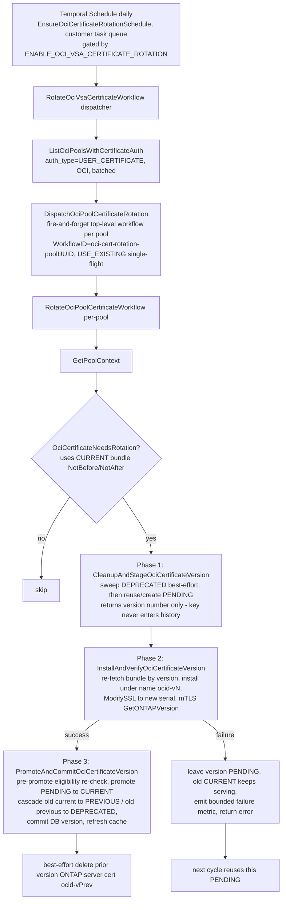

# OCI VSA Certificate Rotation

## Overview

This document describes the design for rotating the VCP-to-VSA (ONTAP) **server/client certificate** for **OCI** cert-auth pools (`auth_type = USER_CERTIFICATE`).

The certificate being rotated is the one minted during pool creation by the `CreateOnTapCredentialsForOCI` activity (`core/orchestrator/activities/pool_activities.go`), via `vsa.CreateCertificateForVSAClusterOCI` → `_createCertificateForVSAClusterOCI` (`core/vsa/provider_factory.go`). That cert is an **internally-managed** certificate issued by an OCI private CA (`env.OCIIssuerCAOCID`); OCI generates and holds the private key.

The OCI design reuses the cloud-agnostic parts of the existing GCP rotation flow (threshold logic, ONTAP install/SSL path, rollback shape) and drops the GCP-specific machinery that does not apply to OCI. Rotation is performed by creating a **new version of the existing certificate** using OCI's native `PENDING` → `CURRENT` staging, and old versions are **deleted** (not revoked) once OCI marks them `DEPRECATED`.

Two cleanup planes exist and are distinct:

- **OCI Vault versions** — `DEPRECATED` versions are schedule-deleted lazily at the start of each rotation (`sweepDeprecatedVersions`).
- **ONTAP server-certificate rows** — each rotation installs the new version on ONTAP under a *version-unique* name; the prior version's row is best-effort pruned after a successful promote (`cleanupPreviousOntapCertificateVersion`) so the ONTAP server-certificate table does not grow unbounded.

> **Note on scheduling/serialization (changed from the original GCP-parity sketch):** OCI production deploys **only a customer worker** (no background worker), so this flow does **not** use the GCP admin-background-job framework or the per-pool Control Workflow. Instead a **Temporal Schedule** (reconciled at startup, see `core/scheduler/ocischedules`) triggers a dispatcher workflow on the **customer task queue**, which fans out each pool's rotation as an **independent top-level workflow** (fire-and-forget). Single-flight per pool is provided by a deterministic workflow ID plus `WORKFLOW_ID_CONFLICT_POLICY_USE_EXISTING`, and a pre-promote eligibility re-check replaces the Control Workflow mutex.

### Scope

In scope:

- Rotate **only** the pool's `USER_CERTIFICATE` certificate created in `CreateOnTapCredentialsForOCI`.
- Rotation creates a **new version of the existing certificate** (same OCID, same name), not a new certificate resource.

Explicitly out of scope (and dropped relative to GCP):

- **No password/secret rotation.** OCI rotation does not touch the OCI Vault admin secret.
- **No expert-mode credential rotation.**
- **No private-key rotation by VCP.** OCI's internally-managed CA owns and rotates the key as part of the new version; VCP only reads the bundle.
- **No revoke.** Disposal is by deletion (`ScheduleCertificateVersionDeletion`) of `DEPRECATED` versions, not revocation. The matching ONTAP server-certificate row of the demoted version is best-effort deleted after promote.

---

## 1. Why OCI rotation differs from GCP

The core difference is the unit of rotation. On GCP we mint a brand-new certificate resource and swap identities; on OCI we mint a new **version** of the same certificate and use OCI's built-in version staging.

| Concern | GCP | OCI (this design) |
|---|---|---|
| Unit of rotation | New certificate resource (`{deployment}-cert-{timestamp}`) | New **version** of the same certificate (stable OCID + name) |
| Key management | VCP generates RSA key + CSR; key stored in Secret Manager | OCI internally-managed CA generates key + signs; **no VCP key handling** |
| Mint API | `CreateCertificate` (CAS) + `CreatePrivateKeyInSecretManager` (SM) | `UpdateCertificate` with `UpdateCertificateIssuedByInternalCaConfigDetails` |
| Staging | DB `certificate_id` ↔ `certificate_id_new` two-field swap | OCI-native `PENDING` → promote `CURRENT` (no DB swap) |
| Old-version handle | `certificate_id_new` (a separate cert resource) | OCI's own stage machine (`CURRENT`/`PREVIOUS`/`DEPRECATED`) — **no DB tracking needed** |
| Disposal | `RevokeCertificate` (revoke; cert lingers until natural expiry — GCP CAS cannot delete) | `ScheduleCertificateVersionDeletion` of `DEPRECATED` versions (true purge) |
| Password co-rotation | Always runs `RotatePoolPasswordWorkflow` after | Dropped |
| Expert-mode certs | `rotateExpertModeCertificate` (Step 7) | Dropped |

---

## 2. OCI version model (the rules this design is built on)

A certificate has multiple **versions**; each version carries one or more **rotation states** (`VersionStageEnum`): `CURRENT`, `PENDING`, `LATEST`, `PREVIOUS`, `DEPRECATED`, `FAILED`, `PENDING_ACTIVATION`. The behavior below is from OCI's documented rules and was verified against the SDK and OCI docs:

1. **`PENDING` staging exists for exactly our use case.** "Marking a certificate version's rotation state as `PENDING` lets you upload the certificate contents to the service without immediately putting the certificate version into active use. You can continue using the `CURRENT` version until you're ready to promote." (`UpdateCertificate` `Stage` = `CURRENT` | `PENDING`.)

2. **Promotion cascades the stages automatically.** When a version becomes `CURRENT`: the old `CURRENT` → `PREVIOUS`, and the old `PREVIOUS` → `DEPRECATED`.

3. **Only `DEPRECATED` versions can be deleted.** `ScheduleCertificateVersionDeletion` accepts only versions whose rotation state is `DEPRECATED`. You **cannot** schedule-delete a `CURRENT`, `PENDING`, `PREVIOUS`, or `FAILED` version.

4. **A `DEPRECATED` version requires `CURRENT` + `PREVIOUS` to also exist** → a certificate must reach **at least three versions** before any version becomes `DEPRECATED` (and therefore deletable). The first two rotations produce nothing deletable.

5. **A `PENDING` version never auto-cascades to `DEPRECATED`.** It stays `PENDING` indefinitely until promoted to `CURRENT`. Creating another `PENDING` version does **not** auto-deprecate an existing one. (This is why we **reuse** a leftover `PENDING` rather than orphaning it — see §4.)

6. **`FAILED` versions cannot be deleted individually.** Version deletion requires `DEPRECATED`; a `FAILED` version cannot be schedule-deleted and does not cascade. The "delete a failed resource after ~1 day" rule applies to a whole certificate **resource** in `FAILED` lifecycle state (`ScheduleCertificateDeletion`), not to a single `FAILED` version. `FAILED` versions are rare (OCI-side provisioning failure) and are handled by alerting (see §5 and §8.H).

---

## 3. Rotation flow



### Parts reused unchanged from the GCP design (cloud-agnostic)

1. Pool eligibility gate: skip `CREATING/DELETING/UPGRADING`; only states in `OCI_CERTIFICATE_ROTATION_POOL_STATES`; `auth_type == USER_CERTIFICATE`.
2. Threshold logic: rotate when `(now - NotBefore) >= threshold% * (NotAfter - NotBefore)`, or if expired/missing/no validity window. The active (`CURRENT`) version's bundle (`NotBefore`/`NotAfter`) is the source.
3. ONTAP install path: `provider.InstallServerCertificate` (REST) + `provider.ModifySSL` (SSH `security ssl modify`) in `core/vsa/security.go`.
4. Cert auth cache refresh.
5. Rotation retry policy: `PopulateRotationRetryPolicyParams` (per-activity `StartToCloseTimeout` 5m, `MaximumAttempts` 2).

### Parts intentionally diverged from the GCP design (OCI-specific)

1. **Scheduling.** No admin-background-job spec. A Temporal Schedule (`OciCertificateRotationScheduleID = "oci-vsa-certificate-rotation"`, cron from `OCI_CERTIFICATE_ROTATION_CRON_EXPRESSION`) is reconciled at process startup by `EnsureOciCertificateRotationSchedule` (`core/scheduler/ocischedules`, called from `oci-proxy/app.go`) and runs the dispatcher on the **customer task queue**, because OCI production has no background worker. Disabling the flag best-effort deletes the schedule.
2. **No Control Workflow.** The dispatcher fans out via `DispatchOciPoolCertificateRotation`, starting each pool's rotation as an **independent top-level workflow** (fire-and-forget). Per-pool concurrency is bounded by customer-worker capacity, not the batch size. Single-flight is provided by a deterministic `WorkflowID` (`oci-cert-rotation-<poolUUID>`) plus `WORKFLOW_ID_CONFLICT_POLICY_USE_EXISTING`. A `poolStillEligibleForPromote` re-check immediately before the promote (the point of no return) is the soft guard against racing a delete/upgrade.
3. **Three-phase activity split** (rather than one monolithic activity): `CleanupAndStageOciCertificateVersion` → `InstallAndVerifyOciCertificateVersion` → `PromoteAndCommitOciCertificateVersion`. Only the staged **version number** crosses the activity/workflow boundary; the bundle (which contains the OCI-held private key) is re-fetched by version inside each phase and never enters Temporal history.
4. **Version-unique ONTAP server-cert names** (`<ocid>-v<version>`) and a **best-effort ONTAP cleanup** of the prior version after promote — neither is needed on GCP (see §4 and §5).

---

## 4. Step-by-step (workflow `RotateOciPoolCertificateWorkflow` → 5 activities)

The per-pool workflow drives five sequential activities. The first two are pre-checks; the rotation itself is the three phases. On any phase failure the workflow emits a single bounded failure metric for that phase (see §8.H Observability) and returns the error.

| Activity / phase | Action | OCI / ONTAP primitive |
|---|---|---|
| **`GetPoolContext`** | Load the pool once into a `PoolContext` passed to later phases. | DB read |
| **`OciCertificateNeedsRotation`** | Gate from the `CURRENT` bundle; return early if not due, not eligible, or pool missing. | `GetCertificate(ocid)` → `NotBefore/NotAfter` |
| **Phase 1 — `CleanupAndStageOciCertificateVersion`** | (a) `sweepDeprecatedVersions`: list versions and schedule-delete every `DEPRECATED` version **not already queued** (skips versions whose `TimeOfDeletion` is set, to avoid redundant 409s). Best-effort; no-op for the first two rotations. (b) Reuse a healthy `ACTIVE` `PENDING` version or create a fresh one. **Returns only the version number** — the staged bundle (with the private key) is discarded here and re-fetched later, keeping key material out of Temporal history. | `ListCertificateVersions` + `ScheduleCertificateVersionDeletion`; then `RenewOciCertificateVersionForVSACluster` (reuse-or-create `UpdateCertificate` `Stage=PENDING`) + `WaitForCertificateActive` |
| **Phase 2 — `InstallAndVerifyOciCertificateVersion`** | Re-read the `PENDING` bundle by version (asserting it matches the staged number). Install on ONTAP under a **version-unique name** `<ocid>-v<version>` (`ontapServerCertName`); an ONTAP 409 "duplicate entry" on a Temporal retry is treated as an installed no-op. Point SSL at the new cert's **serial derived from the PEM** (OCI returns a decimal serial ONTAP rejects; the PEM serial matches ONTAP's stored value) and CA from `deriveCANameFromPEM`. Then verify via an mTLS round-trip using the staged bundle as VCP's client identity (with the OCI SNI override when `OCI_USE_TLS_SNI_OVERRIDE`). On failure the version is left `PENDING` (no re-mint) and the old `CURRENT` keeps serving. | `GetPendingOciCertificateResponse` + `InstallServerCertificate` (REST) + `ModifySSL` (SSH `security ssl modify`) + `GetONTAPVersion` |
| **Phase 3 — `PromoteAndCommitOciCertificateVersion`** | Capture the version being demoted from `CURRENT`. **Pre-promote eligibility re-check** (`poolStillEligibleForPromote`) — abort if the pool left an eligible state. Promote the `PENDING` version to `CURRENT` (OCI cascades old current → `PREVIOUS`, old previous → `DEPRECATED`), commit `ExternalCertificate.Version`, and refresh the cert-auth cache. Idempotent: if there is no `PENDING` version (a prior attempt already promoted) it just re-commits and invalidates the cache. **Finally**, best-effort delete the demoted version's ONTAP server cert `<ocid>-v<prev>` (`cleanupPreviousOntapCertificateVersion`). | `PromoteCertificateVersion` + DB update + cache refresh + `DeleteServerCertificate` (REST `SecurityCertificateDeleteCollection`) |

Notes:
- The OCID and `Name` never change — there is no DB identity swap.
- We track only the **active** version number in `ExternalCertificate.Version` (what's installed on ONTAP). OCI's stage machine is the source of truth for `PREVIOUS`/`DEPRECATED`; we do not track those in the DB.
- The `DEPRECATED` sweep runs at the **start** of the cycle so any versions left by previous rotations are swept before a new one is added — cleanup is therefore lazy / one cycle behind (see §5).
- ONTAP keys its server-certificate table by name and 409s on a duplicate; because OCI's OCID/name are stable across versions, every version is installed under the version-suffixed name so installs never collide and Temporal retries of the same version are idempotent.

---

## 5. Failure handling (the key design decision)

OCI mints every version identically (same internal CA, profile, key algorithm). Therefore a version that reached `ACTIVE` is essentially never "the bad part." Failures split cleanly:

| Symptom | Real cause | Behavior |
|---|---|---|
| Staged version is `ACTIVE`, but **install/verify on ONTAP fails** | **Our code / ONTAP config / SVM-name / network** — not the cert | **Leave the OCI version `PENDING`** (do not promote, do not re-mint), emit the bounded `install_verify` failure metric, and fail the activity. There is **no SSL rollback**: if install + `ModifySSL` already succeeded and only the mTLS verify failed, ONTAP is already serving the freshly-installed staged cert — which is a valid CA-signed cert, so TLS keeps working; only the OCI promote hasn't happened. The next cycle **reuses** this same `PENDING` version and retries. |
| Staged version is `FAILED` (OCI couldn't provision it) | Genuine OCI-side cert failure (rare) | Create a **fresh** `PENDING` version and proceed. The `FAILED` version can't be individually deleted (see §2.6); leave it. |
| OCI provisioning of the new version errors out before `ACTIVE` | Transient OCI / quota | Temporal activity retry; idempotent (reuse the in-flight/leftover `PENDING`). |

### Why no re-mint on install/verify failure

If the cert is healthy (`ACTIVE`) but won't install/verify on ONTAP, minting another cert cannot fix it — the fault is in our install code, ONTAP's trust/SSL config, SVM-name resolution, or the network. Re-minting would just churn versions while the real bug persists. The correct behavior is to **surface it loudly** and keep the existing live cert serving. Reusing the same `PENDING` on the next run (rather than orphaning it) means there is no version accumulation and no orphaned-`PENDING` cleanup problem (recall §2.5: `PENDING` versions can't be deleted and don't auto-deprecate).

### No outage while blocked, and a long runway

On failure ONTAP keeps serving a valid CA-signed cert — either the prior version (if install or `ModifySSL` failed before switching) or the freshly-installed staged version (if only the mTLS verify failed). Either way TLS stays up, so a blocked rotation is a *stalled* rotation, not an outage; what is deferred is only the OCI promote and the DB/cache cutover. Because rotation triggers at 75% of a ~1000-day cert lifetime (`OCI_CERTIFICATE_VALIDITY_DAYS`), the active cert still has roughly **~250 days** of validity left when rotation first fails — a wide window for a human to fix the root cause. Alerting must **escalate** as the active cert nears real expiry.

### `FAILED`-version accumulation

`FAILED` versions cannot be schedule-deleted (only `DEPRECATED` can). They are rare and are left in place. If they accumulate toward OCI's per-certificate version limit, that is an alert-and-investigate situation (OCI-side fault), resolved operationally (support request to raise limits, or recreate the certificate resource as a last resort) — not auto-resolved by rotation.

### Pre-promote eligibility re-check (no Control Workflow)

Because OCI rotations are independent top-level workflows rather than serialized through the pool Control Workflow, `PromoteAndCommitOciCertificateVersion` re-reads the pool's lifecycle state immediately before the promote — the point of no return — via `poolStillEligibleForPromote`. If the pool has since entered `CREATING/DELETING/UPGRADING` (or vanished), the promote is skipped and the verified version is left `PENDING` for the next cycle, avoiding a race with a concurrent lifecycle op. A transient read error does **not** block an already-verified certificate (it proceeds), since the staged version is already proven safe on ONTAP.

### ONTAP server-certificate cleanup (ordering & safety)

After a successful promote, `cleanupPreviousOntapCertificateVersion` best-effort deletes the **demoted** version's ONTAP server-certificate row (`<ocid>-v<prev>`). Unlike OCI Vault versions, ONTAP rows have no auto-expiry, so without this the server-certificate table grows by one row per rotation per SVM. The deletion is safe **because of ordering**, not luck:

1. **Phase 2** already installed the new version and `ModifySSL`-repointed the SVM's `security ssl` to the **new** serial, then proved it with an mTLS round-trip. So before cleanup runs, ONTAP is already presenting the new version in new TLS handshakes and the prior version's row is **unreferenced**.
2. **Phase 3** promotes/commits, then deletes the prior row. By then it is a dormant, unbound entry.

Resulting behavior and impact:

- **New connections** already use the new version. Because every version is issued by the **same OCI internal CA with the same chain**, the cutover is transparent to any client that trusts the CA — nothing is pinned to a specific serial.
- **Established TLS sessions** are not torn down by removing a stored row (TLS is per-connection); they continue until they close naturally.
- **Client-cert auth** (VCP presenting a cert to ONTAP) validates against the **trusted CA**, which is never deleted — so deleting a *server* row never breaks client authentication, even for a caller still holding the old bundle.
- **Built-in guard rail:** ONTAP refuses to delete a server certificate still bound to SSL. Since SSL was repointed to the new version in phase 2, the prior row is deletable; if for any reason it were still bound, the delete would error and be swallowed (this is best-effort).
- **Best-effort by design:** every failure path (no nodes, provider build, SVM-not-found → deployment-name retry, delete error) is logged and ignored. A cleanup miss can never fail a rotation that already succeeded; the orphaned row is simply retried on the next rotation.

This ordering guarantee (SSL on the new version before the old row is deleted) is the load-bearing reason the cleanup is safe.

### `DEPRECATED`-version cleanup is lazy (next-cycle only)

The `DEPRECATED` sweep (§4 Step 1) runs at the **start** of each rotation, *before* the new version is staged. It is therefore **lazy / one cycle behind**: a version that becomes `DEPRECATED` during rotation *N* (when the promote in rotation *N* cascades the old `PREVIOUS` → `DEPRECATED`) is not deleted then — it is purged at the **start of rotation *N+1***, the next time the sweep runs. There is no immediate, post-promote cleanup trigger.

- **Steady state is bounded and fine.** As long as rotations keep firing on schedule, the version count stabilizes at roughly **`CURRENT` + `PREVIOUS` + ~1 retained `DEPRECATED`** (the one awaiting the next cycle's sweep, plus any version still inside its `OCI_CERTIFICATE_DELETION_RETENTION_DAYS` window after being schedule-deleted). It never grows without bound; the laziness only adds a one-cycle delay, not a leak.
- **Edge case — rotation stops entirely.** Because cleanup is *driven by* rotation, if rotation ceases after a version has gone `DEPRECATED` — e.g. `ENABLE_OCI_VSA_CERTIFICATE_ROTATION` is disabled, or the pool leaves `OCI_CERTIFICATE_ROTATION_POOL_STATES` so it is no longer scanned — the sweep never runs again and the last `DEPRECATED` version is **never queued for deletion**. This is a bounded, single-version residue (not unbounded growth), but it persists indefinitely until rotation resumes.
- **`FAILED` versions linger regardless.** Per §2.6 / §5 above, `FAILED` versions can never be schedule-deleted individually, so they are unaffected by the sweep and also remain. Rare, but worth noting alongside the lazy-cleanup behavior.

This is acceptable by design — the residue is bounded and only surfaces when rotation is intentionally stopped — but it is a known limitation rather than a guarantee of zero leftover versions.

---

## 6. Configuration & feature gating

OCI gets its **own** env flags (separate from the GCP rotation flags) so OCI pools can be tuned and rolled out independently.

| Setting | Env var | Default | Meaning |
|---|---|---|---|
| Feature gate | `ENABLE_OCI_VSA_CERTIFICATE_ROTATION` | `false` | Master switch; also drives schedule create vs delete at startup |
| Rotation threshold | `OCI_CERTIFICATE_ROTATION_THRESHOLD_PERCENTAGE` | `75` | Rotate when ≥ this % of the active version's lifetime has elapsed (values > 1 are treated as a percentage and divided by 100) |
| Eligible pool states | `OCI_CERTIFICATE_ROTATION_POOL_STATES` | `READY,DEGRADED` | Which OCI pools are scanned |
| Batch size | `OCI_CERTIFICATE_ROTATION_BATCH_SIZE` | `10` | OCI pools per list page |
| Per-pool workflow timeout | `OCI_CERTIFICATE_ROTATION_CHILD_WORKFLOW_TIMEOUT_MINUTES` | `15` | `WorkflowRunTimeout` for each per-pool rotation |
| Schedule cadence | `OCI_CERTIFICATE_ROTATION_CRON_EXPRESSION` | `0 0 * * *` | Cron for the dispatcher's Temporal Schedule (daily, UTC) |
| TLS SNI override | `OCI_USE_TLS_SNI_OVERRIDE` | `true` | Connect-by-IP + synthetic SNI (`mgmt.<deployment>.<VsaDeployedDnsName>`) for the verify mTLS round-trip, matching pool-create |

**Per-pool workflow timeout vs. retry budget:** the run timeout must comfortably exceed a single phase's activity retry budget (`StartToCloseTimeout` 5m × `MaximumAttempts` 2 = 10m). Phase 1 alone can spend ~180s on two ~90s `WaitForCertificateActive` polls, so the default was raised from 5m to **15m** to clear the realistic worst case (waits + ONTAP round-trips + one phase retry). If the timeout is set below a single phase's budget the dispatcher logs a warning; a too-tight timeout is non-fatal because the next sweep idempotently reuses the `PENDING` version, but it makes rotations span multiple sweeps and shows noisy terminated runs in Temporal.

Reused existing OCI cert env vars (no new flag needed):

- `OCI_COMPARTMENT_OCID` (`env.OCICompartmentOCID`)
- `OCI_ISSUER_CA_OCID` (`env.OCIIssuerCAOCID`)
- `OCI_CERTIFICATE_VALIDITY_DAYS` (`env.OCICertificateValidityDays`, default 1000) — lifetime for the new version
- `OCI_CERTIFICATE_DELETION_RETENTION_DAYS` (`env.OCICertificateDeletionRetentionDays`, default 7) — retention window passed to `ScheduleCertificateVersionDeletion`

Env accessors follow the existing patterns in `utils/env/env.go` (`GetCertificateRotationThresholdPercentage`, `GetCertificateRotationPoolStates`), as OCI-named equivalents:

- `GetOCICertificateRotationThresholdPercentage() float64`
- `GetOCICertificateRotationPoolStates() []string`

---

## 7. Data model

**No new DB field is required.** OCI's version stage machine (`CURRENT`/`PREVIOUS`/`DEPRECATED`) is the source of truth for old-version disposal, so the `PreviousVersion` field considered in an earlier draft is **not** needed.

The existing `ExternalCredRef` (`database/datamodel/models.go`) is sufficient; rotation updates only `Version` to the newly-promoted active version:

```go
type ExternalCredRef struct {
	ExternalIdentifier string `json:"external_identifier"` // OCID (stable across rotations)
	Name               string `json:"name"`               // cert name (stable across rotations)
	Version            int64  `json:"version"`            // currently active (CURRENT) version installed on ONTAP
}
```

The OCID (`ExternalIdentifier`) and `Name` never change across rotations. This removes the entire `certificate_id` / `certificate_id_new` swap and `checkAndSyncCertificateConnectivity` resync machinery that GCP needs.

---

## 8. Implementation (as-built, file-by-file)

### A. Config & feature gating — `utils/env/env.go`
- `ENABLE_OCI_VSA_CERTIFICATE_ROTATION` → `EnableOCIVsaCertificateRotation` (bool, default `false`).
- `GetOCICertificateRotationThresholdPercentage()` reads `OCI_CERTIFICATE_ROTATION_THRESHOLD_PERCENTAGE` (default `75`; values > 1 divided by 100).
- `GetOCICertificateRotationPoolStates()` reads `OCI_CERTIFICATE_ROTATION_POOL_STATES` (default `READY,DEGRADED`).
- `GetOCICertificateRotationCronExpression()` reads `OCI_CERTIFICATE_ROTATION_CRON_EXPRESSION` (default `0 0 * * *`).
- `OCICertificateRotationBatchSize` (default `10`) and `OCICertificateRotationChildWorkflowTimeoutMinutes` (default **`15`**).
- `OCIUseTLSSNIOverride` (default `true`).
- Reuses `OCICertificateValidityDays`, `OCICertificateDeletionRetentionDays`, `OCICompartmentOCID`, `OCIIssuerCAOCID`.

### B. Hyperscaler OCI layer — `hyperscaler/oci/certificate_management.go`
- `RenewCertificateVersionPending(...)` — `UpdateCertificate` with `UpdateCertificateIssuedByInternalCaConfigDetails{Stage: PENDING, Validity, VersionName}`.
- `PromoteCertificateVersion(certOCID, versionNumber)` — `UpdateCertificate` to make the given version `CURRENT`.
- `ListCertificateVersions(certOCID)` — returns `[]OCICertificateVersion` with stage helpers `IsDeprecated()` / `IsScheduledForDeletion()` (the latter reads `TimeOfDeletion`).
- `ScheduleCertificateVersionDeletion(certOCID, versionNumber)` — schedule-delete a `DEPRECATED` version; not-found / already-scheduled (409) treated as success.
- Reuses `WaitForCertificateActive`, `GetCertificate`, `GetCertificateByName`.
- `RevokeCertificateVersion` is **not** added — disposal is by deletion only.

### C. Provider factory wrappers — `core/vsa/provider_factory.go`
- `RenewOciCertificateVersionForVSACluster` (test-seam `var` → `_renewOciCertificateVersionForVSACluster`): reuse-or-create `PENDING` → `WaitForCertificateActive` → fetch bundle → `buildCustomCertificateResponseFromOCI`. Does **not** promote, install, or touch the cache (the activity owns those).
- `GetPendingOciCertificateResponse` (test-seam `var` → `_getPendingOciCertificateResponse`): reads the current `PENDING` bundle by stage.

### D. ONTAP provider — `core/vsa/security.go` + `core/vsa/provider.go` + `core/vsa/models.go`
- `DeleteServerCertificate(DeleteServerCertificateParams{SvmName, CertificateName, CertificateType, SerialNumber})` on the `Provider` interface and `OntapRestProvider`, calling REST `SecurityCertificateDeleteCollection`. Added so rotation can prune the demoted version's ONTAP server-cert row. Mock added in `core/vsa/provider_mock.go`.

### E. Activities — `core/orchestrator/activities/backgroundactivities/oci_certificate_rotation_activities.go`
- `RotateOciVcpToVsaCertificateActivity{SE}` with test seams `getOCIServiceForCertRotation`, `renewOciCertificateVersion`, `getPendingOciCertificateBundle`, and the `installOciCertFunc` / `verifyOciCertFunc` injection points.
- `ListOciPoolsWithCertificateAuth` (paginated), `OciCertificateNeedsRotation`, `GetPoolContext`, `DispatchOciPoolCertificateRotation` (fire-and-forget top-level start), and the three phases `CleanupAndStageOciCertificateVersion` / `InstallAndVerifyOciCertificateVersion` / `PromoteAndCommitOciCertificateVersion`.
- Helpers: `sweepDeprecatedVersions`, `cleanupPreviousOntapCertificateVersion`, `poolStillEligibleForPromote`, `ontapServerCertName`, `serialHexFromPEM`, `deriveCANameFromPEM`.

### F. Workflows — `core/orchestrator/workflows/backgroundworkflows/rotate_oci_pool_certificate_workflow.go`
- `RotateOciVsaCertificateWorkflow` (dispatcher) — self-gates on `EnableOCIVsaCertificateRotation`; lists pools in batches; fans out `DispatchOciPoolCertificateRotation` per pool; warns if the per-pool timeout is below a single phase's retry budget.
- `RotateOciPoolCertificateWorkflow(poolUUID)` — runs the 5 activities of §4 and emits a single bounded failure metric per failed phase. No password child, no expert-mode step.
- Workflow-name constants `RotateOciVsaCertificateWorkflowName` / `RotateOciPoolCertificateWorkflowName` in `core/orchestrator/common/workflow_constants.go`; retry policy from `PopulateRotationRetryPolicyParams` (2 attempts / 5 min).

### G. Scheduling & registration
- **Temporal Schedule, not an admin job.** `core/scheduler/ocischedules/oci_certificate_rotation_schedule.go` → `EnsureOciCertificateRotationSchedule` reconciles a schedule (`OciCertificateRotationScheduleID = "oci-vsa-certificate-rotation"`, cron from env) on the **customer task queue**; called at startup from `oci-proxy/app.go`. Enable creates/syncs it; disable best-effort deletes it. (OCI prod has no background worker, so the GCP `admin_background_jobs.json` path is not used.)
- Workflows + `RotateOciVcpToVsaCertificateActivity` + `EmitCertificateRotationFailureMetric` registered on the OCI customer worker in `worker/main.go` (`RegisterOCICustomerWorkflowsAndActivities`).
- Env vars surfaced in `kubernetes/OCI/vcp-worker-chart/` and `skaffold/k8s/vcp-worker.yaml`.

### H. Observability
- Failure metric: reuses `EmitCertificateRotationFailureMetric` with failure type `oci_certificate_rotation`, emitted **exactly once per failed phase from the workflow** (not inside retried activities), including the pre-checks (`GetPoolContext`, `OciCertificateNeedsRotation`).
- The `error_type` label is a **bounded category** (`pool_lookup`, `rotation_check`, `staging`, `install_verify`, `promote_commit`), never the raw error string — OCI/ONTAP errors embed OCIDs / versions / serials, so `cause.Error()` would explode Prometheus cardinality. The full error is preserved in the per-phase structured log line. The pool name falls back to `unknown` when not yet resolved.
- Structured logs carry `poolUUID`, `poolName`, `version`, and the cert OCID across phases.

### I. Tests
- Hyperscaler: `RenewCertificateVersionPending` / `PromoteCertificateVersion` / `ListCertificateVersions` / `ScheduleCertificateVersionDeletion` and version-stage helpers (`hyperscaler/oci/certificate_versions_test.go`, `certificate_management_test.go`).
- Activities: `oci_certificate_rotation_activities_test.go` — needs-rotation thresholds, sweep (incl. no-op early cycles + skip-already-scheduled), reuse-vs-create `PENDING`, install/verify (duplicate-entry no-op, SVM fallback, no re-mint on failure), promote idempotency, pre-promote re-check, and best-effort ONTAP cleanup.
- Workflow: `rotate_oci_pool_certificate_workflow_test.go` — dispatch fan-out and per-pool skip/rotate paths plus bounded failure-metric emission on every phase (including pre-rotation failures).
- Schedule: `core/scheduler/ocischedules/oci_certificate_rotation_schedule_test.go` — enable/disable create/update/delete reconcile paths.

---

## 9. What we deliberately drop from the GCP flow

- **Password rotation** — no `RotatePoolPasswordWorkflow`, no `checkAndSyncPasswordConnectivity`.
- **Expert-mode cert rotation** — no `rotateExpertModeCertificate` / Step 7.
- **Private key / Secret Manager logic** — OCI's internally-managed CA owns the key; VCP only reads the bundle.
- **Two-cert ID swap** (`certificate_id` ↔ `certificate_id_new`) and the resync — replaced by OCI-native `PENDING` → `CURRENT` staging with no DB swap.
- **Revoke** — disposal is by deletion of `DEPRECATED` versions, not revocation.

---

## 10. Open questions / confirmations

Resolved during implementation:
- Rotation installs the new version directly on the running ONTAP via the REST + SSH path (`InstallServerCertificate` + `ModifySSL`), not a VLM redeploy — matching GCP rotation.
- OCI promote cascade (`PENDING` → `CURRENT`, old current → `PREVIOUS`, old previous → `DEPRECATED`) and `ScheduleCertificateVersionDeletion` acceptance for `DEPRECATED` versions are implemented and unit-tested against the SDK stubs.

Still open:
- Escalation thresholds (warn vs page) for an **expiry-aware** rotation-failure alert: the failure metric exists, but the alert rule that escalates as the active cert nears `NotAfter` is not yet defined.
- `FAILED`-version accumulation alerting (approaching the per-certificate version limit) is described in §5 but not yet wired to a metric/alert.
- Lazy `DEPRECATED` cleanup leaves the last version (and any `FAILED` versions) behind if rotation stops entirely (§5); accepted as a bounded, documented limitation.

---

## References (code & docs)

- OCI rotation workflows: `core/orchestrator/workflows/backgroundworkflows/rotate_oci_pool_certificate_workflow.go` — `RotateOciVsaCertificateWorkflow`, `RotateOciPoolCertificateWorkflow`.
- OCI rotation activities: `core/orchestrator/activities/backgroundactivities/oci_certificate_rotation_activities.go` — `CleanupAndStageOciCertificateVersion`, `InstallAndVerifyOciCertificateVersion`, `PromoteAndCommitOciCertificateVersion`, `sweepDeprecatedVersions`, `cleanupPreviousOntapCertificateVersion`.
- OCI rotation schedule: `core/scheduler/ocischedules/oci_certificate_rotation_schedule.go` — `EnsureOciCertificateRotationSchedule`.
- Provider-factory seams: `core/vsa/provider_factory.go` — `_createCertificateForVSAClusterOCI`, `RenewOciCertificateVersionForVSACluster`, `GetPendingOciCertificateResponse`.
- OCI cert create activity: `core/orchestrator/activities/pool_activities.go` — `CreateOnTapCredentialsForOCI`.
- OCI cert primitives: `hyperscaler/oci/certificate_management.go` — `CreateCertificate`, `GetCertificate`, `WaitForCertificateActive`, `RenewCertificateVersionPending`, `PromoteCertificateVersion`, `ListCertificateVersions`, `ScheduleCertificateVersionDeletion`.
- ONTAP install/SSL/delete path: `core/vsa/security.go` — `InstallServerCertificate`, `ModifySSL`, `DeleteServerCertificate`.
- GCP rotation reference: `core/orchestrator/activities/backgroundactivities/rotation_shared_activities.go` — `RotatePoolCertificateWithContext`, `rollbackCertificateRotation`.
- OCI cert env vars: `utils/env/env.go` — `EnableOCIVsaCertificateRotation`, `OCICertificateRotationBatchSize`, `OCICertificateRotationChildWorkflowTimeoutMinutes`, `OCIUseTLSSNIOverride`, `OCICompartmentOCID`, `OCIIssuerCAOCID`, `OCICertificateValidityDays`, `OCICertificateDeletionRetentionDays`.
- OCI docs: [Certificate Versions and Rotation States](https://docs.oracle.com/en-us/iaas/Content/certificates/rotation-states.htm), [Deleting a Certificate Version](https://docs.oracle.com/en-us/iaas/Content/certificates/deleting-certificate-version.htm), [Known Issues for Certificates](https://docs.oracle.com/en-us/iaas/Content/certificates/known-issues.htm).
